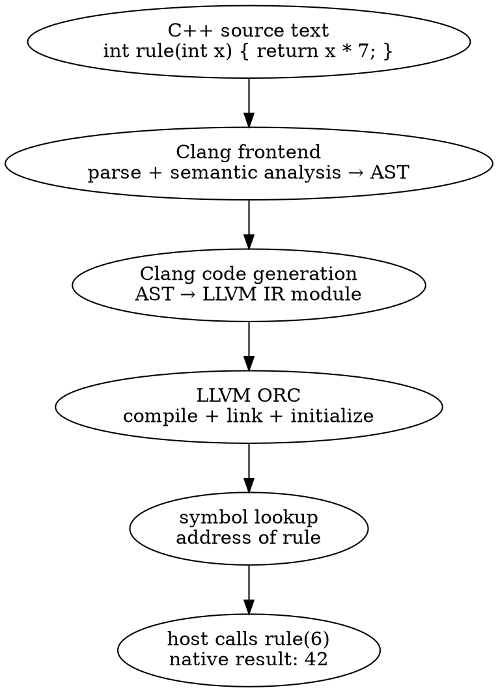

# Clang JIT Engine Lab

Learn to embed Clang’s incremental C++ compiler and LLVM’s JIT in your own application. Start with a complete C++ host, then add compiler inspection, host integration, object lifetimes and execution hooks. The optional REPL frontend comes at the end.

Work through each lesson as a conversation with the code: predict a result, run a small example, change it, and explain what changed. Commands run from the lab root; `.repl` files used by native tools are ordered API-input fixtures. You do not need to learn the `clang-repl` shell to complete this path.

## The idea: compile C++ inside a running application

Imagine a simulation whose rule is `x * 7`. You could compile that rule into the application, but changing it would require rebuilding the application. Instead, keep the application running and give it a new C++ function as text. Clang checks the function and compiles it; the JIT makes its machine code available; your application calls it with ordinary arguments.

**JIT** means *just-in-time compilation*. The source becomes native machine code during the application’s lifetime. The host is the C++ program you build ahead of time; the JIT code is the C++ it compiles later. The first examples put both in one process, so generated functions can receive host data and call host callbacks.

There are two layers to learn. **Clang** understands the C++ language: declarations, types, overloads, templates and diagnostics. **LLVM ORC** manages compilation and linking of generated code: symbols, executable memory, dependencies and removal. `clang::Interpreter` connects those layers and retains compiler state between inputs. Its name does not mean it walks and evaluates each C++ AST node at runtime; the examples execute compiled native code.

For one function, the journey is:



An **AST**, or abstract syntax tree, describes the language meaning of your input: the function’s parameter, return type and multiplication expression. **LLVM IR** is the lower-level program representation produced from that AST. A **symbol** is a name the runtime linker uses to find a function or global variable. Looking up a symbol returns an address; calling that address with the correct function-pointer type transfers control into generated machine code.

## The components and their responsibilities

| Component | The job it performs | What you use it for |
|---|---|---|
| `IncrementalCompilerBuilder` | Creates a compiler configured for incremental C++. | Choose language options, include paths, target and frontend flags. |
| `CompilerInstance` | Holds Clang’s frontend services and invocation. | Reach diagnostics, source locations and semantic analysis. |
| `Interpreter` | Owns the incremental compiler session and executor. | Submit inputs, execute them, look up symbols and remove recent inputs. |
| `PartialTranslationUnit` (PTU) | Associates one accepted input with an AST part and generated module. | Inspect an input between parsing and execution. |
| `ASTContext`, declarations and `QualType` | Describe compiler-owned entities and types. | Find a function’s signature or inspect a record’s layout. |
| `Sema` | Applies C++ language rules and name lookup. | Resolve names and overloads using the session’s actual compiler state. |
| `clang::Value` | Carries a captured expression result and its type. | Read a scalar result or manage a captured C++ object. |
| `IncrementalExecutor` | Defines the interface between the interpreter and execution backend. | Customize module addition, initialization, lookup and removal. |
| ORC `LLJIT` and `JITDylib` | Compile/link code and organize runtime symbol namespaces. | Expose host callbacks, customize linking or select another executor. |

The host owns the interpreter; the interpreter owns its compiler state and execution machinery. A PTU’s declaration pointers belong to that session. A looked-up address does not own its generated code. An object Value may need generated destructor support. These lifetimes explain why undoing an input or destroying a session can invalidate things the host previously obtained.

## How the API calls fit together

Creating an engine and running a function are separate operations. Read this sequence before trying to memorize individual classes:

| Stage | C++ API | The resulting state |
|---|---|---|
| Configure | `Builder.SetCompilerArgs(...)` | The builder knows which compiler options to use. |
| Create the frontend | `Builder.CreateCpp()` | A configured `CompilerInstance` is available. |
| Create the session | `Interpreter::create(std::move(CI))` | The interpreter owns the compiler and prepares incremental execution. |
| Compile one input | `Engine->Parse(source)` | A PTU contains declarations and, for code-generating actions, LLVM IR. User initializers have not run yet. |
| Execute that input | `Engine->Execute(PTU)` | The module is submitted to the executor and its initialization code runs. |
| Find a function | `Engine->getSymbolAddress(...)` | A callable address is resolved; lookup may trigger materialization. |
| Call it | `Address.toPtr<int (*)(int)>()(6)` | Native code runs with the ABI signature the host supplied. |

`ParseAndExecute(source, &value)` combines the compilation and execution path and can capture an expression result. Use `Parse` and `Execute` separately when you want to inspect a declaration or IR before executing it. Defining a function makes its code available; it does not call that function. A global initializer, however, can run during module initialization.

A session is **incremental** because later inputs can refer to earlier declarations and definitions. Parsing `int scale = 7;`, then defining a function using `scale`, then calling it are three inputs in one persistent compiler session. A fresh interpreter starts a different session. `Undo` removes recent inputs; it does not reverse arbitrary effects such as a callback’s file write or a previous change to host memory.

Keep one distinction in mind throughout the lab: compiler acceptance, runtime symbol resolution and native execution are different stages. A declaration can type-check while its definition is missing at linking time. A correctly linked function can still throw or fail when called. Each lesson exposes one of those boundaries.

Before building anything, explain where each of these failures belongs: an unknown C++ type, a declared function with no linked definition, and a function returning the wrong numerical result. Then follow one successful input through the diagram. The next lesson turns that mental model into a complete C++ host.

## Getting started

Start with [Part 1](part_1_shell_basics.md): it explains the pipeline before giving separate Linux (Ubuntu/Debian) and macOS setup commands, followed by the same native smoke test. The lab targets LLVM 22; reference outputs use 22.1.8.

## Learning path

**Part 1 — Your First Embedded JIT** ([open lessons](part_1_shell_basics.md))

- 1.1 The idea: compile C++ inside an application
- 1.2 The components and their responsibilities
- 1.3 How the API calls fit together
- 1.4 Build a host that links Clang
- 1.5 Create the compiler and interpreter
- 1.6 Call the generated machine code
- 1.7 Capture an expression result
- 1.8 Report a failed input
- 1.9 Keep ownership visible
- 1.10 Parse command-line options with LLVM

**Part 2 — Incremental Compilation** ([open lessons](part_2_power_user_shell.md))

- 2.1 `Parse` versus `Execute`
- 2.2 Inspecting a PTU's AST
- 2.3 Inspecting a PTU's LLVM IR
- 2.4 Choose language and optimization settings
- 2.5 Give the engine headers
- 2.6 Type-check without executing

**Part 3 — Connecting Host and JIT** ([open lessons](part_3_under_the_hood.md))

- 3.1 Calling JIT code from the host
- 3.2 Sharing state with the host
- 3.3 Injecting host data into JIT code
- 3.4 Load a supporting library through the API
- 3.5 Register a host address explicitly
- 3.6 `Undo` from the API
- 3.7 Initializers and exception boundaries

**Part 4 — Clang Compiler Services** ([open lessons](part_4_embedding_api.md))

- 4.1 Errors and diagnostics
- 4.2 The code-completion API
- 4.3 Name lookup with `Sema`
- 4.4 Walking types and record layouts
- 4.5 Templates on demand
- 4.6 Choose an observation point

**Part 5 — Values, Objects and Lifetimes** ([open lessons](part_5_values_and_data.md))

- 5.1 Anatomy of `clang::Value`
- 5.2 Builtins, kinds and `convertTo`
- 5.3 Objects, ownership and destructors
- 5.4 The printing API
- 5.5 An object inspector
- 5.6 Release results before their engine

**Part 6 — Advanced JIT Customization** ([open lessons](part_6_extending.md))

- 6.1 Subclassing `Interpreter` with an `ASTConsumer`
- 6.2 Reflection-driven code injection
- 6.3 A custom `LLJIT` builder
- 6.4 Capturing object code
- 6.5 Writing your own `IncrementalExecutor`
- 6.6 Out-of-process execution from the API
- 6.7 Eval-style programming: JIT code calls the interpreter
- 6.8 Syntax-only interpreters
- 6.9 Choose an extension boundary

**Part 7 — A Callable C++ Kernel** ([open lessons](part_7_capstone.md))

- 7.1 Compile a function supplied as a file
- 7.2 Check the entry signature before calling
- 7.3 Separate compile cost from call cost
- 7.4 Replace a kernel without dangling pointers
- 7.5 Turn observations into acceptance cases
- 7.6 Extend the host in one direction

## Reading and experimenting

Use `--help` to see a host's options. Select a mode with `--mode=layout`, supply several names with `--name=Inner --name=Layout`, and put compiler flags after `--`. Recorded `build/bin/` transcripts use the separate reference tools and retain their original arguments.

Run the C++ programs in a terminal. To read the HTML lessons, start a local server:

```bash
python3 scripts/build_site.py
python3 -m http.server 8000 --directory site
```

Open [the local lab](http://127.0.0.1:8000/) in your browser on Linux or macOS.

Keep your place in [PROGRESS.md](PROGRESS.md). The source snapshots in [reference](../reference/README.md) provide the pinned implementation context.

## API references

[Interpreter declarations for LLVM 22.1.8](https://github.com/llvm/llvm-project/blob/llvmorg-22.1.8/clang/include/clang/Interpreter/Interpreter.h) define the version used here. [LLVM ORC design](https://llvm.org/docs/ORCv2.html) explains the execution layers; prefer the installed 22.1.8 headers when an unversioned online example differs.
