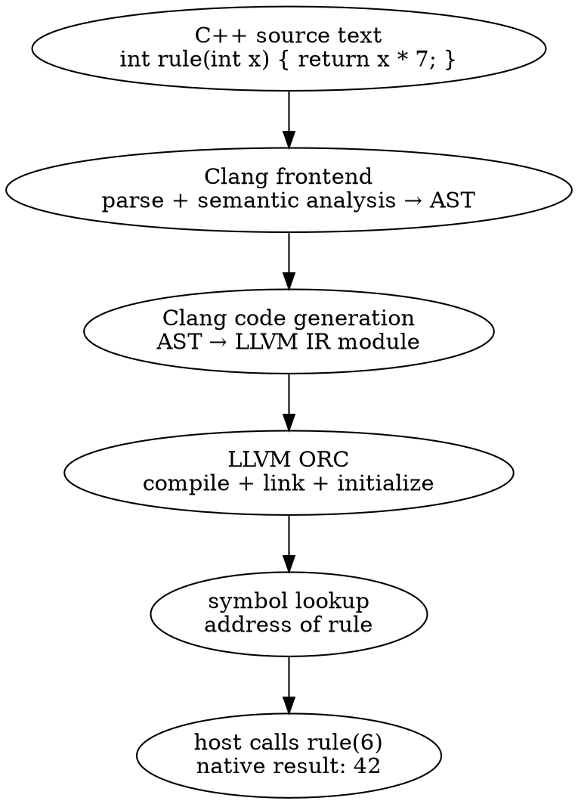

# Part 1 — Your First Embedded JIT

[← README](README.md) | [Part 2 — Incremental Compilation →](part_2_power_user_shell.md)

Build a small C++ host and call a function that did not exist when the host was compiled. Every exercise uses the Clang C++ API directly.

## Section 1.1 — The idea: compile C++ inside an application

Imagine a simulation whose rule is `x * 7`. You want to change that rule while the application is running, then call the new version with ordinary C++ arguments. Instead of rebuilding the application, give Clang the function's source text and ask the JIT to make its compiled code available.

This is just-in-time compilation: source becomes native machine code during the application's lifetime. The application you build beforehand is the **host**; the function it compiles later is the **JIT code**. Follow that function from source to a callable address, keeping track of which work belongs to the compiler and which belongs to the executor.

Clang supplies the language knowledge: it resolves names, checks types, selects overloads and instantiates templates. LLVM ORC takes the generated code through compilation and linking, keeps track of symbols and owns executable memory. `clang::Interpreter` joins those services into a session that remembers earlier inputs.

Follow a function through that session:



The AST describes the function in C++ terms, including its parameter and multiplication expression. LLVM IR expresses the same computation in a form the backend can compile. A symbol names the generated function for the runtime linker; resolving it gives the host an address to call.

Before continuing, change the multiplication in the diagram on paper and trace which stages must run again. Once you already have the address, which stages does an ordinary call repeat?

> [!hint]- Follow the source string, then the function pointer
> The compiler consumes text. The processor executes the code at the resolved address.

> [!success]- Follow the call
> Changing the function body requires compilation and linking again. Calling an existing pointer runs its native code without parsing the source again.

---

## Section 1.2 — The components and their responsibilities

Compiling a function inside an application involves several cooperating objects. One configures the compiler, another keeps declarations and types, and another manages executable code. Knowing their jobs makes it easier to choose the right API when you want to inspect a function, call it or remove it.

Use the components below to trace a single request: create a session, submit a function and obtain its address. For each object you encounter, ask what it owns and how long the things it returns remain usable. That ownership will matter when you begin retaining declarations, function pointers and captured objects.

The compiler and executor meet at the interpreter, but their objects answer different questions. Use this map as you follow the first program: configuring headers belongs to the frontend, while finding a callable address belongs to execution.

| Component | The job it performs | What you use it for |
|---|---|---|
| `IncrementalCompilerBuilder` | Creates a compiler configured for incremental C++. | Choose language options, include paths, target and frontend flags. |
| `CompilerInstance` | Holds Clang’s frontend services and invocation. | Reach diagnostics, source locations and semantic analysis. |
| `Interpreter` | Owns the incremental compiler session and executor. | Submit inputs, execute them, look up symbols and remove recent inputs. |
| `PartialTranslationUnit` (PTU) | Associates one accepted input with an AST part and generated module. | Inspect an input between parsing and execution. |
| `ASTContext`, declarations and `QualType` | Describe compiler-owned entities and types. | Find a function’s signature or inspect a record’s layout. |
| `Sema` | Applies C++ language rules and name lookup. | Resolve names and overloads using the session’s actual compiler state. |
| `clang::Value` | Carries a captured expression result and its type. | Read a scalar result or manage a captured C++ object. |
| `IncrementalExecutor` | Defines the interface between the interpreter and execution backend. | Customize module addition, initialization, lookup and removal. |
| ORC `LLJIT` and `JITDylib` | Compile/link code and organize runtime symbol namespaces. | Expose host callbacks, customize linking or select another executor. |

Ownership follows the same structure. The host keeps the interpreter alive; the interpreter keeps its compiler state and execution machinery alive. A declaration pointer borrows the compiler's AST, and a function address borrows the executor's code. Neither pointer extends its owner's lifetime. An object held by `clang::Value` may also need that code when its destructor runs.

Draw an arrow from each borrowed object to the owner it needs. Then place three operations on your drawing: asking for a function's type, calling that function and destroying a captured object. Keep the drawing beside the first example and match it to the actual smart pointers.

---

## Section 1.3 — How the API calls fit together

A source string cannot be called directly. First Clang must understand it and produce code; then the executor must make that code available; finally the host needs an address with the right function-pointer type. These stages are separate, so accepting a definition does not mean the function has already run.

Follow the API sequence below as the path of one function through the engine. Notice when compiler state is created, when an input becomes a PTU, and when execution begins. Later exercises will pause between these steps to inspect the AST or LLVM IR and to locate failures more precisely.

Read the API sequence as a series of state changes. The compiler must exist before it can accept source; generated code must reach the executor before a dependent call can run.

| Stage | C++ API | The resulting state |
|---|---|---|
| Configure | `Builder.SetCompilerArgs(...)` | The builder knows which compiler options to use. |
| Create the frontend | `Builder.CreateCpp()` | A configured `CompilerInstance` is available. |
| Create the session | `Interpreter::create(std::move(CI))` | The interpreter owns the compiler and prepares incremental execution. |
| Compile one input | `Engine->Parse(source)` | A PTU contains declarations and, for code-generating actions, LLVM IR. User initializers have not run yet. |
| Execute that input | `Engine->Execute(PTU)` | The module is submitted to the executor and its initialization code runs. |
| Find a function | `Engine->getSymbolAddress(...)` | A callable address is resolved; lookup may trigger materialization. |
| Call it | `Address.toPtr<int (*)(int)>()(6)` | Native code runs with the ABI signature the host supplied. |

`ParseAndExecute(source, &value)` combines parsing and execution and can deliver an expression result. Separate `Parse` from `Execute` when the host needs to inspect the AST or IR first. Defining a function prepares a callable implementation; a global initializer can actually run when its module is executed.

Later inputs share the session's declarations. For example, declare `int scale = 7;`, define a function that uses `scale`, then call it in another input. A fresh interpreter starts with different compiler state. `Undo` removes recent inputs from a session, but cannot reverse a file write or a change already made to host memory.

Classify three failures before building the host: an unknown type, a declared function with no linked definition, and a function that computes the wrong number. Explain which stage can discover each one. The first program concentrates on engine construction; Section 1.10 then introduces LLVM's parser for the host's command-line interface.

---

## Section 1.4 — Build a host that links Clang

Your first host needs to build against Clang's C++ libraries and create a working compiler at runtime. Those are two related pieces of setup: the host build needs Clang/LLVM development headers and libraries, while the embedded compiler needs the headers used by the source you submit to it.

Use the instructions for your operating system to install a matching LLVM 22 toolchain and identify its prefix. The examples use LLVM 22.1.8. As you reach the first build command, connect each include path and linked library to the part of the engine that needs it; installing the `clang` executable alone does not provide everything needed for embedding.

### Linux: Ubuntu or Debian

Install the build tools and LLVM 22 development packages. The [LLVM package repository](https://apt.llvm.org/) documents the installer's version argument; its [LLVM 22 package index](https://apt.llvm.org/noble/pool/main/l/llvm-toolchain-22/) includes the Clang C++ development library used here.

```bash
sudo apt-get update
sudo apt-get install -y build-essential cmake ninja-build python3 \
  graphviz curl wget gnupg lsb-release software-properties-common ripgrep
mkdir -p out
curl -fsSL https://apt.llvm.org/llvm.sh -o out/llvm-install.sh
sudo bash out/llvm-install.sh 22
sudo apt-get install -y clang-22 llvm-22-dev libclang-22-dev \
  libclang-cpp22-dev libclang-rt-22-dev
export LLVM="$(llvm-config-22 --prefix)"
"$LLVM/bin/clang++" --version
"$LLVM/bin/llvm-config" --version
```

Selecting 22 keeps the installation aligned with the APIs in these examples. If the distribution already provides LLVM 22, use its matching development packages and set `LLVM` to their installation prefix.

The embedded compiler needs to find the distribution's C++ headers, which is why the Linux run commands pass `--gcc-toolchain=/usr`. The host link command uses `-Wl,--export-dynamic` so later examples can resolve exported host callbacks.

### macOS: Homebrew

```bash
xcode-select --install
brew install llvm cmake ninja graphviz ripgrep
export LLVM="$(brew --prefix llvm)"
"$LLVM/bin/clang++" --version
```

Run `xcode-select --install` if the command-line tools are missing. Check the installed LLVM version: Homebrew's unversioned formula can advance beyond 22. The macOS run commands supply Clang's resource directory, Homebrew's libc++ headers and the macOS SDK to the embedded compiler.

### Link the host and configure its compiler

Use the program and platform command in Section 1.5. `llvm-config --cxxflags` supplies settings for building the host against your LLVM installation. The command then selects C++20, links `clang-cpp` and `LLVM`, and records where to find those libraries at runtime. Keep the compiler, headers and libraries from the same installation.

The compiler created inside the host has its own invocation. Its header paths and language options come from the arguments passed to `IncrementalCompilerBuilder`, even when the host was built with different options.

To read the HTML edition locally:

```bash
python3 scripts/build_site.py
python3 -m http.server 8000 --directory site
```

Open [the local lab](http://127.0.0.1:8000/). On a Linux desktop, `xdg-open http://127.0.0.1:8000/` opens that address; macOS provides `open`.

| Topic | Linux | macOS |
|---|---|---|
| Shared library build | `clang++ -fPIC -shared source.cpp -o library.so` | `clang++ -dynamiclib source.cpp -o library.dylib` |
| Typical object format | ELF | Mach-O |
| C symbol at the linker layer | Usually no extra prefix. | Usually a leading underscore. |
| Standard library in the provided setup | Distro libstdc++, matching the host. | Homebrew libc++, matching the host. |
| Header setup | Explicit resource directory and GCC toolchain prefix. | Explicit resource directory, libc++ path and macOS SDK. |

These differences matter when reading later transcripts. Derive linker prefixes from the target's `DataLayout`, and record sizes and offsets from `ASTContext`. A libc++ layout printed on macOS does not describe Linux libstdc++.

After running the first program, change `x * 7` to `x * 8`. Predict both printed numbers, rebuild and compare. Restore the original expression before following the recorded runs.

---

## Section 1.5 — Create the compiler and interpreter

Before the host can compile any source text, it needs an initialized machine-code backend and a compiler session. Think of this as preparing a workspace for future inputs: it has a language configuration, compiler services and an executor that can make generated code callable.

`IncrementalCompilerBuilder` turns the compiler arguments into a `CompilerInstance`. Passing that instance to `Interpreter::create` transfers ownership into the session. Follow those transfers in the program below, including the error branches, and distinguish creating the engine from submitting the function it will later compile.

Follow the two ownership transfers in the program: `CreateCpp()` gives the host a compiler, then `Interpreter::create` takes that compiler and returns the session.

<!-- runnable-example: 1.5 -->

`examples/p01_engine.cpp`:

```cpp
#include <clang/Frontend/CompilerInstance.h>
#include <clang/Interpreter/Interpreter.h>
#include <clang/Interpreter/Value.h>
#include <cstdlib>
#include <llvm/ADT/StringRef.h>
#include <llvm/Support/Error.h>
#include <llvm/Support/TargetSelect.h>
#include <llvm/Support/raw_ostream.h>
#include <utility>
#include <vector>

int main(int argc, const char **argv) {
  // Register LLVM's native target and assembly support for generated code.
  llvm::InitializeNativeTarget();
  llvm::InitializeNativeTargetAsmPrinter();

  std::vector<const char *> DriverArgs;
  for (int N = 1; N < argc; ++N) {
    if (llvm::StringRef(argv[N]) != "--") {
      DriverArgs.push_back(argv[N]);
    }
  }
  clang::IncrementalCompilerBuilder Builder;
  // Configure the embedded compiler, independently of the host build flags.
  // These argument strings must remain alive until CreateCpp() finishes.
  Builder.SetCompilerArgs(DriverArgs);
  // CreateCpp returns an owned CompilerInstance or an error inside Expected.
  auto CompilerOrError = Builder.CreateCpp();
  // Extract the failed Expected with takeError(); logging consumes that Error.
  if (!CompilerOrError) {
    llvm::logAllUnhandledErrors(CompilerOrError.takeError(), llvm::errs(),
                                "error: ");
    return 1;
  }
  auto Compiler = std::move(*CompilerOrError);
  // Give the session the compiler and prepare its runtime prelude.
  auto InterpreterOrError = clang::Interpreter::create(std::move(Compiler));
  if (!InterpreterOrError) {
    llvm::logAllUnhandledErrors(InterpreterOrError.takeError(), llvm::errs(),
                                "error: ");
    return 1;
  }
  auto Engine = std::move(*InterpreterOrError);

  // Compile this input, then submit its module and run its initializers.
  if (llvm::Error Error = Engine->ParseAndExecute(
          "extern \"C\" int run(int x) { return x * 7; }")) {
    llvm::logAllUnhandledErrors(std::move(Error), llvm::errs(), "error: ");
    return 1;
  }
  // Resolve a runtime address; lookup may compile/link a module on demand.
  // The session owns code/storage; function-pointer types must match the ABI.
  auto AddressOrError = Engine->getSymbolAddress("run");
  if (!AddressOrError) {
    llvm::logAllUnhandledErrors(AddressOrError.takeError(), llvm::errs(),
                                "error: ");
    return 1;
  }
  auto Address = std::move(*AddressOrError);
  // toPtr is a cast: the definition must match this int(int) signature.
  auto Run = Address.toPtr<int (*)(int)>();
  llvm::outs() << "run(6) = " << Run(6) << "\n";

  // Pass &Result to capture the expression instead of printing it.
  // Destroy Result before Engine, which owns its type/runtime support.
  clang::Value Result;
  if (llvm::Error Error = Engine->ParseAndExecute("run(5)", &Result)) {
    llvm::logAllUnhandledErrors(std::move(Error), llvm::errs(), "error: ");
    return 1;
  }
  // Read this known int result only after checking validity and void.
  if (Result.isValid() && !Result.isVoid()) {
    llvm::outs() << "captured = " << Result.convertTo<int>() << "\n";
  }
  return 0;
}
```

Linux:

```bash
export LLVM="${LLVM:-$(llvm-config-22 --prefix)}"
mkdir -p out
"$LLVM/bin/clang++" $("$LLVM/bin/llvm-config" --cxxflags) -std=c++20 -pthread \
  examples/p01_engine.cpp -L"$LLVM/lib" -Wl,-rpath,"$LLVM/lib" \
  -Wl,--export-dynamic -lclang-cpp -lLLVM -o out/p01_engine
out/p01_engine -- -std=c++20 -resource-dir "$("$LLVM/bin/clang++" -print-resource-dir)" --gcc-toolchain=/usr
```

macOS:

```bash
export LLVM="${LLVM:-$(brew --prefix llvm)}"
mkdir -p out
"$LLVM/bin/clang++" $("$LLVM/bin/llvm-config" --cxxflags) -std=c++20 -pthread \
  examples/p01_engine.cpp -L"$LLVM/lib" -Wl,-rpath,"$LLVM/lib" \
  -lclang-cpp -lLLVM -o out/p01_engine
out/p01_engine -- -std=c++20 -resource-dir "$("$LLVM/bin/clang++" -print-resource-dir)" -nostdinc++ -isystem "$LLVM/include/c++/v1" -isysroot "$(xcrun --show-sdk-path)"
```

<!-- /runnable-example -->

The native-target initialization makes LLVM's backend available. `SetCompilerArgs` configures the frontend, and `CreateCpp` builds the `CompilerInstance`. Both construction calls return `llvm::Expected`: the failure branch takes and reports the error; the success branch moves out the owned object.

`DriverArgs` borrows strings from `argv`, so those strings remain available while the builder reads them. Arguments after `--` configure the embedded compiler. The resource directory supplies builtin headers; the platform options supply the standard library and system headers.

The includes follow these operations: `Interpreter.h` exposes the builder and session, `CompilerInstance.h` completes the owned compiler type, `TargetSelect.h` supplies backend initialization, and `Error.h` supplies the checked results. `Value.h` is needed for the captured result; the stream and standard-library headers support printing, argument storage and ownership transfers.

The reference tool runs the same construction and calls:

```bash
build/bin/p01_engine
```

```text expected
run(6) = 42
captured = 35
```

Add `-std=c++20` after `--` in the standalone run command, keeping its existing platform flags. Find where those arguments reach the builder, then identify the different `-std=c++20` used to compile the host.

> [!hint]- Which owner must survive a generated call?
> The address obtained by lookup has no ownership of its own.

> [!success]- Follow the ownership
> Keep the interpreter alive while calling generated code. The builder is no longer needed after compiler construction.

---

## Section 1.6 — Call the generated machine code

You have given the engine a function definition. Now the host needs to use that function repeatedly, perhaps for every value in a simulation loop. Compiling the definition prepares its code, but the host still needs a callable address before it can pass arguments and receive a result.

Look up `run` with `getSymbolAddress`, turn the returned address into an `int (*)(int)`, and call it. The definition and pointer type must agree: converting an address does not check the C++ signature for you. Predict the result for input 6, then notice which operations would stay outside a loop making many native calls.

Look for the point where the program stops handling source text and starts handling an address:

<!-- runnable-example: 1.6 -->

`examples/p01_call.cpp`:

```cpp
#include <clang/Frontend/CompilerInstance.h>
#include <clang/Interpreter/Interpreter.h>
#include <cstdlib>
#include <llvm/ADT/StringRef.h>
#include <llvm/Support/CommandLine.h>
#include <llvm/Support/Error.h>
#include <llvm/Support/TargetSelect.h>
#include <llvm/Support/raw_ostream.h>
#include <memory>
#include <string>
#include <utility>
#include <vector>

int main(int argc, const char **argv) {
  // Register typed host options before parsing argv; Clang receives its own
  // flag list.
  llvm::cl::OptionCategory Options("JIT example options");

  llvm::cl::list<std::string> CompilerFlags(
      llvm::cl::Positional, llvm::cl::ZeroOrMore,
      llvm::cl::desc("<compiler flags after -->"), llvm::cl::cat(Options));
  llvm::cl::HideUnrelatedOptions(Options);
  // Fill the registered options; malformed host arguments stop before compiler
  // setup.
  if (!llvm::cl::ParseCommandLineOptions(argc, argv, "Clang JIT API example\n",
                                         &llvm::errs())) {
    return 2;
  }

  // Register LLVM's native target and assembly support for generated code.
  llvm::InitializeNativeTarget();
  llvm::InitializeNativeTargetAsmPrinter();

  std::vector<const char *> DriverArgs;
  for (const std::string &Flag : CompilerFlags) {
    DriverArgs.push_back(Flag.c_str());
  }
  clang::IncrementalCompilerBuilder Builder;
  // Configure the embedded compiler, independently of the host build flags.
  // These argument strings must remain alive until CreateCpp() finishes.
  Builder.SetCompilerArgs(DriverArgs);
  // CreateCpp returns an owned CompilerInstance or an error inside Expected.
  auto CompilerOrError = Builder.CreateCpp();
  // Extract the failed Expected with takeError(); logging consumes that Error.
  if (!CompilerOrError) {
    llvm::logAllUnhandledErrors(CompilerOrError.takeError(), llvm::errs(),
                                "error: ");
    return 1;
  }
  auto Compiler = std::move(*CompilerOrError);
  // Give the session the compiler and prepare its runtime prelude.
  auto InterpreterOrError = clang::Interpreter::create(std::move(Compiler));
  if (!InterpreterOrError) {
    llvm::logAllUnhandledErrors(InterpreterOrError.takeError(), llvm::errs(),
                                "error: ");
    return 1;
  }
  auto Engine = std::move(*InterpreterOrError);
  // Compile this input, then submit its module and run its initializers.
  if (llvm::Error Error = Engine->ParseAndExecute(
          R"cpp(
extern "C" int run(int x) {
  return x * 7;
}
)cpp")) {
    llvm::logAllUnhandledErrors(std::move(Error), llvm::errs(), "error: ");
    return 1;
  }
  // Resolve a runtime address; lookup may compile/link a module on demand.
  // The session owns code/storage; function-pointer types must match the ABI.
  auto AddressOrError = Engine->getSymbolAddress("run");
  if (!AddressOrError) {
    llvm::logAllUnhandledErrors(AddressOrError.takeError(), llvm::errs(),
                                "error: ");
    return 1;
  }
  auto Address = std::move(*AddressOrError);
  // Use the exact int(int) calling type; repeated calls through Run do not
  // parse C++.
  auto Run = Address.toPtr<int (*)(int)>();
  llvm::outs() << "run(6) = " << Run(6) << "\n";
  return 0;
}
```

Linux:

```bash
export LLVM="${LLVM:-$(llvm-config-22 --prefix)}"
mkdir -p out
"$LLVM/bin/clang++" $("$LLVM/bin/llvm-config" --cxxflags) -std=c++20 -pthread \
  examples/p01_call.cpp -L"$LLVM/lib" -Wl,-rpath,"$LLVM/lib" \
  -Wl,--export-dynamic -lclang-cpp -lLLVM -o out/p01_call
out/p01_call -- -std=c++20 -resource-dir "$("$LLVM/bin/clang++" -print-resource-dir)" --gcc-toolchain=/usr
```

macOS:

```bash
export LLVM="${LLVM:-$(brew --prefix llvm)}"
mkdir -p out
"$LLVM/bin/clang++" $("$LLVM/bin/llvm-config" --cxxflags) -std=c++20 -pthread \
  examples/p01_call.cpp -L"$LLVM/lib" -Wl,-rpath,"$LLVM/lib" \
  -lclang-cpp -lLLVM -o out/p01_call
out/p01_call -- -std=c++20 -resource-dir "$("$LLVM/bin/clang++" -print-resource-dir)" -nostdinc++ -isystem "$LLVM/include/c++/v1" -isysroot "$(xcrun --show-sdk-path)"
```

<!-- /runnable-example -->

`ParseAndExecute` accepts the definition and makes it available to the executor. `getSymbolAddress("run")` resolves that definition. The `extern "C"` declaration gives it a straightforward lookup name, and `toPtr<int (*)(int)>()` supplies the calling type the host will use.

That conversion cannot prove the type is correct. Here the definition establishes `int(int)`; changing the JIT signature requires changing the host pointer type too.

Add a loop after lookup that calls `Run` with 1, 2 and 3. Predict the three numbers, then rebuild. Keep compiler construction and lookup outside the loop so each iteration calls the same generated function.

> [!hint]- Where would repeated compilation show up?
> Find the call that receives the source string and compare it with the loop's location.

> [!success]- Follow one iteration
> Each iteration executes native code through `Run`; the added calls produce 7, 14 and 21 without submitting another C++ input.

---

## Section 1.7 — Capture an expression result

Your host can call `Run(6)` because it already knows the function's name and C++ signature. Now imagine receiving `run(5)` as text: you want to compile that expression and bring its answer back into the host, without arranging another named function and symbol lookup.

Create a `clang::Value` and pass its address as the second argument to `ParseAndExecute`. Clang compiles and executes the expression, then stores its result and type in that Value. The host can read the answer after the call returns. Defining `run` alone does not produce an answer; evaluating `run(5)` does.

The program first defines `run`, then submits `run(5)` without a final semicolon so its result is captured rather than discarded. Since this function returns `int`, the host reads the result with `convertTo<int>()`. Work out the number it should print before running it.

<!-- runnable-example: 1.7 -->

`examples/p01_capture.cpp`:

```cpp
#include <clang/Frontend/CompilerInstance.h>
#include <clang/Interpreter/Interpreter.h>
#include <clang/Interpreter/Value.h>
#include <cstdlib>
#include <llvm/ADT/StringRef.h>
#include <llvm/Support/CommandLine.h>
#include <llvm/Support/Error.h>
#include <llvm/Support/TargetSelect.h>
#include <llvm/Support/raw_ostream.h>
#include <memory>
#include <string>
#include <utility>
#include <vector>

int main(int argc, const char **argv) {
  // Register typed host options before parsing argv; Clang receives its own
  // flag list.
  llvm::cl::OptionCategory Options("JIT example options");

  llvm::cl::list<std::string> CompilerFlags(
      llvm::cl::Positional, llvm::cl::ZeroOrMore,
      llvm::cl::desc("<compiler flags after -->"), llvm::cl::cat(Options));
  llvm::cl::HideUnrelatedOptions(Options);
  // Fill the registered options; malformed host arguments stop before compiler
  // setup.
  if (!llvm::cl::ParseCommandLineOptions(argc, argv, "Clang JIT API example\n",
                                         &llvm::errs())) {
    return 2;
  }

  // Register LLVM's native target and assembly support for generated code.
  llvm::InitializeNativeTarget();
  llvm::InitializeNativeTargetAsmPrinter();

  std::vector<const char *> DriverArgs;
  for (const std::string &Flag : CompilerFlags) {
    DriverArgs.push_back(Flag.c_str());
  }
  clang::IncrementalCompilerBuilder Builder;
  // Configure the embedded compiler, independently of the host build flags.
  // These argument strings must remain alive until CreateCpp() finishes.
  Builder.SetCompilerArgs(DriverArgs);
  // CreateCpp returns an owned CompilerInstance or an error inside Expected.
  auto CompilerOrError = Builder.CreateCpp();
  // Extract the failed Expected with takeError(); logging consumes that Error.
  if (!CompilerOrError) {
    llvm::logAllUnhandledErrors(CompilerOrError.takeError(), llvm::errs(),
                                "error: ");
    return 1;
  }
  auto Compiler = std::move(*CompilerOrError);
  // Give the session the compiler and prepare its runtime prelude.
  auto InterpreterOrError = clang::Interpreter::create(std::move(Compiler));
  if (!InterpreterOrError) {
    llvm::logAllUnhandledErrors(InterpreterOrError.takeError(), llvm::errs(),
                                "error: ");
    return 1;
  }
  auto Engine = std::move(*InterpreterOrError);
  const char *Source = R"cpp(
extern "C" int run(int x) {
  return x * 7;
}
)cpp";
  // Compile this input, then submit its module and run its initializers.
  if (llvm::Error Error = Engine->ParseAndExecute(Source)) {
    llvm::logAllUnhandledErrors(std::move(Error), llvm::errs(), "error: ");
    return 1;
  }
  // Capture the expression into host-side storage; Result must die before
  // Engine.
  clang::Value Result;
  if (llvm::Error Error = Engine->ParseAndExecute(R"cpp(
run(5)
)cpp",
                                                  &Result)) {
    llvm::logAllUnhandledErrors(std::move(Error), llvm::errs(), "error: ");
    return 1;
  }
  // Validity means a result was captured; isVoid distinguishes a void
  // expression.
  // convertTo<int>() converts the supported scalar kind to the requested host
  // type.
  if (Result.isValid() && !Result.isVoid()) {
    llvm::outs() << "captured = " << Result.convertTo<int>() << "\n";
  }
  return 0;
}
```

Linux:

```bash
export LLVM="${LLVM:-$(llvm-config-22 --prefix)}"
mkdir -p out
"$LLVM/bin/clang++" $("$LLVM/bin/llvm-config" --cxxflags) -std=c++20 -pthread \
  examples/p01_capture.cpp -L"$LLVM/lib" -Wl,-rpath,"$LLVM/lib" \
  -Wl,--export-dynamic -lclang-cpp -lLLVM -o out/p01_capture
out/p01_capture -- -std=c++20 -resource-dir "$("$LLVM/bin/clang++" -print-resource-dir)" --gcc-toolchain=/usr
```

macOS:

```bash
export LLVM="${LLVM:-$(brew --prefix llvm)}"
mkdir -p out
"$LLVM/bin/clang++" $("$LLVM/bin/llvm-config" --cxxflags) -std=c++20 -pthread \
  examples/p01_capture.cpp -L"$LLVM/lib" -Wl,-rpath,"$LLVM/lib" \
  -lclang-cpp -lLLVM -o out/p01_capture
out/p01_capture -- -std=c++20 -resource-dir "$("$LLVM/bin/clang++" -print-resource-dir)" -nostdinc++ -isystem "$LLVM/include/c++/v1" -isysroot "$(xcrun --show-sdk-path)"
```

<!-- /runnable-example -->

The expression input omits its final semicolon so the interpreter can capture the result. Passing `&Result` directs that result into the host's `clang::Value`; the host then tests it and reads the integer. The `llvm::Error` from `ParseAndExecute` answers whether the operation failed, while the Value answers whether it produced a result.

Change the expression to `run(8)` and predict the number. Then add its final semicolon and run again: the input becomes a statement, so the result-printing branch no longer runs. Use a fresh Value for each comparison.

> [!hint]- Can an input succeed without a captured value?
> Consider a variable declaration or an ordinary statement.

> [!success]- Separate success from capture
> Yes. A successful API call can leave the Value invalid because no result was captured. For arbitrary expressions, inspect validity and type before choosing a conversion; Part 5 develops that handling.

---

## Section 1.8 — Report a failed input

A user will eventually submit an expression or declaration that Clang cannot accept. Your host needs to recognize that failure, explain it and decide whether to accept another input. A compiler message on the terminal is useful to a person, but the application also needs a result it can act on.

Clang's diagnostic explains the source problem; the returned `llvm::Error` tells the host that the API operation failed. Submit a broken declaration, handle that error, then evaluate a separate valid expression. Watch both the diagnostic and the host's control flow so you can tell reporting a failure from recovering after it.

<!-- runnable-example: 1.8 -->

`examples/p01_errors.cpp`:

```cpp
#include <clang/Frontend/CompilerInstance.h>
#include <clang/Interpreter/Interpreter.h>
#include <clang/Interpreter/Value.h>
#include <cstdlib>
#include <llvm/ADT/StringRef.h>
#include <llvm/Support/CommandLine.h>
#include <llvm/Support/Error.h>
#include <llvm/Support/TargetSelect.h>
#include <llvm/Support/raw_ostream.h>
#include <memory>
#include <string>
#include <utility>
#include <vector>

int main(int argc, const char **argv) {
  // Register typed host options before parsing argv; Clang receives its own
  // flag list.
  llvm::cl::OptionCategory Options("JIT example options");

  llvm::cl::list<std::string> CompilerFlags(
      llvm::cl::Positional, llvm::cl::ZeroOrMore,
      llvm::cl::desc("<compiler flags after -->"), llvm::cl::cat(Options));
  llvm::cl::HideUnrelatedOptions(Options);
  // Fill the registered options; malformed host arguments stop before compiler
  // setup.
  if (!llvm::cl::ParseCommandLineOptions(argc, argv, "Clang JIT API example\n",
                                         &llvm::errs())) {
    return 2;
  }

  // Register LLVM's native target and assembly support for generated code.
  llvm::InitializeNativeTarget();
  llvm::InitializeNativeTargetAsmPrinter();

  std::vector<const char *> DriverArgs;
  for (const std::string &Flag : CompilerFlags) {
    DriverArgs.push_back(Flag.c_str());
  }
  clang::IncrementalCompilerBuilder Builder;
  // Configure the embedded compiler, independently of the host build flags.
  // These argument strings must remain alive until CreateCpp() finishes.
  Builder.SetCompilerArgs(DriverArgs);
  // CreateCpp returns an owned CompilerInstance or an error inside Expected.
  auto CompilerOrError = Builder.CreateCpp();
  // Extract the failed Expected with takeError(); logging consumes that Error.
  if (!CompilerOrError) {
    llvm::logAllUnhandledErrors(CompilerOrError.takeError(), llvm::errs(),
                                "error: ");
    return 1;
  }
  auto Compiler = std::move(*CompilerOrError);
  // Give the session the compiler and prepare its runtime prelude.
  auto InterpreterOrError = clang::Interpreter::create(std::move(Compiler));
  if (!InterpreterOrError) {
    llvm::logAllUnhandledErrors(InterpreterOrError.takeError(), llvm::errs(),
                                "error: ");
    return 1;
  }
  auto Engine = std::move(*InterpreterOrError);
  // Compile this input, then submit its module and run its initializers.
  if (llvm::Error E = Engine->ParseAndExecute(R"cpp(
int broken = ;
)cpp")) {
    llvm::logAllUnhandledErrors(std::move(E), llvm::errs(), "input: ");
  }

  // A simple failed input is followed by a separate valid input.
  // Use fresh result storage for the next input, independently of the preceding
  // error.
  clang::Value Result;
  if (llvm::Error Error = Engine->ParseAndExecute(R"cpp(
6 * 7
)cpp",
                                                  &Result)) {
    llvm::logAllUnhandledErrors(std::move(Error), llvm::errs(), "error: ");
    return 1;
  }
  if (!Result.isValid() || Result.isVoid()) {
    return 1;
  }
  llvm::outs() << "after error = " << Result.convertTo<int>() << "\n";
  return 0;
}
```

Linux:

```bash
export LLVM="${LLVM:-$(llvm-config-22 --prefix)}"
mkdir -p out
"$LLVM/bin/clang++" $("$LLVM/bin/llvm-config" --cxxflags) -std=c++20 -pthread \
  examples/p01_errors.cpp -L"$LLVM/lib" -Wl,-rpath,"$LLVM/lib" \
  -Wl,--export-dynamic -lclang-cpp -lLLVM -o out/p01_errors
out/p01_errors -- -std=c++20 -resource-dir "$("$LLVM/bin/clang++" -print-resource-dir)" --gcc-toolchain=/usr
```

macOS:

```bash
export LLVM="${LLVM:-$(brew --prefix llvm)}"
mkdir -p out
"$LLVM/bin/clang++" $("$LLVM/bin/llvm-config" --cxxflags) -std=c++20 -pthread \
  examples/p01_errors.cpp -L"$LLVM/lib" -Wl,-rpath,"$LLVM/lib" \
  -lclang-cpp -lLLVM -o out/p01_errors
out/p01_errors -- -std=c++20 -resource-dir "$("$LLVM/bin/clang++" -print-resource-dir)" -nostdinc++ -isystem "$LLVM/include/c++/v1" -isysroot "$(xcrun --show-sdk-path)"
```

<!-- /runnable-example -->

Clang reports the invalid input, and the host consumes its returned `llvm::Error` before submitting another expression. The later result, `after error = 42`, shows that this simple rejected input did not prevent the next input from running.

Change that later expression to `7 * 7` and rebuild. Follow the error branch and success branch separately: the failed input must never reach code that assumes it produced a usable result.

The same discipline applies to construction and lookup, whose `llvm::Expected<T>` values contain either a result or an error. Test before dereferencing and use `takeError()` on failure. This recovery example covers a simple input; rejected inputs involving headers and shared compiler state can require a fresh interpreter.

---

## Section 1.9 — Keep ownership visible

A function address is useful only while its generated code still exists. A captured C++ object can also depend on the interpreter for its type information and destructor support. Keeping the pointer or Value does not, by itself, keep the whole session alive.

Follow the destruction order in `p01_engine`: the interpreter is created before `Result`, so C++ destroys `Result` first. Use that order to draw the lifetime of each object the host retains. The aim is to recognize when a handle borrows session-owned state and when a result can safely be copied into independent host data.

Sketch the compiler, interpreter, generated address and Value in the order they are created. Now read the program backwards: local objects are destroyed in reverse order, so a captured result must finish using its type information and generated destructor before the interpreter disappears.

Move the Value into an inner scope and print a message on either side of that scope. Rebuild and use those messages to mark where the result ends its lifetime. The integer result is simple; later object results make this order observable through their destructors.

Keep this ownership arrangement while adding a command-line interface in the next section. Option parsing changes how the host selects its work, rather than who owns the compiler session.

---

## Section 1.10 — Parse command-line options with LLVM

As the host gains features, you may want to choose an input value, print LLVM IR or compile without running anything. Reading those choices from the command line introduces names, defaults and value conversions that would otherwise distract from the compiler API.

Declare the host's options with LLVM's command-line library and let it fill typed values before the engine is created. Explore the `run` and `compile` commands, their generated help and an invalid integer argument. Keep track of which options control the host and which are forwarded to Clang to configure the embedded compiler.

The host and compiler parse different languages. LLVM's `llvm::cl` reads options such as `run --input=6`; Clang reads compiler flags such as `-std=c++20` and `-DSCALE=9`. The `--` separator sends the remaining tokens to the positional `CompilerArgs` list. The host passes their strings to `SetCompilerArgs`, leaving Clang to interpret them.

Read the declarations before `main` and predict how the three invocations beside the source differ. `cl::opt<int>` gives `--input` its type and default, `cl::alias` adds `-x`, and `cl::opt<bool>` registers `--dump-ir`. `cl::SubCommand` registers `run` and `compile`; `cl::sub` associates options with each command.

<!-- runnable-example: 1.10 -->

`examples/p01_options.cpp`:

```cpp
// LLVM parses host options; Clang parses the forwarded compiler flags.
#include <clang/Frontend/CompilerInstance.h>
#include <clang/Interpreter/Interpreter.h>
#include <clang/Interpreter/PartialTranslationUnit.h>
#include <llvm/IR/Module.h>
#include <llvm/Support/CommandLine.h>
#include <llvm/Support/Error.h>
#include <llvm/Support/TargetSelect.h>
#include <llvm/Support/raw_ostream.h>
#include <string>
#include <utility>
#include <vector>

// Register typed host options before parsing argv; Clang receives its own flag
// list.
static llvm::cl::OptionCategory HostOptions("JIT host options");
// SubCommand registers a command; cl::sub below selects which options it
// accepts.
static llvm::cl::SubCommand RunCommand("run", "Compile and call a function");
static llvm::cl::SubCommand CompileCommand("compile",
                                           "Compile without executing");
static llvm::cl::opt<int>
    Input("input", llvm::cl::desc("Integer passed to the generated function"),
          llvm::cl::init(6), llvm::cl::cat(HostOptions),
          llvm::cl::sub(RunCommand));
// aliasopt shares the existing option value instead of declaring a second
// integer.
static llvm::cl::alias InputAlias("x", llvm::cl::desc("Alias for --input"),
                                  llvm::cl::aliasopt(Input),
                                  llvm::cl::cat(HostOptions));
static llvm::cl::opt<bool>
    DumpIR("dump-ir", llvm::cl::desc("Print the generated LLVM IR"),
           llvm::cl::init(false), llvm::cl::cat(HostOptions),
           llvm::cl::sub(RunCommand), llvm::cl::sub(CompileCommand));
static llvm::cl::list<std::string>
    CompilerArgs(llvm::cl::Positional, llvm::cl::ZeroOrMore,
                 llvm::cl::desc("<compiler flags after -->"),
                 llvm::cl::cat(HostOptions), llvm::cl::sub(RunCommand),
                 llvm::cl::sub(CompileCommand));

int main(int argc, const char **argv) {
  llvm::cl::HideUnrelatedOptions(HostOptions);
  llvm::cl::HideUnrelatedOptions(HostOptions, RunCommand);
  llvm::cl::HideUnrelatedOptions(HostOptions, CompileCommand);
  // Fill the registered options; malformed host arguments stop before compiler
  // setup.
  if (!llvm::cl::ParseCommandLineOptions(
          argc, argv, "Compile C++ inside a host application\n",
          &llvm::errs())) {
    return 1;
  }
  if (!RunCommand && !CompileCommand) {
    llvm::errs() << "Choose a command: run or compile; use --help for usage.\n";
    return 1;
  }

  // Register LLVM's native target and assembly support for generated code.
  llvm::InitializeNativeTarget();
  llvm::InitializeNativeTargetAsmPrinter();
  std::vector<const char *> DriverArgs;
  for (const std::string &Argument : CompilerArgs) {
    DriverArgs.push_back(Argument.c_str());
  }
  clang::IncrementalCompilerBuilder Builder;
  // Configure the embedded compiler, independently of the host build flags.
  // These argument strings must remain alive until CreateCpp() finishes.
  Builder.SetCompilerArgs(DriverArgs);
  // CreateCpp returns an owned CompilerInstance or an error inside Expected.
  auto CompilerOrError = Builder.CreateCpp();
  // Extract the failed Expected with takeError(); logging consumes that Error.
  if (!CompilerOrError) {
    llvm::logAllUnhandledErrors(CompilerOrError.takeError(), llvm::errs(),
                                "error: ");
    return 1;
  }
  // Give the session the compiler and prepare its runtime prelude.
  auto InterpreterOrError =
      clang::Interpreter::create(std::move(*CompilerOrError));
  if (!InterpreterOrError) {
    llvm::logAllUnhandledErrors(InterpreterOrError.takeError(), llvm::errs(),
                                "error: ");
    return 1;
  }
  auto Engine = std::move(*InterpreterOrError);
  // Build the input's AST and IR without running its initializers.
  auto UnitOrError = Engine->Parse(R"cpp(
#ifndef SCALE
#define SCALE 7
#endif
extern "C" int run(int x) {
  return x * SCALE;
}
)cpp");
  if (!UnitOrError) {
    llvm::logAllUnhandledErrors(UnitOrError.takeError(), llvm::errs(),
                                "error: ");
    return 1;
  }
  // Inspect IR before Execute transfers the module into the executor.
  if (DumpIR && UnitOrError->TheModule) {
    UnitOrError->TheModule->print(llvm::outs(), nullptr);
  }
  // A host command selects control flow; this branch never executes the parsed
  // module.
  if (CompileCommand) {
    llvm::outs() << "compiled; execution skipped\n";
    return 0;
  }
  // Submit the PTU module to the executor and run its initialization code.
  if (llvm::Error Error = Engine->Execute(*UnitOrError)) {
    llvm::logAllUnhandledErrors(std::move(Error), llvm::errs(), "error: ");
    return 1;
  }
  // Resolve a runtime address; lookup may compile/link a module on demand.
  // The session owns code/storage; function-pointer types must match the ABI.
  auto AddressOrError = Engine->getSymbolAddress("run");
  if (!AddressOrError) {
    llvm::logAllUnhandledErrors(AddressOrError.takeError(), llvm::errs(),
                                "error: ");
    return 1;
  }
  auto Function = AddressOrError->toPtr<int (*)(int)>();
  llvm::outs() << "run(" << Input << ") = " << Function(Input) << "\n";
  return 0;
}
```

Linux:

```bash
export LLVM="${LLVM:-$(llvm-config-22 --prefix)}"
mkdir -p out
"$LLVM/bin/clang++" $("$LLVM/bin/llvm-config" --cxxflags) -std=c++20 -pthread \
  examples/p01_options.cpp -L"$LLVM/lib" -Wl,-rpath,"$LLVM/lib" \
  -Wl,--export-dynamic -lclang-cpp -lLLVM -o out/p01_options
out/p01_options run --input=6 -- -std=c++20 -resource-dir "$("$LLVM/bin/clang++" -print-resource-dir)" --gcc-toolchain=/usr
out/p01_options run -x=5 -- -std=c++20 -resource-dir "$("$LLVM/bin/clang++" -print-resource-dir)" --gcc-toolchain=/usr -DSCALE=9
out/p01_options compile --dump-ir -- -std=c++20 -resource-dir "$("$LLVM/bin/clang++" -print-resource-dir)" --gcc-toolchain=/usr
```

macOS:

```bash
export LLVM="${LLVM:-$(brew --prefix llvm)}"
mkdir -p out
"$LLVM/bin/clang++" $("$LLVM/bin/llvm-config" --cxxflags) -std=c++20 -pthread \
  examples/p01_options.cpp -L"$LLVM/lib" -Wl,-rpath,"$LLVM/lib" \
  -lclang-cpp -lLLVM -o out/p01_options
out/p01_options run --input=6 -- -std=c++20 -resource-dir "$("$LLVM/bin/clang++" -print-resource-dir)" -nostdinc++ -isystem "$LLVM/include/c++/v1" -isysroot "$(xcrun --show-sdk-path)"
out/p01_options run -x=5 -- -std=c++20 -resource-dir "$("$LLVM/bin/clang++" -print-resource-dir)" -nostdinc++ -isystem "$LLVM/include/c++/v1" -isysroot "$(xcrun --show-sdk-path)" -DSCALE=9
out/p01_options compile --dump-ir -- -std=c++20 -resource-dir "$("$LLVM/bin/clang++" -print-resource-dir)" -nostdinc++ -isystem "$LLVM/include/c++/v1" -isysroot "$(xcrun --show-sdk-path)"
```

<!-- /runnable-example -->

The first two runs print 42 and 45. In the second, `-DSCALE=9` changes the source compilation rather than the host's integer argument. The `compile --dump-ir` branch stops before `Execute`, after printing the module. Dumping there matters because execution transfers the module into the JIT.

Explore the interface generated from those declarations:

```bash
out/p01_options --help
out/p01_options run --help
out/p01_options compile --help
```

Top-level help lists commands; command help lists their options. `cl::desc` supplies the descriptions and `cl::init` supplies defaults. `HideUnrelatedOptions` removes unrelated LLVM options from normal help. Passing `&llvm::errs()` to `ParseCommandLineOptions` lets the host receive `false` for malformed arguments and choose its return status. Help exits successfully before constructing a compiler.

Try `run --input=banana` and `run --inpoot=6`. Both are host parsing errors. Then use `run --input=6 -- -std=not-a-cxx-standard`: the host accepts the tail, and Clang rejects its language standard. Keep host options before `--`, since everything after it reaches Clang.

| Declaration or modifier | Behavior you can add |
|---|---|
| `cl::opt<T>` with `cl::init(...)` | A typed scalar option with a default; the example uses integer and boolean options. |
| `cl::list<T>` with `cl::ZeroOrMore` | Repeated values; with `cl::Positional`, unnamed arguments such as the compiler-flag tail. |
| `cl::Required` | An option that must be supplied; the parser diagnoses its absence. |
| `cl::values(...)` and `cl::value_desc(...)` | Named enum choices and a readable value label in help. |
| `cl::alias` and `cl::aliasopt(...)` | Another spelling of an existing option, sharing its value. |
| `cl::OptionCategory`, `cl::cat(...)`, `cl::desc(...)` | Grouping and descriptions for generated help. |
| `cl::SubCommand` and `cl::sub(...)` | A command name and the options accepted by that command; this API provides a flat command level. |

Add an integer option named `repeat`, defaulting to 1 and belonging to `RunCommand`. After lookup, reject values below 1; otherwise repeat the native call and its output. Rebuild, then run `run --repeat=3 --input=4` with the existing platform flags after `--`. Predict the output and look for the new option in `run --help`.

> [!hint]- Which operations belong inside the repeat loop?
> Only the call and its output need repeating.

> [!success]- Follow the new option
> The run prints three results of 28. LLVM converts the integer; the host enforces positivity and implements repetition. Declaring an option alone does not implement its behavior.

To add a command, register `inspect` with `cl::SubCommand`, attach the shared options, accept it in the selection guard and add a branch after `Parse`. Have that branch print whether `TheModule` exists and return before execution. Run its help and then the command itself.

`clang::tooling::CommonOptionsParser` builds on LLVM's parser for LibTooling programs using source paths and compilation databases. An in-memory JIT host can use `llvm::cl` directly. Clang's driver has a separate `llvm::opt::OptTable`: registering a host option does not add a compiler flag. Consume that option in the host and translate it into supported compiler settings or application behavior.

The [LLVM command-line manual](https://llvm.org/docs/CommandLine.html) covers option declarations; [Clang's LibTooling guide](https://clang.llvm.org/docs/LibTooling.html) explains compilation databases and `CommonOptionsParser`.

---

[← README](README.md) | [Part 2 — Incremental Compilation →](part_2_power_user_shell.md)

