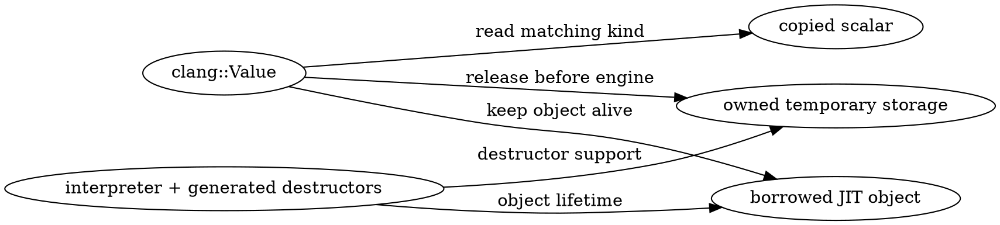

# Part 5 — Values, Objects and Lifetimes

[← Part 4 — Clang Compiler Services](part_4_embedding_api.md) | [Part 6 — Advanced JIT Customization →](part_6_extending.md)

Follow results across the host/JIT boundary. Scalars, borrowed pointers and owned C++ objects need different handling, especially when code or a session is removed.



## Section 5.1 — Anatomy of `clang::Value`

An expression can produce an integer, a pointer, an object or no usable result at all. Your host receives a `clang::Value`, but it needs to understand what that particular Value represents before trying to read or retain its data.

Evaluate several kinds of expressions and inspect validity, kind and type alongside the captured result. Compare them with a declaration and a void-returning call. Reading the Value's structure will help you distinguish a failed operation, an input with no captured result and a result whose storage needs special lifetime handling.

`Value` keeps both result storage and a Clang type. Its kind selects the active storage, while its allocation flag distinguishes owned object storage from a borrowed address.

| Member | Type | Meaning |
|--------|------|---------|
| `Interp` | `const Interpreter *` | the interpreter whose `ASTContext` owns the type; null in a default-constructed `Value` |
| `OpaqueType` | `void *` | a `QualType`, stored as its opaque pointer: `getType()` rebuilds it with `QualType::getFromOpaquePtr` |
| `Data` | `union Storage` | one member per builtin type (`m_Int`, `m_Double`, ...), a `void *m_Ptr`, and target-dependent raw storage (`m_RawBits`; 64 bytes in the recorded arm64 macOS build) |
| `ValueKind` | `Kind` | which union member is live: a `K_` constant (Section 5.2) |
| `IsManuallyAlloc` | `bool` | true when the `Value` owns heap storage for an object (Section 5.3) |

| Accessor | Answers |
|----------|---------|
| `isValid()` | `getKind() != K_Unspecified`: did the input produce a value at all? |
| `isVoid()` | the expression had type `void` |
| `hasValue()` | `isValid() && !isVoid()`: there is something to read |
| `getKind()` | the live union member (or `K_PtrOrObj`, `K_Void`, `K_Unspecified`) |
| `getType()` | the expression's `clang::QualType` (null for an invalid `Value`) |
| `isManuallyAlloc()` | the `Value` owns the object behind `getPtr()` |
| `getPtr()` | the pointer, or the address of the object, when `getKind() == K_PtrOrObj` |

<!-- runnable-example: 5.1 -->

`examples/p05_anatomy.cpp`:

```cpp
#include <clang/AST/ASTContext.h>
#include <clang/Frontend/CompilerInstance.h>
#include <clang/Interpreter/Interpreter.h>
#include <clang/Interpreter/Value.h>
#include <cstdio>
#include <cstdlib>
#include <llvm/ADT/StringRef.h>
#include <llvm/Support/CommandLine.h>
#include <llvm/Support/Error.h>
#include <llvm/Support/FormatVariadic.h>
#include <llvm/Support/TargetSelect.h>
#include <llvm/Support/raw_ostream.h>
#include <memory>
#include <string>
#include <utility>
#include <vector>

using namespace clang;

// Keep inputs separate: each accepted input adds to the same compiler session.
const std::vector<std::string> SourceInputs = {
    R"cpp(
int x = 42;
)cpp",
    R"cpp(
double d = 2.5;
)cpp",
    R"cpp(
struct P {
  int a;
  int b;
};
)cpp",
    R"cpp(
P p{1, 2};
)cpp",
    R"cpp(
void nothing() {
}
)cpp",
    R"cpp(
x
)cpp",
    R"cpp(
x + 1
)cpp",
    R"cpp(
d * 2
)cpp",
    R"cpp(
(x > 3)
)cpp",
    R"cpp(
'A'
)cpp",
    R"cpp(
"hello"
)cpp",
    R"cpp(
nothing()
)cpp",
    R"cpp(
nothing
)cpp",
    R"cpp(
p
)cpp",
    R"cpp(
P{3, 4}
)cpp",
    R"cpp(
&x
)cpp",
    R"cpp(
static_cast<void *>(&x)
)cpp",
    R"cpp(
nullptr
)cpp",
    R"cpp(
int arr[3] = {7, 8, 9};
)cpp",
    R"cpp(
arr
)cpp",
};

int main(int argc, const char **argv) {
  // Register typed host options before parsing argv; Clang receives its own
  // flag list.
  llvm::cl::OptionCategory Options("JIT example options");
  llvm::cl::opt<bool> Reuse(
      "reuse", llvm::cl::desc("Reuse one Value across several inputs"),
      llvm::cl::cat(Options), llvm::cl::init(false));
  llvm::cl::list<std::string> CompilerFlags(
      llvm::cl::Positional, llvm::cl::ZeroOrMore,
      llvm::cl::desc("<compiler flags after -->"), llvm::cl::cat(Options));
  llvm::cl::HideUnrelatedOptions(Options);
  // Fill the registered options; malformed host arguments stop before compiler
  // setup.
  if (!llvm::cl::ParseCommandLineOptions(argc, argv, "Clang JIT API example\n",
                                         &llvm::errs())) {
    return 2;
  }

  // Register LLVM's native target and assembly support for generated code.
  llvm::InitializeNativeTarget();
  llvm::InitializeNativeTargetAsmPrinter();
  llvm::InitializeNativeTargetAsmParser();
  std::setvbuf(stdout, nullptr, _IONBF, 0);
  llvm::outs().SetUnbuffered();

  std::vector<const char *> CompilerArguments;
  for (const std::string &Flag : CompilerFlags) {
    CompilerArguments.push_back(Flag.c_str());
  }
  clang::IncrementalCompilerBuilder CompilerBuilder;
  // Configure the embedded compiler, independently of the host build flags.
  // These argument strings must remain alive until CreateCpp() finishes.
  CompilerBuilder.SetCompilerArgs(CompilerArguments);
  // CreateCpp returns an owned CompilerInstance or an error inside Expected.
  auto CompilerOrError = CompilerBuilder.CreateCpp();
  // Extract the failed Expected with takeError(); logging consumes that Error.
  if (!CompilerOrError) {
    llvm::logAllUnhandledErrors(CompilerOrError.takeError(), llvm::errs(),
                                "compiler: ");
    return 1;
  }

  // Give the session the compiler and prepare its runtime prelude.
  auto InterpreterOrError =
      clang::Interpreter::create(std::move(*CompilerOrError), nullptr);
  if (!InterpreterOrError) {
    llvm::logAllUnhandledErrors(InterpreterOrError.takeError(), llvm::errs(),
                                "error: ");
    return 1;
  }
  std::unique_ptr<Interpreter> I = std::move(*InterpreterOrError);

  if (Reuse) {
    // Compile this input, then submit its module and run its initializers.
    if (llvm::Error Error = I->ParseAndExecute(R"cpp(
int x = 42;
void nothing() {
}
)cpp")) {
      llvm::logAllUnhandledErrors(std::move(Error), llvm::errs(), "error: ");
      return 1;
    }
    // One Value reused for several inputs: only an input that produces a value
    // writes to it. A declaration leaves the previous contents alone.
    llvm::outs() << "\nreusing one Value:\n";
    Value V;
    for (const char *Code : {R"cpp(
x
)cpp",
                             R"cpp(
int y = 1;
)cpp",
                             R"cpp(
nothing()
)cpp",
                             R"cpp(
y + 1
)cpp",
                             R"cpp(
int z = 2;
)cpp"}) {
      llvm::Error InputError2 = I->ParseAndExecute(Code, &V);
      bool InputAccepted1 = !InputError2;
      if (InputError2) {
        llvm::logAllUnhandledErrors(std::move(InputError2), llvm::errs(),
                                    "error: ");
      }
      if (!InputAccepted1) {
        continue;
      }
      std::string ValueText;
      if (!V.isValid()) {
        ValueText = "<invalid Value>\n";
      } else {
        llvm::raw_string_ostream OutputForValueText(ValueText);
        V.print(OutputForValueText);
      }
      const char *KindName = "?";
      // The kind identifies active storage; getType() retains the expression's
      // Clang type.
      switch (V.getKind()) {
#define X(type, name)                                                          \
  case clang::Value::K_##name:                                                 \
    KindName = "K_" #name;                                                     \
    break;
        REPL_BUILTIN_TYPES
#undef X
      case clang::Value::K_Void:
        KindName = "K_Void";
        break;
      case clang::Value::K_PtrOrObj:
        KindName = "K_PtrOrObj";
        break;
      case clang::Value::K_Unspecified:
        KindName = "K_Unspecified";
        break;
      }
      llvm::outs()
          << "  after "
          << (llvm::formatv(("{0,-" + std::to_string((12)) + "}").c_str(),
                            (Code))
                  .str())
          << "-> "
          << (llvm::formatv(("{0,-" + std::to_string((15)) + "}").c_str(),
                            (KindName))
                  .str())
          << (V.hasValue() ? ValueText : std::string("(no data)\n"));
    }
    return 0;
  }

  llvm::outs() << (llvm::formatv(("{0,-" + std::to_string((38)) + "}").c_str(),
                                 ("input"))
                       .str())
               << (llvm::formatv(("{0,-" + std::to_string((8)) + "}").c_str(),
                                 ("isValid"))
                       .str())
               << (llvm::formatv(("{0,-" + std::to_string((15)) + "}").c_str(),
                                 ("kind"))
                       .str())
               << (llvm::formatv(("{0,-" + std::to_string((9)) + "}").c_str(),
                                 ("hasValue"))
                       .str())
               << (llvm::formatv(("{0,-" + std::to_string((7)) + "}").c_str(),
                                 ("manual"))
                       .str())
               << "type\n";
  {
    for (const std::string &Code : SourceInputs) {
      if (llvm::StringRef(Code).starts_with("//")) {
        continue;
      }
      // A fresh Value starts invalid, avoiding a stale result after a
      // declaration-only input.
      Value V; // a fresh Value for every input: default constructed = invalid
      llvm::Error InputError4 = I->ParseAndExecute(Code, &V);
      bool InputAccepted3 = !InputError4;
      if (InputError4) {
        llvm::logAllUnhandledErrors(std::move(InputError4), llvm::errs(),
                                    "error: ");
      }
      if (!InputAccepted3) {
        continue;
      }
      std::string Type =
          V.isValid()
              ? V.getType().getAsString(V.getASTContext().getPrintingPolicy())
              : "-";
      const char *KindName2 = "?";
      switch (V.getKind()) {
#define X(type, name)                                                          \
  case clang::Value::K_##name:                                                 \
    KindName2 = "K_" #name;                                                    \
    break;
        REPL_BUILTIN_TYPES
#undef X
      case clang::Value::K_Void:
        KindName2 = "K_Void";
        break;
      case clang::Value::K_PtrOrObj:
        KindName2 = "K_PtrOrObj";
        break;
      case clang::Value::K_Unspecified:
        KindName2 = "K_Unspecified";
        break;
      }
      llvm::outs()
          << (llvm::formatv(("{0,-" + std::to_string((38)) + "}").c_str(),
                            (Code))
                  .str())
          << (llvm::formatv(("{0,-" + std::to_string((8)) + "}").c_str(),
                            (V.isValid() ? "yes" : "no"))
                  .str())
          << (llvm::formatv(("{0,-" + std::to_string((15)) + "}").c_str(),
                            (KindName2))
                  .str())
          << (llvm::formatv(("{0,-" + std::to_string((9)) + "}").c_str(),
                            (V.hasValue() ? "yes" : "no"))
                  .str())
          << (llvm::formatv(("{0,-" + std::to_string((7)) + "}").c_str(),
                            (V.isManuallyAlloc() ? "yes" : "no"))
                  .str())
          << Type << "\n";
    }
  }

  return 0;
}
```

Linux:

```bash
export LLVM="${LLVM:-$(llvm-config-22 --prefix)}"
mkdir -p out
"$LLVM/bin/clang++" $("$LLVM/bin/llvm-config" --cxxflags) -std=c++20 -pthread \
  examples/p05_anatomy.cpp -L"$LLVM/lib" -Wl,-rpath,"$LLVM/lib" \
  -Wl,--export-dynamic -lclang-cpp -lLLVM -o out/p05_anatomy
out/p05_anatomy -- -std=c++20 -resource-dir "$("$LLVM/bin/clang++" -print-resource-dir)" --gcc-toolchain=/usr
```

macOS:

```bash
export LLVM="${LLVM:-$(brew --prefix llvm)}"
mkdir -p out
"$LLVM/bin/clang++" $("$LLVM/bin/llvm-config" --cxxflags) -std=c++20 -pthread \
  examples/p05_anatomy.cpp -L"$LLVM/lib" -Wl,-rpath,"$LLVM/lib" \
  -lclang-cpp -lLLVM -o out/p05_anatomy
out/p05_anatomy -- -std=c++20 -resource-dir "$("$LLVM/bin/clang++" -print-resource-dir)" -nostdinc++ -isystem "$LLVM/include/c++/v1" -isysroot "$(xcrun --show-sdk-path)"
```

<!-- /runnable-example -->

The example requests a result from `ParseAndExecute`, then prints validity, kind, ownership and type. The kind names come from `REPL_BUILTIN_TYPES` in the installed `Value.h`.

Predict those properties for the reference fixture:

```bash
cat manifests/p05_anatomy.repl
```

```text expected
// Part 5.1 -- one Value per input: what does the interpreter hand back?
int x = 42;
double d = 2.5;
struct P { int a; int b; };
P p{1, 2};
void nothing() {}
x
x + 1
d * 2
(x > 3)
'A'
"hello"
nothing()
nothing
p
P{3, 4}
&x
static_cast<void *>(&x)
nullptr
int arr[3] = {7, 8, 9};
arr
```

```bash
build/bin/p05_anatomy manifests/p05_anatomy.repl
```

```text expected
input                                 isValid kind           hasValue manual type
int x = 42;                           no      K_Unspecified  no       no     -
double d = 2.5;                       no      K_Unspecified  no       no     -
struct P { int a; int b; };           no      K_Unspecified  no       no     -
P p{1, 2};                            no      K_Unspecified  no       no     -
void nothing() {}                     no      K_Unspecified  no       no     -
x                                     yes     K_Int          yes      no     int
x + 1                                 yes     K_Int          yes      no     int
d * 2                                 yes     K_Double       yes      no     double
(x > 3)                               yes     K_Bool         yes      no     bool
'A'                                   yes     K_Char_S       yes      no     char
"hello"                               yes     K_PtrOrObj     yes      yes    const char[6]
nothing()                             yes     K_Void         no       no     void
nothing                               yes     K_PtrOrObj     yes      no     void ()
p                                     yes     K_PtrOrObj     yes      no     P &
P{3, 4}                               yes     K_PtrOrObj     yes      yes    P
&x                                    yes     K_PtrOrObj     yes      no     int *
static_cast<void *>(&x)               yes     K_PtrOrObj     yes      no     void *
nullptr                               yes     K_PtrOrObj     yes      no     std::nullptr_t
int arr[3] = {7, 8, 9};               no      K_Unspecified  no       no     -
arr                                   yes     K_PtrOrObj     yes      yes    int[3]
```

Scalar lvalues such as `x` become copied numbers. A class lvalue such as `p` becomes a borrowed `P &`, while a temporary `P{3, 4}` owns storage through the Value. Arrays, including string literals, are copied into owned storage. A pointer expression carries the pointer itself; it does not acquire ownership of the pointed-to object.

A declaration or ordinary statement produces no result. Reusing an old Value can obscure this distinction, because an input without a captured result can leave the previous contents untouched:

```bash
build/bin/p05_anatomy reuse
```

```text expected

reusing one Value:
  after x           -> K_Int          (int) 42
  after int y = 1;  -> K_Int          (int) 42
  after nothing()   -> K_Void         (no data)
  after y + 1       -> K_Int          (int) 2
  after int z = 2;  -> K_Int          (int) 2
```

Use a fresh Value or clear it before asking whether a particular input produced a result. A `void` expression is a separate state: it can be valid while `hasValue()` is false.

LLVM 22.1.8 has an additional `void` capture limitation. Compare the bare call and the statement form:

```bash
build/bin/p05_anatomy manifests/p05_void.repl | sed '/^$/,$d'
```

```text expected
input                                 isValid kind           hasValue manual type
#include <cstdio>                     no      K_Unspecified  no       no     -
void hello() { puts("hello ran"); }   no      K_Unspecified  no       no     -
hello()                               yes     K_Void         no       no     void
hello ran
hello();                              no      K_Unspecified  no       no     -
```

In this version, a semicolon-less `void` call can report `K_Void` without running the call. Use the statement form when execution is intended. For other expressions, generated `__clang_Interpreter_SetValue*` calls fill the interpreter's result storage before the API transfers it to the supplied Value.

Predict the ownership of a string lvalue, temporary, size result and `c_str()` result:

```bash
mkdir -p out
printf '%s\n' '#include <string>' 'std::string s = "hi";' 's' 'std::string("x")' 's.size()' 's.c_str()' > out/p05_verify_anatomy.repl
build/bin/p05_anatomy out/p05_verify_anatomy.repl -- -Wno-unused-result | tail -n +4
```

```text expected
s                                     yes     K_PtrOrObj     yes      no     std::string &
std::string("x")                      yes     K_PtrOrObj     yes      yes    std::string
s.size()                              yes     K_ULong        yes      no     size_type
s.c_str()                             yes     K_PtrOrObj     yes      no     const value_type *
```

The lvalue borrows the string object, the temporary owns storage, `size()` copies a scalar, and `c_str()` borrows the string's character buffer.

> [!hint]- Where does a captured record temporary live?
> The storage union holds its address, while the allocation flag describes ownership.

> [!success]- Follow the payload
> Its bytes live in separately allocated storage. The size of Value itself is target-dependent: the recorded arm64 macOS build used 88 bytes, and the tested x86_64 Linux build used 160.

Add `unsigned count = 9;`, `count`, `&count` and `count;` as separate inputs in a copied fixture. Predict each row and explain it using the expression's type and whether it requests capture.

---

## Section 5.2 — Builtins, kinds and `convertTo`

An integer and a floating-point result may both fit inside a Value, but they are stored and read according to different kinds. Calling the wrong getter can interpret the same bytes as the wrong type without giving the host a helpful error.

Inspect `getKind()` before selecting a typed getter, then compare that access with `convertTo<T>()`. Try results with different numeric types and an enumeration to see how their types relate to the stored kind. The goal is to choose a read or conversion deliberately rather than treating every captured scalar as an `int`.

The builtin kinds, storage members and accessors are generated from `REPL_BUILTIN_TYPES` in `Value.h`. Expanding that macro lets this host stay aligned with the installed header.

<!-- runnable-example: 5.2 -->

`examples/p05_kinds.cpp`:

```cpp
#include <clang/AST/ASTContext.h>
#include <clang/Frontend/CompilerInstance.h>
#include <clang/Interpreter/Interpreter.h>
#include <clang/Interpreter/Value.h>
#include <cstdio>
#include <cstdlib>
#include <llvm/ADT/StringRef.h>
#include <llvm/Support/CommandLine.h>
#include <llvm/Support/Error.h>
#include <llvm/Support/Format.h>
#include <llvm/Support/TargetSelect.h>
#include <llvm/Support/raw_ostream.h>
#include <memory>
#include <string>
#include <type_traits>
#include <utility>
#include <vector>

using namespace clang;

int main(int argc, const char **argv) {
  // Register typed host options before parsing argv; Clang receives its own
  // flag list.
  llvm::cl::OptionCategory Options("JIT example options");
  llvm::cl::opt<std::string> Mode(
      "mode", llvm::cl::desc("Demonstration: table, natural, wrong, ptr"),
      llvm::cl::cat(Options), llvm::cl::init("table"));
  llvm::cl::list<std::string> CompilerFlags(
      llvm::cl::Positional, llvm::cl::ZeroOrMore,
      llvm::cl::desc("<compiler flags after -->"), llvm::cl::cat(Options));
  llvm::cl::HideUnrelatedOptions(Options);
  // Fill the registered options; malformed host arguments stop before compiler
  // setup.
  if (!llvm::cl::ParseCommandLineOptions(argc, argv, "Clang JIT API example\n",
                                         &llvm::errs())) {
    return 2;
  }

  // Register LLVM's native target and assembly support for generated code.
  llvm::InitializeNativeTarget();
  llvm::InitializeNativeTargetAsmPrinter();
  llvm::InitializeNativeTargetAsmParser();
  std::setvbuf(stdout, nullptr, _IONBF, 0);
  llvm::outs().SetUnbuffered();

  if (Mode == "table") {
    {

      llvm::outs() << "kind  name           C++ type            sizeof\n";
#define X(type, name)                                                          \
  llvm::outs() << llvm::format("%-5d %-14s %-19s %zu\n", (int)Value::K_##name, \
                               "K_" #name, #type, sizeof(type));
      REPL_BUILTIN_TYPES
#undef X
      llvm::outs() << llvm::format("%-5d %-14s\n", (int)Value::K_Void,
                                   "K_Void");
      llvm::outs() << llvm::format("%-5d %-14s\n", (int)Value::K_PtrOrObj,
                                   "K_PtrOrObj");
      llvm::outs() << llvm::format("%-5d %-14s\n", (int)Value::K_Unspecified,
                                   "K_Unspecified");
      // The storage union is as wide as 8 long doubles; the rest of a Value is
      // a few words.
      llvm::outs() << "sizeof(clang::Value) = " << sizeof(Value)
                   << ", of which the storage union is "
                   << sizeof(long double) * 8 << " bytes\n";
    }
    return 0;
  }

  std::vector<const char *> CompilerArguments;
  for (const std::string &Flag : CompilerFlags) {
    CompilerArguments.push_back(Flag.c_str());
  }
  clang::IncrementalCompilerBuilder CompilerBuilder;
  // Configure the embedded compiler, independently of the host build flags.
  // These argument strings must remain alive until CreateCpp() finishes.
  CompilerBuilder.SetCompilerArgs(CompilerArguments);
  // CreateCpp returns an owned CompilerInstance or an error inside Expected.
  auto CompilerOrError = CompilerBuilder.CreateCpp();
  // Extract the failed Expected with takeError(); logging consumes that Error.
  if (!CompilerOrError) {
    llvm::logAllUnhandledErrors(CompilerOrError.takeError(), llvm::errs(),
                                "compiler: ");
    return 1;
  }

  // Give the session the compiler and prepare its runtime prelude.
  auto InterpreterOrError =
      clang::Interpreter::create(std::move(*CompilerOrError), nullptr);
  if (!InterpreterOrError) {
    llvm::logAllUnhandledErrors(InterpreterOrError.takeError(), llvm::errs(),
                                "error: ");
    return 1;
  }
  std::unique_ptr<Interpreter> I = std::move(*InterpreterOrError);
  // Compile this input, then submit its module and run its initializers.
  if (llvm::Error Error = I->ParseAndExecute(
          R"cpp(
enum Color : unsigned char { Red, Green = 5 };
enum Plain { A, B };
enum class Cls : short { X = -2 };
int answer = 42;
double pi = 2.9;
float f = 1.5f;
int *pa = &answer;
)cpp")) {
    llvm::logAllUnhandledErrors(std::move(Error), llvm::errs(), "error: ");
  }

  if (Mode == "natural") {
    for (const char *Code : {R"cpp(
answer
)cpp",
                             R"cpp(
pi
)cpp",
                             R"cpp(
f
)cpp",
                             R"cpp(
'A'
)cpp",
                             R"cpp(
(bool)3
)cpp",
                             R"cpp(
(unsigned char)200
)cpp",
                             R"cpp(
Green
)cpp",
                             R"cpp(
B
)cpp",
                             R"cpp(
Cls::X
)cpp",
                             R"cpp(
10UL
)cpp",
                             R"cpp(
2.5L
)cpp"}) {
      Value V;
      if (llvm::Error Error = I->ParseAndExecute(Code, &V)) {
        llvm::logAllUnhandledErrors(std::move(Error), llvm::errs(), "error: ");
      }
      std::string Ty =
          V.getType().getAsString(V.getASTContext().getPrintingPolicy());
      const char *KindName = "?";
      // The kind selects the active storage member; the macro enumerates
      // Clang's builtin kinds.
      switch (V.getKind()) {
#define X(type, name)                                                          \
  case clang::Value::K_##name:                                                 \
    KindName = "K_" #name;                                                     \
    break;
        REPL_BUILTIN_TYPES
#undef X
      case clang::Value::K_Void:
        KindName = "K_Void";
        break;
      case clang::Value::K_PtrOrObj:
        KindName = "K_PtrOrObj";
        break;
      case clang::Value::K_Unspecified:
        KindName = "K_Unspecified";
        break;
      }
      std::string NaturalValue;

      llvm::raw_string_ostream ValueOutput(NaturalValue);
      switch (V.getKind()) {
#define X(type, name)                                                          \
  case Value::K_##name:                                                        \
    ValueOutput << "get" #name "() = ";                                        \
    if constexpr (std::is_integral_v<type> && std::is_unsigned_v<type>) {      \
      ValueOutput << static_cast<unsigned long long>(V.get##name());           \
    } else if constexpr (std::is_integral_v<type>) {                           \
      ValueOutput << static_cast<long long>(V.get##name());                    \
    } else {                                                                   \
      ValueOutput << llvm::format("%g", static_cast<double>(V.get##name()));   \
    }                                                                          \
    break;
        REPL_BUILTIN_TYPES
#undef X
      case Value::K_Void:
        ValueOutput << "(void)";
        break;
      case Value::K_PtrOrObj:
        ValueOutput << "getPtr() is an address";
        break;
      case Value::K_Unspecified:
        ValueOutput << "(no value)";
        break;
      }

      llvm::outs() << llvm::format("%-20s %-15s %-13s ", Code, Ty.c_str(),
                                   KindName)
                   << NaturalValue << "\n";
    }
  } else if (Mode == "wrong") {
    // Reading a union member that does not match the kind reinterprets the
    // bytes.
    Value D, F, P, N;
    if (llvm::Error Error = I->ParseAndExecute(R"cpp(
1.0
)cpp",
                                               &D)) {
      llvm::logAllUnhandledErrors(std::move(Error), llvm::errs(), "error: ");
    }
    if (llvm::Error Error = I->ParseAndExecute(R"cpp(
f
)cpp",
                                               &F)) {
      llvm::logAllUnhandledErrors(std::move(Error), llvm::errs(), "error: ");
    }
    if (llvm::Error Error = I->ParseAndExecute(R"cpp(
pi
)cpp",
                                               &P)) {
      llvm::logAllUnhandledErrors(std::move(Error), llvm::errs(), "error: ");
    }
    if (llvm::Error Error = I->ParseAndExecute(R"cpp(
answer
)cpp",
                                               &N)) {
      llvm::logAllUnhandledErrors(std::move(Error), llvm::errs(), "error: ");
    }
    llvm::outs() << "double 1.0   getDouble()          = " << D.getDouble()
                 << "\n";
    llvm::outs() << "double 1.0   getLong()            = " << D.getLong()
                 << "   (bit pattern)\n";
    // convertTo selects the stored kind and converts the number; a getter only
    // reads storage.
    llvm::outs() << "double 1.0   convertTo<long>()    = "
                 << D.convertTo<long>() << "   (a conversion)\n";
    llvm::outs() << "float 1.5f   getInt()             = " << F.getInt()
                 << "   (bit pattern)\n";
    llvm::outs() << "float 1.5f   convertTo<int>()     = " << F.convertTo<int>()
                 << "\n";
    llvm::outs() << "double 2.9   convertTo<int>()     = " << P.convertTo<int>()
                 << "   (truncates)\n";
    llvm::outs() << "int 42       convertTo<double>()  = "
                 << N.convertTo<double>() << "\n";
    llvm::outs() << "int 42       convertTo<bool>()    = "
                 << N.convertTo<bool>() << "\n";
  } else if (Mode == "ptr") {
    Value PV, IV, SV, OV;
    if (llvm::Error Error = I->ParseAndExecute(R"cpp(
pa
)cpp",
                                               &PV)) {
      llvm::logAllUnhandledErrors(std::move(Error), llvm::errs(), "error: ");
    }
    if (llvm::Error Error = I->ParseAndExecute(R"cpp(
answer
)cpp",
                                               &IV)) {
      llvm::logAllUnhandledErrors(std::move(Error), llvm::errs(), "error: ");
    }
    if (llvm::Error Error = I->ParseAndExecute(R"cpp(
"hello"
)cpp",
                                               &SV)) {
      llvm::logAllUnhandledErrors(std::move(Error), llvm::errs(), "error: ");
    }
    if (llvm::Error Error = I->ParseAndExecute(R"cpp(
Color {
  Green
}
)cpp",
                                               &OV)) {
      llvm::logAllUnhandledErrors(std::move(Error), llvm::errs(), "error: ");
    }
    // A pointer-kind Value exposes its address without taking ownership of the
    // pointee.
    int *P = PV.convertTo<int *>();
    const char *KindName2 = "?";
    switch (PV.getKind()) {
#define X(type, name)                                                          \
  case clang::Value::K_##name:                                                 \
    KindName2 = "K_" #name;                                                    \
    break;
      REPL_BUILTIN_TYPES
#undef X
    case clang::Value::K_Void:
      KindName2 = "K_Void";
      break;
    case clang::Value::K_PtrOrObj:
      KindName2 = "K_PtrOrObj";
      break;
    case clang::Value::K_Unspecified:
      KindName2 = "K_Unspecified";
      break;
    }
    llvm::outs() << "pa kind                      = " << KindName2 << "\n";
    llvm::outs() << "*pa read by the host         = " << *P << "\n";
    *P = 43;
    llvm::outs() << "after the host wrote 43      = ";
    if (llvm::Error Error = I->ParseAndExecute(R"cpp(
answer
)cpp")) {
      llvm::logAllUnhandledErrors(std::move(Error), llvm::errs(), "error: ");
    }
    llvm::outs() << "convertTo<int *>() on an int = "
                 << (void *)IV.convertTo<int *>() << "\n";
    llvm::outs() << "convertTo<long>() on a ptr   = same as getPtr(): "
                 << (PV.convertTo<long>() == (long)PV.getPtr()) << "\n";
    const char *KindName3 = "?";
    switch (SV.getKind()) {
#define X(type, name)                                                          \
  case clang::Value::K_##name:                                                 \
    KindName3 = "K_" #name;                                                    \
    break;
      REPL_BUILTIN_TYPES
#undef X
    case clang::Value::K_Void:
      KindName3 = "K_Void";
      break;
    case clang::Value::K_PtrOrObj:
      KindName3 = "K_PtrOrObj";
      break;
    case clang::Value::K_Unspecified:
      KindName3 = "K_Unspecified";
      break;
    }
    llvm::outs() << "\"hello\" kind, owned          = " << KindName3 << ", "
                 << SV.isManuallyAlloc() << "\n";
    llvm::outs() << "convertTo<const char *>()    = "
                 << SV.convertTo<const char *>() << "\n";
    const char *KindName4 = "?";
    switch (OV.getKind()) {
#define X(type, name)                                                          \
  case clang::Value::K_##name:                                                 \
    KindName4 = "K_" #name;                                                    \
    break;
      REPL_BUILTIN_TYPES
#undef X
    case clang::Value::K_Void:
      KindName4 = "K_Void";
      break;
    case clang::Value::K_PtrOrObj:
      KindName4 = "K_PtrOrObj";
      break;
    case clang::Value::K_Unspecified:
      KindName4 = "K_Unspecified";
      break;
    }
    llvm::outs() << "Color{Green} (a temporary) = " << KindName4 << "\n";
  }
  return 0;
}
```

Linux:

```bash
export LLVM="${LLVM:-$(llvm-config-22 --prefix)}"
mkdir -p out
"$LLVM/bin/clang++" $("$LLVM/bin/llvm-config" --cxxflags) -std=c++20 -pthread \
  examples/p05_kinds.cpp -L"$LLVM/lib" -Wl,-rpath,"$LLVM/lib" \
  -Wl,--export-dynamic -lclang-cpp -lLLVM -o out/p05_kinds
out/p05_kinds --mode=table -- -std=c++20 -resource-dir "$("$LLVM/bin/clang++" -print-resource-dir)" --gcc-toolchain=/usr
out/p05_kinds --mode=natural -- -std=c++20 -resource-dir "$("$LLVM/bin/clang++" -print-resource-dir)" --gcc-toolchain=/usr
out/p05_kinds --mode=wrong -- -std=c++20 -resource-dir "$("$LLVM/bin/clang++" -print-resource-dir)" --gcc-toolchain=/usr
```

macOS:

```bash
export LLVM="${LLVM:-$(brew --prefix llvm)}"
mkdir -p out
"$LLVM/bin/clang++" $("$LLVM/bin/llvm-config" --cxxflags) -std=c++20 -pthread \
  examples/p05_kinds.cpp -L"$LLVM/lib" -Wl,-rpath,"$LLVM/lib" \
  -lclang-cpp -lLLVM -o out/p05_kinds
out/p05_kinds --mode=table -- -std=c++20 -resource-dir "$("$LLVM/bin/clang++" -print-resource-dir)" -nostdinc++ -isystem "$LLVM/include/c++/v1" -isysroot "$(xcrun --show-sdk-path)"
out/p05_kinds --mode=natural -- -std=c++20 -resource-dir "$("$LLVM/bin/clang++" -print-resource-dir)" -nostdinc++ -isystem "$LLVM/include/c++/v1" -isysroot "$(xcrun --show-sdk-path)"
out/p05_kinds --mode=wrong -- -std=c++20 -resource-dir "$("$LLVM/bin/clang++" -print-resource-dir)" -nostdinc++ -isystem "$LLVM/include/c++/v1" -isysroot "$(xcrun --show-sdk-path)"
```

<!-- /runnable-example -->

The reference tool prints the builtin table:

```bash
build/bin/p05_kinds table
```

```text expected
kind  name           C++ type            sizeof
0     K_Bool         bool                1
1     K_Char_S       char                1
2     K_SChar        signed char         1
3     K_Char_U       unsigned char       1
4     K_UChar        unsigned char       1
5     K_Short        short               2
6     K_UShort       unsigned short      2
7     K_Int          int                 4
8     K_UInt         unsigned int        4
9     K_Long         long                8
10    K_ULong        unsigned long       8
11    K_LongLong     long long           8
12    K_ULongLong    unsigned long long  8
13    K_Float        float               4
14    K_Double       double              8
15    K_LongDouble   long double         8
16    K_Void
17    K_PtrOrObj
18    K_Unspecified
sizeof(clang::Value) = 88, of which the storage union is 64 bytes
```

The expression's type chooses its kind. An enumeration uses its underlying integer kind; pointers, records, arrays, functions and `nullptr` use `K_PtrOrObj`. The original Clang type remains available even when two expressions share a storage kind.

```bash
build/bin/p05_kinds natural
```

```text expected
answer               int             K_Int         getInt() = 42
pi                   double          K_Double      getDouble() = 2.9
f                    float           K_Float       getFloat() = 1.5
'A'                  char            K_Char_S      getChar_S() = 65
(bool)3              bool            K_Bool        getBool() = 1
(unsigned char)200   unsigned char   K_UChar       getUChar() = 200
Green                Color           K_UChar       getUChar() = 5
B                    Plain           K_UInt        getUInt() = 1
Cls::X               Cls             K_Short       getShort() = -2
10UL                 unsigned long   K_ULong       getULong() = 10
2.5L                 long double     K_LongDouble  getLongDouble() = 2.5
```

On the recorded target, plain `char` is signed and uses `K_Char_S`, distinct from explicit `signed char`. The enum examples show why its name alone cannot select a getter: the underlying type determines which integer member is live.

A typed getter reads its union member directly. `convertTo<T>()` instead selects the current kind and performs a conversion. Compare those operations in the deliberately incorrect-accessor demonstration:

```bash
build/bin/p05_kinds wrong
```

```text expected
double 1.0   getDouble()          = 1.000000e+00
double 1.0   getLong()            = 4607182418800017408   (bit pattern)
double 1.0   convertTo<long>()    = 1   (a conversion)
float 1.5f   getInt()             = 1069547520   (bit pattern)
float 1.5f   convertTo<int>()     = 1
double 2.9   convertTo<int>()     = 2   (truncates)
int 42       convertTo<double>()  = 4.200000e+01
int 42       convertTo<bool>()    = 1
```

The displayed bit patterns are evidence of reading the wrong storage, rather than numeric conversion. Other mismatches can include uninitialized bytes and have unreliable results. Use a matching getter after examining the kind, or a supported numeric conversion when conversion is intended.

Pointer conversion has a different meaning:

```bash
build/bin/p05_kinds ptr
```

```text expected
pa kind                      = K_PtrOrObj
*pa read by the host         = 42
after the host wrote 43      = (int) 43
convertTo<int *>() on an int = 0x0
convertTo<long>() on a ptr   = same as getPtr(): 1
"hello" kind, owned          = K_PtrOrObj, 1
convertTo<const char *>()    = hello
Color{Green} (a temporary) = K_UChar
```

For `K_PtrOrObj`, conversion to a pointer yields the stored address; converting an integer-kind Value to a pointer returns null in this API. A successful pointer conversion still does not establish the pointed-to type, lifetime or ownership. `getAs<T>()`, shown in some documentation, is not a public Value member in 22.1.8.

The supported kinds also limit capture. In this version, `__int128` can yield an invalid Value, while scalar `wchar_t`, `char16_t` and `char32_t` capture can reach an unsupported runtime case and trap. The following failure demonstration runs in its own process:

```bash
mkdir -p out
printf '%s\n' '(__int128)5' "L'x'" > out/p05_unsupported.repl
{ build/bin/p05_anatomy out/p05_unsupported.repl; } 2>/dev/null
echo "exit status: $?"
```

```text expected
input                                 isValid kind           hasValue manual type
(__int128)5                           no      K_Unspecified  no       no     -
exit status: 133
```

Do not use unsupported capture as a normal probing strategy in a live host. Inspect the type before requesting a result when inputs are unconstrained.

Predict the kinds for these enum and arithmetic expressions:

```bash
mkdir -p out
printf '%s\n' 'enum class Small : signed char { A = -1 };' 'enum Wide : unsigned long long { Big = 1ULL << 40 };' 'Small::A' 'Big' '(short)-1' '(1 == 2)' > out/p05_verify_kinds.repl
build/bin/p05_anatomy out/p05_verify_kinds.repl | tail -n +4
```

```text expected
Small::A                              yes     K_SChar        yes      no     Small
Big                                   yes     K_ULongLong    yes      no     Wide
(short)-1                             yes     K_Short        yes      no     short
(1 == 2)                              yes     K_Bool         yes      no     bool
```

The enum kinds follow their underlying types, and the comparison produces a boolean.

> [!hint]- How can either an `int` or a `long` result become a host `long`?
> The requested operation is conversion rather than direct storage access.

> [!success]- Choose conversion
> Use `convertTo<long>()` for those supported integer kinds. `getLong()` is appropriate only when `K_Long` is the active member.

Add a `short` and a `double` expression to a copied example. First print the kind, then choose a matching getter or numeric conversion and explain the resulting number.

---

## Section 5.3 — Objects, ownership and destructors

Capturing a class object raises a question that copying an integer does not: who owns the object, and when should its destructor run? A temporary result and an expression referring to an existing object can have different ownership even when both Values expose an address.

Use constructors, copies and destructors that print to follow those lifetimes. Compare a temporary with an lvalue and observe how retaining or copying the Value affects cleanup. Keep the interpreter alive while its object results need it, and pay attention to the LLVM 22.1.8 move-constructor limitation demonstrated later in the exercise.

<!-- runnable-example: 5.3 -->

`examples/p05_ownership.cpp`:

```cpp
#include <clang/AST/ASTContext.h>
#include <clang/Frontend/CompilerInstance.h>
#include <clang/Interpreter/Interpreter.h>
#include <clang/Interpreter/Value.h>
#include <cstdio>
#include <cstdlib>
#include <llvm/ADT/StringRef.h>
#include <llvm/Support/CommandLine.h>
#include <llvm/Support/Error.h>
#include <llvm/Support/TargetSelect.h>
#include <llvm/Support/raw_ostream.h>
#include <memory>
#include <string>
#include <utility>
#include <vector>

using namespace clang;

// Host-side counter the interpreted destructor increments: lets the tool
// observe "the destructor ran" without touching an object that may already be
// gone.
extern "C" int destructorCount = 0;

// An object with a visible life cycle. The copy constructor prints too, so the
// copy that SetValueWithAlloc makes into the Value's storage is visible.
static const char *Prelude = R"cpp(
#include <cstdio>
extern "C" int destructorCount;
struct T {
  int n;
  T(int n) : n(n) {
    printf("    T(%d)\n", n);
  }
  T(const T &o) : n(o.n) {
    printf("    T(const T&) copy of %d\n", o.n);
  }
  ~T() {
    printf("    ~T(%d)\n", n);
    n = -1;
    ++destructorCount;
  }
};
)cpp";

int main(int argc, const char **argv) {
  // Register typed host options before parsing argv; Clang receives its own
  // flag list.
  llvm::cl::OptionCategory Options("JIT example options");
  llvm::cl::opt<std::string> Mode(
      "mode",
      llvm::cl::desc(
          "Demonstration: temp, lvalue, copies, bug, bug-destroy, safe"),
      llvm::cl::cat(Options), llvm::cl::init("temp"));
  llvm::cl::list<std::string> CompilerFlags(
      llvm::cl::Positional, llvm::cl::ZeroOrMore,
      llvm::cl::desc("<compiler flags after -->"), llvm::cl::cat(Options));
  llvm::cl::HideUnrelatedOptions(Options);
  // Fill the registered options; malformed host arguments stop before compiler
  // setup.
  if (!llvm::cl::ParseCommandLineOptions(argc, argv, "Clang JIT API example\n",
                                         &llvm::errs())) {
    return 2;
  }

  // Register LLVM's native target and assembly support for generated code.
  llvm::InitializeNativeTarget();
  llvm::InitializeNativeTargetAsmPrinter();
  llvm::InitializeNativeTargetAsmParser();
  std::setvbuf(stdout, nullptr, _IONBF, 0);
  llvm::outs().SetUnbuffered();

  std::vector<const char *> CompilerArguments;
  for (const std::string &Flag : CompilerFlags) {
    CompilerArguments.push_back(Flag.c_str());
  }
  clang::IncrementalCompilerBuilder CompilerBuilder;
  // Configure the embedded compiler, independently of the host build flags.
  // These argument strings must remain alive until CreateCpp() finishes.
  CompilerBuilder.SetCompilerArgs(CompilerArguments);
  // CreateCpp returns an owned CompilerInstance or an error inside Expected.
  auto CompilerOrError = CompilerBuilder.CreateCpp();
  // Extract the failed Expected with takeError(); logging consumes that Error.
  if (!CompilerOrError) {
    llvm::logAllUnhandledErrors(CompilerOrError.takeError(), llvm::errs(),
                                "compiler: ");
    return 1;
  }

  // Give the session the compiler and prepare its runtime prelude.
  auto InterpreterOrError =
      clang::Interpreter::create(std::move(*CompilerOrError), nullptr);
  if (!InterpreterOrError) {
    llvm::logAllUnhandledErrors(InterpreterOrError.takeError(), llvm::errs(),
                                "error: ");
    return 1;
  }
  std::unique_ptr<Interpreter> I = std::move(*InterpreterOrError);
  // Compile this input, then submit its module and run its initializers.
  if (llvm::Error Error = I->ParseAndExecute(Prelude)) {
    llvm::logAllUnhandledErrors(std::move(Error), llvm::errs(), "error: ");
    return 1;
  }

  if (Mode == "temp") {
    (llvm::outs() << ("evaluate T{7}:") << "\n");
    Value V;
    if (llvm::Error Error = I->ParseAndExecute(R"cpp(
T{7}
)cpp",
                                               &V)) {
      llvm::logAllUnhandledErrors(std::move(Error), llvm::errs(), "error: ");
    }
    const char *KindName = "?";
    switch (V.getKind()) {
#define X(type, name)                                                          \
  case clang::Value::K_##name:                                                 \
    KindName = "K_" #name;                                                     \
    break;
      REPL_BUILTIN_TYPES
#undef X
    case clang::Value::K_Void:
      KindName = "K_Void";
      break;
    case clang::Value::K_PtrOrObj:
      KindName = "K_PtrOrObj";
      break;
    case clang::Value::K_Unspecified:
      KindName = "K_Unspecified";
      break;
    }
    llvm::outs() << "kind=" << KindName
                 << " manuallyAlloc=" << V.isManuallyAlloc()
                 << " type=" << V.getType().getAsString()
                 << " n=" << *(int *)V.getPtr() << "\n";
    (llvm::outs() << ("V goes out of scope:") << "\n");
  } else if (Mode == "lvalue") {
    if (llvm::Error Error = I->ParseAndExecute(R"cpp(
T t(1);
)cpp")) {
      llvm::logAllUnhandledErrors(std::move(Error), llvm::errs(), "error: ");
    }
    (llvm::outs() << ("evaluate the lvalue t:") << "\n");
    {
      Value V;
      if (llvm::Error Error = I->ParseAndExecute(R"cpp(
t
)cpp",
                                                 &V)) {
        llvm::logAllUnhandledErrors(std::move(Error), llvm::errs(), "error: ");
      }
      const char *KindName2 = "?";
      switch (V.getKind()) {
#define X(type, name)                                                          \
  case clang::Value::K_##name:                                                 \
    KindName2 = "K_" #name;                                                    \
    break;
        REPL_BUILTIN_TYPES
#undef X
      case clang::Value::K_Void:
        KindName2 = "K_Void";
        break;
      case clang::Value::K_PtrOrObj:
        KindName2 = "K_PtrOrObj";
        break;
      case clang::Value::K_Unspecified:
        KindName2 = "K_Unspecified";
        break;
      }
      llvm::outs() << "kind=" << KindName2
                   << " manuallyAlloc=" << V.isManuallyAlloc() << " type="
                   << V.getType().getAsString(
                          V.getASTContext().getPrintingPolicy())
                   << "\n";
      (llvm::outs() << ("V goes out of scope:") << "\n");
    }
    (llvm::outs() << ("V is gone; t still lives in the interpreter:") << "\n");
    if (llvm::Error Error = I->ParseAndExecute(R"cpp(
t.n
)cpp")) {
      llvm::logAllUnhandledErrors(std::move(Error), llvm::errs(), "error: ");
    }
  } else if (Mode == "copies") {
    (llvm::outs() << ("evaluate T{8}:") << "\n");
    Value V;
    if (llvm::Error Error = I->ParseAndExecute(R"cpp(
T{8}
)cpp",
                                               &V)) {
      llvm::logAllUnhandledErrors(std::move(Error), llvm::errs(), "error: ");
    }
    {
      // Copying a Value retains the same object storage; it does not
      // copy-construct T.
      Value C1 = V;
      Value C2 = C1;
      llvm::outs() << "three owners, same storage: "
                   << (C1.getPtr() == V.getPtr() && C2.getPtr() == V.getPtr())
                   << ", dtor runs so far: " << destructorCount << "\n";
      (llvm::outs() << ("C1 and C2 die:") << "\n");
    }
    llvm::outs() << "dtor runs so far: " << destructorCount << "\n";
    (llvm::outs() << ("V.clear():") << "\n");
    // Release this Value's share; the last owner runs the captured object's
    // destructor.
    V.clear();
    llvm::outs() << "dtor runs so far: " << destructorCount
                 << ", V valid: " << V.isValid() << "\n";
    (llvm::outs() << ("move-assignment is safe:") << "\n");
    Value S1, S2;
    if (llvm::Error Error = I->ParseAndExecute(R"cpp(
T{9}
)cpp",
                                               &S1)) {
      llvm::logAllUnhandledErrors(std::move(Error), llvm::errs(), "error: ");
    }
    // Move assignment transfers an existing share safely; move construction is
    // broken in LLVM 22.1.8.
    S2 = std::move(S1);
    llvm::outs() << "dtor runs so far: " << destructorCount
                 << ", S1 valid: " << S1.isValid()
                 << ", S2 n=" << *(int *)S2.getPtr() << "\n";
    (llvm::outs() << ("S2 goes out of scope:") << "\n");
  } else if (Mode == "bug") {
    Value A1;
    if (llvm::Error Error = I->ParseAndExecute(R"cpp(
T{9}
)cpp",
                                               &A1)) {
      llvm::logAllUnhandledErrors(std::move(Error), llvm::errs(), "error: ");
    }
    int *Payload = (int *)A1.getPtr();
    llvm::outs() << "A1 owns n=" << *Payload
                 << ", dtor runs: " << destructorCount << "\n";
    (llvm::outs() << ("Value *B = new Value(std::move(A1)):") << "\n");
    // The heap Value is never deleted on purpose: its destructor would release
    // storage that is already gone.
    // Deliberately exercise LLVM 22.1.8's broken move constructor, leaving a
    // dangling owner.
    // This failure demonstration is not a pattern for retaining a result.
    Value *B = new Value(std::move(A1));
    llvm::outs() << "dtor runs: " << destructorCount
                 << ", A1 valid: " << A1.isValid()
                 << ", B valid: " << B->isValid()
                 << ", B manuallyAlloc: " << B->isManuallyAlloc() << "\n";
    // Undefined behaviour, shown on purpose: the block was freed (after the
    // destructor stored -1 into it), so what the allocator left there is not 9.
    llvm::outs() << "B still points at "
                 << (B->getPtr() == Payload ? "the same payload"
                                            : "something else")
                 << ", and its n is "
                 << (*Payload == 9 ? "still 9" : "no longer 9") << "\n";
  } else if (Mode == "bug-destroy") {
    // The same bug, but B is allowed to die: its destructor Release()s the
    // storage a second time.
    Value A1;
    if (llvm::Error Error = I->ParseAndExecute(R"cpp(
T{9}
)cpp",
                                               &A1)) {
      llvm::logAllUnhandledErrors(std::move(Error), llvm::errs(), "error: ");
    }
    {
      Value B = std::move(A1);
      (llvm::outs() << ("B goes out of scope:") << "\n");
    }
    (llvm::outs() << ("survived") << "\n");
  } else if (Mode == "safe") {
    (llvm::outs() << ("copy construction instead of move construction:")
                  << "\n");
    Value V;
    if (llvm::Error Error = I->ParseAndExecute(R"cpp(
T{9}
)cpp",
                                               &V)) {
      llvm::logAllUnhandledErrors(std::move(Error), llvm::errs(), "error: ");
    }
    Value B = V; // retains: both own the object
    llvm::outs() << "dtor runs: " << destructorCount
                 << ", B n=" << *(int *)B.getPtr() << "\n";
    (llvm::outs() << ("both go out of scope:") << "\n");
  }
  return 0;
}
```

Linux:

```bash
export LLVM="${LLVM:-$(llvm-config-22 --prefix)}"
mkdir -p out
"$LLVM/bin/clang++" $("$LLVM/bin/llvm-config" --cxxflags) -std=c++20 -pthread \
  examples/p05_ownership.cpp -L"$LLVM/lib" -Wl,-rpath,"$LLVM/lib" \
  -Wl,--export-dynamic -lclang-cpp -lLLVM -o out/p05_ownership
out/p05_ownership --mode=safe -- -std=c++20 -resource-dir "$("$LLVM/bin/clang++" -print-resource-dir)" --gcc-toolchain=/usr
```

macOS:

```bash
export LLVM="${LLVM:-$(brew --prefix llvm)}"
mkdir -p out
"$LLVM/bin/clang++" $("$LLVM/bin/llvm-config" --cxxflags) -std=c++20 -pthread \
  examples/p05_ownership.cpp -L"$LLVM/lib" -Wl,-rpath,"$LLVM/lib" \
  -lclang-cpp -lLLVM -o out/p05_ownership
out/p05_ownership --mode=safe -- -std=c++20 -resource-dir "$("$LLVM/bin/clang++" -print-resource-dir)" -nostdinc++ -isystem "$LLVM/include/c++/v1" -isysroot "$(xcrun --show-sdk-path)"
```

<!-- /runnable-example -->

For an owned object result, Value allocates storage with a reference count and destructor information. `getPtr()` reaches the payload. Copies retain that storage, and releasing the last owner destroys the object while its interpreter is still available.

Begin with a temporary:

```bash
build/bin/p05_ownership temp
```

```text expected
evaluate T{7}:
    T(7)
kind=K_PtrOrObj manuallyAlloc=1 type=T n=7
V goes out of scope:
    ~T(7)
```

`T{7}` is constructed directly into the captured storage. Its destructor runs when the Value releases the final share. Compare an existing class lvalue:

```bash
build/bin/p05_ownership lvalue
```

```text expected
    T(1)
evaluate the lvalue t:
kind=K_PtrOrObj manuallyAlloc=0 type=T &
V goes out of scope:
V is gone; t still lives in the interpreter:
(int) 1
    ~T(1)
```

The `T &` Value borrows the session's object and runs no destructor for it. The session retains responsibility for that object's lifetime.

Copying a Value does not copy-construct the captured object; both Values share its storage:

```bash
build/bin/p05_ownership copies
```

```text expected
evaluate T{8}:
    T(8)
three owners, same storage: 1, dtor runs so far: 0
C1 and C2 die:
dtor runs so far: 0
V.clear():
    ~T(8)
dtor runs so far: 1, V valid: 0
move-assignment is safe:
    T(9)
dtor runs so far: 1, S1 valid: 0, S2 n=9
S2 goes out of scope:
    ~T(9)
```

`clear()` releases one share. Move assignment transfers a share into an existing Value and invalidates the source. Move construction has a different, broken implementation in LLVM 22.1.8: it releases the newly acquired storage, leaving the destination pointing at freed memory. The following optional diagnostic mode demonstrates that defect and must not be used as an application pattern:

```bash
build/bin/p05_ownership bug
```

```text expected
    T(9)
A1 owns n=9, dtor runs: 0
Value *B = new Value(std::move(A1)):
    ~T(9)
dtor runs: 1, A1 valid: 0, B valid: 1, B manuallyAlloc: 1
B still points at the same payload, and its n is no longer 9
```

Allowing that damaged destination to be destroyed releases freed storage again. The recorded failure below is one possible outcome; undefined behavior has no dependable output or exit status:

```bash
{ build/bin/p05_ownership bug-destroy; } 2>/dev/null
echo "exit status: $?"
```

```text
    T(9)
    ~T(9)
B goes out of scope:
survived
exit status: 133
```

For this version, copy a Value or default-construct it and then move-assign. Account for implicit move construction too, including container relocation and wrapper return paths. Reserving a vector only avoids its reallocations while capacity is sufficient; a container or ownership arrangement that does not move-construct these Values is easier to reason about.

```bash
build/bin/p05_ownership safe
```

```text expected
copy construction instead of move construction:
    T(9)
dtor runs: 0, B n=9
both go out of scope:
    ~T(9)
```

Count the temporary's destructor calls:

```bash
build/bin/p05_ownership temp | grep -c '~T'
```

```text expected
1
```

There is one captured object and one final destruction, even when several Values shared ownership.

> [!hint]- Does a borrowed class Value keep the JIT object alive?
> Its allocation flag is false.

> [!success]- Follow the borrowed address
> No. Removal or destruction can leave the Value dangling. If the host needs independent data, explicitly copy it into a host representation or capture a suitable owned result while the object and engine remain alive; evaluating another class lvalue still borrows it.

Add nested scopes and distinct destructor messages to a copy of the safe example. Predict the order when clearing one share, releasing the last share and finally destroying the interpreter.

---

## Section 5.4 — The printing API

A terminal needs a readable result such as `(int) 42`, while a graphical interface may want the type name and value in separate fields. Capturing a Value gives the host access to the result; presenting it introduces a choice about how to format that data.

Use the Value printing APIs to obtain those display formats, then compare them with output produced when the interpreter prints an expression itself. Try library objects whose default display shows an address, and explore how custom formatting can make their contents readable.

Value exposes separate operations for displaying a type, its data or both:

| Function | Writes |
|----------|--------|
| `print(OS)` | `(type) data` and a newline; nothing for `void` or an invalid `Value` |
| `printType(OS)` | the type name only |
| `printData(OS)` | the data only |
| `dump()` | `print(llvm::outs())` |

These methods use the interpreter's type and formatting services. Guard type-only and data-only printing with validity and value checks; `print` itself suppresses invalid and void results.

```bash
build/bin/p05_printing apis manifests/p05_printing.repl
```

```text expected
f        type: float
         data: 1.50000f
d        type: double
         data: 0.10000000
cs       type: const char *
         data: "hi"
ch       type: char
         data: 'A'
(Color)5 type: Color
         data: (Green) : unsigned int 5
(Color)3 type: Color
         data:  : unsigned int 3
arr      type: int[3]
         data: { 7, 8, 9 }
grid     type: double[2][2]
         data: { { 1.0, 2.0 }, { 3.0, 4.0 } }
ip       type: int *
         data: 0xADDR
fp       type: void (*)(int)
         data: Function @0xADDR
twice    type: void (int)
         data: Function @0xADDR
void twice(int x) {
    printf("%d\n", 2 * x);
}

p        type: P &
         data: @0xADDR
name     type: std::basic_string<char, std::char_traits<char>, std::allocator<char> > &
         data: @0xADDR
```

The formatter recognizes scalar suffixes, quoted character strings, arrays and enum values. A function can include its source definition because the AST still describes it. A record normally prints an address, which motivates adding formatting for known class types.

Capture changes who presents the result:

```bash
build/bin/p05_printing capture manifests/p05_printing.repl
```

```text expected
without a Value, the interpreter prints:
(unsigned long) 5
with a Value, nothing is printed:
then print(), dump() and printData() are ours to call:
(unsigned long) 5
(unsigned long) 5
5
a declaration prints nothing either way: isValid=0
```

Without a supplied Value, `ParseAndExecute` prints its captured result. With one, the host receives the result and chooses when and how to display it. Declarations produce no captured output in either path.

For a library class, use the AST to recognize the declaration and generated C++ to ask the object for its data. A string formatter can evaluate `c_str()` on the object's address; a vector formatter can obtain `size()` and elements through its public operations. This avoids assuming a particular standard-library layout.

<!-- runnable-example: 5.4 -->

`examples/p05_printing.cpp`:

```cpp
#include <clang/AST/ASTContext.h>
#include <clang/AST/DeclTemplate.h>
#include <clang/Frontend/CompilerInstance.h>
#include <clang/Interpreter/Interpreter.h>
#include <clang/Interpreter/Value.h>
#include <cstdint>
#include <cstdio>
#include <cstdlib>
#include <llvm/ADT/StringRef.h>
#include <llvm/Support/CommandLine.h>
#include <llvm/Support/Error.h>
#include <llvm/Support/Format.h>
#include <llvm/Support/TargetSelect.h>
#include <llvm/Support/raw_ostream.h>
#include <memory>
#include <string>
#include <utility>
#include <vector>

using namespace clang;

// std::string -> "text"; std::vector<T> -> [a, b, c] (elements pretty-printed
// recursively); everything else: the interpreter's own printing.
static std::string prettyValue(Interpreter &I, const Value &V) {
  if (!V.isValid()) {
    return "<error>";
  }
  // Canonical: `std::string` is a typedef, the pattern below wants what it
  // names.
  // Remove references and aliases to recognize the underlying library class
  // declaration.
  QualType QT =
      V.getType().getNonReferenceType().getCanonicalType().getUnqualifiedType();
  std::string T = QT.getAsString(V.getASTContext().getPrintingPolicy());
  bool IsRef = V.getType()->isReferenceType();
  // Recognise the class by its declaration, not by the spelling of its type.
  const CXXRecordDecl *RD = QT->getAsCXXRecordDecl();
  bool InStd = RD && RD->isInStdNamespace();

  if (IsRef && InStd && RD->getName() == "basic_string") {
    Value S;
    // Ask generated C++ to call c_str() through the public interface, without
    // reading library internals.
    // S receives the pointer result and must be released while the interpreter
    // is alive.
    if (llvm::Error Error = I.ParseAndExecute(
            (R"cpp(((const )cpp" + (T) + R"cpp( *))cpp" +
             std::to_string((uintptr_t)V.getPtr()) + R"cpp(UL))cpp") +
                R"cpp(->c_str())cpp",
            &S)) {
      llvm::logAllUnhandledErrors(std::move(Error), llvm::errs(), "error: ");
    }
    return std::string("\"") + S.convertTo<const char *>() + "\"";
  }
  if (IsRef && InStd && RD->getName() == "vector") {
    // The element type comes from the AST, not from string surgery.
    const auto *Spec = llvm::cast<ClassTemplateSpecializationDecl>(RD);
    std::string Elt = Spec->getTemplateArgs()[0].getAsType().getAsString(
        V.getASTContext().getPrintingPolicy());
    Value NV;
    if (llvm::Error Error = I.ParseAndExecute(
            (R"cpp(((const )cpp" + (T) + R"cpp( *))cpp" +
             std::to_string((uintptr_t)V.getPtr()) + R"cpp(UL))cpp") +
                R"cpp(->size())cpp",
            &NV)) {
      llvm::logAllUnhandledErrors(std::move(Error), llvm::errs(), "error: ");
    }
    size_t N = NV.convertTo<size_t>();
    std::string Out = "[";
    for (size_t K = 0; K < N; ++K) {
      Value E;
      if (llvm::Error Error = I.ParseAndExecute(
              R"cpp((*)cpp" +
                  (R"cpp(((const )cpp" + (T) + R"cpp( *))cpp" +
                   std::to_string((uintptr_t)V.getPtr()) + R"cpp(UL))cpp") +
                  R"cpp()[)cpp" + std::to_string(K) + R"cpp(])cpp",
              &E)) {
        llvm::logAllUnhandledErrors(std::move(Error), llvm::errs(), "error: ");
      }
      Out += (K ? ", " : "") + prettyValue(I, E);
    }
    return Out + "]";
  }
  // Fallback: the built-in printer, minus the "(type) " prefix.
  std::string PrintedValue;
  llvm::raw_string_ostream OutputForPrintedValue(PrintedValue);
  // Use Value's data formatter with this stream, omitting the combined type
  // prefix.
  V.printData(OutputForPrintedValue);
  return PrintedValue;
}

// Keep inputs separate: each accepted input adds to the same compiler session.
const std::vector<std::string> SourceInputs = {
    R"cpp(
#include <string>
)cpp",
    R"cpp(
#include <vector>
)cpp",
    R"cpp(
#include <cstdio>
)cpp",
    R"cpp(
enum Color { Red, Green = 5 };
)cpp",
    R"cpp(
struct P {
  int a;
  int b;
};
)cpp",
    R"cpp(
int arr[3] = {7, 8, 9};
)cpp",
    R"cpp(
double grid[2][2] = {{1, 2}, {3, 4}};
)cpp",
    R"cpp(
float f = 1.5f;
)cpp",
    R"cpp(
double d = 0.1;
)cpp",
    R"cpp(
const char *cs = "hi";
)cpp",
    R"cpp(
char ch = 'A';
)cpp",
    R"cpp(
int *ip = &arr[1];
)cpp",
    R"cpp(
void twice(int x) {
  printf("%d\n", 2 * x);
}
)cpp",
    R"cpp(
void (*fp)(int) = twice;
)cpp",
    R"cpp(
std::string name = "C++ JIT";
)cpp",
    R"cpp(
std::vector<int> nums = {3, 1, 4, 1, 5};
)cpp",
    R"cpp(
std::vector<std::string> words = {"a", "bb", "ccc"};
)cpp",
    R"cpp(
P p{1, 2};
)cpp",
};

int main(int argc, const char **argv) {
  // Register typed host options before parsing argv; Clang receives its own
  // flag list.
  llvm::cl::OptionCategory Options("JIT example options");
  llvm::cl::opt<std::string> Mode(
      "mode", llvm::cl::desc("Demonstration: apis, capture, pretty"),
      llvm::cl::cat(Options), llvm::cl::init("pretty"));
  llvm::cl::list<std::string> CompilerFlags(
      llvm::cl::Positional, llvm::cl::ZeroOrMore,
      llvm::cl::desc("<compiler flags after -->"), llvm::cl::cat(Options));
  llvm::cl::HideUnrelatedOptions(Options);
  // Fill the registered options; malformed host arguments stop before compiler
  // setup.
  if (!llvm::cl::ParseCommandLineOptions(argc, argv, "Clang JIT API example\n",
                                         &llvm::errs())) {
    return 2;
  }

  // Register LLVM's native target and assembly support for generated code.
  llvm::InitializeNativeTarget();
  llvm::InitializeNativeTargetAsmPrinter();
  llvm::InitializeNativeTargetAsmParser();
  std::setvbuf(stdout, nullptr, _IONBF, 0);
  llvm::outs().SetUnbuffered();

  // nodiscard on size() and operator[] would warn on every probe we evaluate.
  CompilerFlags.insert(CompilerFlags.begin(), "-Wno-unused-result");
  std::vector<const char *> CompilerArguments;
  for (const std::string &Flag : CompilerFlags) {
    CompilerArguments.push_back(Flag.c_str());
  }
  clang::IncrementalCompilerBuilder CompilerBuilder;
  // Configure the embedded compiler, independently of the host build flags.
  // These argument strings must remain alive until CreateCpp() finishes.
  CompilerBuilder.SetCompilerArgs(CompilerArguments);
  // CreateCpp returns an owned CompilerInstance or an error inside Expected.
  auto CompilerOrError = CompilerBuilder.CreateCpp();
  // Extract the failed Expected with takeError(); logging consumes that Error.
  if (!CompilerOrError) {
    llvm::logAllUnhandledErrors(CompilerOrError.takeError(), llvm::errs(),
                                "compiler: ");
    return 1;
  }

  // Give the session the compiler and prepare its runtime prelude.
  auto InterpreterOrError =
      clang::Interpreter::create(std::move(*CompilerOrError), nullptr);
  if (!InterpreterOrError) {
    llvm::logAllUnhandledErrors(InterpreterOrError.takeError(), llvm::errs(),
                                "error: ");
    return 1;
  }
  std::unique_ptr<Interpreter> I = std::move(*InterpreterOrError);
  for (const std::string &Code : SourceInputs) {
    if (llvm::Error Error = I->ParseAndExecute(Code)) {
      llvm::logAllUnhandledErrors(std::move(Error), llvm::errs(), "error: ");
      return 1;
    }
  }

  if (Mode == "apis") {
    for (const char *Expr : {R"cpp(
f
)cpp",
                             R"cpp(
d
)cpp",
                             R"cpp(
cs
)cpp",
                             R"cpp(
ch
)cpp",
                             R"cpp(
(Color)5
)cpp",
                             R"cpp(
(Color)3
)cpp",
                             R"cpp(
arr
)cpp",
                             R"cpp(
grid
)cpp",
                             R"cpp(
ip
)cpp",
                             R"cpp(
fp
)cpp",
                             R"cpp(
twice
)cpp",
                             R"cpp(
p
)cpp",
                             R"cpp(
name
)cpp"}) {
      Value V;
      if (llvm::Error Error = I->ParseAndExecute(Expr, &V)) {
        llvm::logAllUnhandledErrors(std::move(Error), llvm::errs(), "error: ");
      }
      std::string PrintedValue2;
      llvm::raw_string_ostream OutputForPrintedValue2(PrintedValue2);
      V.printType(OutputForPrintedValue2);
      std::string PrintedValue3;
      llvm::raw_string_ostream OutputForPrintedValue3(PrintedValue3);
      V.printData(OutputForPrintedValue3);
      llvm::outs() << llvm::format("%-9s", Expr) << "type: " << PrintedValue2
                   << "\n"
                   << llvm::format("%-9s", "") << "data: " << PrintedValue3
                   << "\n";
    }
  } else if (Mode == "capture") {
    llvm::outs() << "without a Value, the interpreter prints:\n";
    if (llvm::Error Error = I->ParseAndExecute(R"cpp(
nums.size()
)cpp")) {
      llvm::logAllUnhandledErrors(std::move(Error), llvm::errs(), "error: ");
    }
    llvm::outs() << "with a Value, nothing is printed:\n";
    Value V;
    if (llvm::Error Error = I->ParseAndExecute(R"cpp(
nums.size()
)cpp",
                                               &V)) {
      llvm::logAllUnhandledErrors(std::move(Error), llvm::errs(), "error: ");
    }
    llvm::outs() << "then print(), dump() and printData() are ours to call:\n";
    // print writes type and data; with a captured Value, presentation belongs
    // to the host.
    V.print(llvm::outs());
    V.dump();
    V.printData(llvm::outs());
    llvm::outs() << "\n";
    llvm::outs() << "a declaration prints nothing either way: ";
    Value W;
    if (llvm::Error Error = I->ParseAndExecute(R"cpp(
int unused = 0;
)cpp",
                                               &W)) {
      llvm::logAllUnhandledErrors(std::move(Error), llvm::errs(), "error: ");
    }
    llvm::outs() << "isValid=" << W.isValid() << "\n";
  } else if (Mode == "pretty") {
    for (const char *Expr : {R"cpp(
name
)cpp",
                             R"cpp(
nums
)cpp",
                             R"cpp(
words
)cpp",
                             R"cpp(
p
)cpp",
                             R"cpp(
name.size()
)cpp",
                             R"cpp(
arr
)cpp"}) {
      Value V;
      if (llvm::Error Error = I->ParseAndExecute(Expr, &V)) {
        llvm::logAllUnhandledErrors(std::move(Error), llvm::errs(), "error: ");
      }
      std::string PrintedValue4;
      llvm::raw_string_ostream OutputForPrintedValue4(PrintedValue4);
      (V.*(&Value::print))(OutputForPrintedValue4);
      llvm::outs() << llvm::format("%-12s", Expr)
                   << "default: " << PrintedValue4;
      llvm::outs() << llvm::format("%-12s", "")
                   << "pretty:  " << prettyValue(*I, V) << "\n";
    }
  }
  return 0;
}
```

Linux:

```bash
export LLVM="${LLVM:-$(llvm-config-22 --prefix)}"
mkdir -p out
"$LLVM/bin/clang++" $("$LLVM/bin/llvm-config" --cxxflags) -std=c++20 -pthread \
  examples/p05_printing.cpp -L"$LLVM/lib" -Wl,-rpath,"$LLVM/lib" \
  -Wl,--export-dynamic -lclang-cpp -lLLVM -o out/p05_printing
out/p05_printing --mode=pretty -- -std=c++20 -resource-dir "$("$LLVM/bin/clang++" -print-resource-dir)" --gcc-toolchain=/usr
```

macOS:

```bash
export LLVM="${LLVM:-$(brew --prefix llvm)}"
mkdir -p out
"$LLVM/bin/clang++" $("$LLVM/bin/llvm-config" --cxxflags) -std=c++20 -pthread \
  examples/p05_printing.cpp -L"$LLVM/lib" -Wl,-rpath,"$LLVM/lib" \
  -lclang-cpp -lLLVM -o out/p05_printing
out/p05_printing --mode=pretty -- -std=c++20 -resource-dir "$("$LLVM/bin/clang++" -print-resource-dir)" -nostdinc++ -isystem "$LLVM/include/c++/v1" -isysroot "$(xcrun --show-sdk-path)"
```

<!-- /runnable-example -->

The reference formatter compares its output with the default address display:

```bash
build/bin/p05_printing pretty manifests/p05_printing.repl
```

```text expected
name        default: (std::basic_string<char, std::char_traits<char>, std::allocator<char> > &) @0xADDR
            pretty:  "clang-repl"
nums        default: (std::vector<int, std::allocator<int> > &) @0xADDR
            pretty:  [3, 1, 4, 1, 5]
words       default: (std::vector<std::basic_string<char, std::char_traits<char>, std::allocator<char> >, std::allocator<std::basic_string<char, std::char_traits<char>, std::allocator<char> > > > &) @0xADDR
            pretty:  ["a", "bb", "ccc"]
p           default: (P &) @0xADDR
            pretty:  @0xADDR
name.size() default: (unsigned long) 10
            pretty:  10
arr         default: (int[3]) { 7, 8, 9 }
            pretty:  { 7, 8, 9 }
```

The string lvalue's Value borrows the original object, so the probes read that live object. The formatter must keep it and the interpreter alive, handle failed probe inputs, and limit how much data it displays. Its `-Wno-unused-result` flag suppresses warnings from the probing expressions in the recorded libc++ setup.

Predict how the default formatter presents arithmetic, a nested array and a string literal:

```bash
build/bin/p04_hello 'float f = 2.5f;' 'f * 2' \
  'int a[2][2] = {{1, 2}, {3, 4}};' 'a' '"ab"'
```

```text expected
input: float f = 2.5f;
input: f * 2
(float) 5.0f
input: int a[2][2] = {{1, 2}, {3, 4}};
input: a
(int[2][2]) { { 1, 2 }, { 3, 4 } }
input: "ab"
(const char[3]) "ab"
```

The float carries a suffix, arrays display nested elements, and the null-terminated character array displays as a quoted string. Exact digit choices belong to the formatter.

> [!hint]- Why is a vector lvalue available by address?
> Capture preserves class lvalues as references.

> [!success]- Follow the reference
> The Value points to the existing vector rather than a copied vector, so generated member access probes that object's public interface.

Add an expression to a copied printing fixture and compare type-only, data-only and combined output. Implement a formatter for one known type, with an explicit unsupported result for other types.

---

## Section 5.5 — An object inspector

A record's address does not explain what is inside it. If the host wants to display a nested object, it must combine the captured storage with Clang's description of fields, element types and layout.

Build an inspector that walks the supported types and uses that metadata to read each part of a captured object. Follow a nested scene through records, arrays, enums and pointers, paying attention to which representations the inspector actually understands. Compiler layout information helps locate data; interpreting a library-specific object still requires knowledge of that representation.

Start with the Value's non-reference type and object address, then interpret each region using the AST. A record layout supplies field offsets; each field's type determines how to inspect its bytes.

| Canonical type | What the walker does |
|----------------|----------------------|
| `BuiltinType` | `switch (BT->getKind())` and `memcpy` a value of that type out of `Mem` (`char` also prints as a character) |
| enum (`getAsEnumDecl`) | read the underlying integer, find the enumerator with that value in `enumerators()`, print its name |
| pointer | read the pointer; follow a `char *` through the platform’s checked memory-read API; say if it points into the object itself |
| `ConstantArrayType` | `char[N]` as a string, otherwise one line per element, recursively |
| class (`CXXRecordDecl`) | `getASTRecordLayout`; the vptr, then each base at `getBaseClassOffset`, then each field at `getFieldOffset(i) / 8` |
| bit-field | the byte at `offset / 8`, shifted by `offset % 8`, masked to `getBitWidthValue()` bits |

<!-- runnable-example: 5.5 -->

`examples/p05_inspect.cpp`:

```cpp
#include <clang/AST/ASTContext.h>
#include <clang/AST/Decl.h>
#include <clang/AST/DeclCXX.h>
#include <clang/AST/RecordLayout.h>
#include <clang/AST/Type.h>
#include <clang/Frontend/CompilerInstance.h>
#include <clang/Interpreter/Interpreter.h>
#include <clang/Interpreter/Value.h>
#include <cstdint>
#include <cstdio>
#include <cstdlib>
#include <cstring>
#include <llvm/ADT/StringRef.h>
#include <llvm/Support/CommandLine.h>
#include <llvm/Support/Error.h>
#include <llvm/Support/Format.h>
#include <llvm/Support/TargetSelect.h>
#include <llvm/Support/raw_ostream.h>
#include <memory>
#include <string>
#include <utility>
#include <vector>

#if defined(__APPLE__)
#include <mach/mach.h>
#elif defined(__linux__)
#include <sys/uio.h>
#include <unistd.h>
#endif

using namespace clang;

namespace {

// A C string at P, or a note if P is not readable memory. The inspector follows
// every char * it meets, and a union can make any bytes look like a pointer.
std::string safeString(const void *P) {
  std::string Out;
  for (int K = 0; K < 64; ++K) {
    char Ch;
#if defined(__APPLE__)
    vm_size_t Got = 0;
    if (vm_read_overwrite(mach_task_self(), (vm_address_t)P + K, 1,
                          (vm_address_t)&Ch, &Got) != KERN_SUCCESS ||
        Got != 1) {
      return "<unreadable>";
    }
#elif defined(__linux__)
    // Ask the kernel to copy from our address space so an invalid pointer or
    // a C string crossing an unmapped page reports EFAULT instead of crashing.
    iovec Local{&Ch, 1};
    iovec Remote{reinterpret_cast<void *>(reinterpret_cast<uintptr_t>(P) + K),
                 1};
    if (process_vm_readv(getpid(), &Local, 1, &Remote, 1, 0) != 1) {
      return "<unreadable>";
    }
#else
    return "<unsupported platform>";
#endif
    if (!Ch) {
      return "\"" + Out + "\"";
    }
    Out += Ch;
  }
  return "\"" + Out + "\"...";
}

class Inspector {
  ASTContext &C;
  llvm::raw_ostream &OS;
  const unsigned char *RootBegin = nullptr, *RootEnd = nullptr;

public:
  Inspector(ASTContext &C, llvm::raw_ostream &OS) : C(C), OS(OS) {}

  // Inspect the object of type T at Mem; pointers into it are reported as
  // offsets.
  void inspect(QualType T, const unsigned char *Mem, const std::string &Label) {
    RootBegin = Mem;
    RootEnd = Mem + C.getTypeSizeInChars(T).getQuantity();
    walk(T, Mem, 1, Label, 0);
  }

  // Print one object of type T living at Mem. Label is "name" for a field,
  // "[3]" for an element, "base Foo" for a base. Off is the offset from the
  // root object; Bit/Width describe a bit-field (Width == 0: not one).
  void walk(QualType T, const unsigned char *Mem, unsigned Depth,
            const std::string &Label, uint64_t Off, unsigned BitShift = 0,
            unsigned Width = 0) {
    // Canonicalize for dispatch: aliases should not change how a stored value
    // is read.
    QualType CT = T.getCanonicalType().getUnqualifiedType();
    std::string Head = std::string(Depth * 2, ' ') +
                       llvm::formatv("+{0,-3} ", Off).str() + Label + " : " +
                       typeName(T);

    if (const auto *BT = CT->getAs<BuiltinType>()) {
      OS << Head << " = " << scalar(BT, Mem, BitShift, Width) << "\n";
    } else if (const auto *ED = CT->getAsEnumDecl()) {
      OS << Head << " = " << enumerator(ED, Mem) << "\n";
    } else if (CT->isPointerType()) {
      const void *P;
      std::memcpy(&P, Mem, sizeof P);
      OS << Head << " = " << pointer(CT->getPointeeType(), P) << "\n";
    } else if (CT->isReferenceType()) {
      const void *P;
      std::memcpy(&P, Mem, sizeof P);
      OS << Head << " -> " << (llvm::formatv("{0:x}", (uintptr_t)P).str())
         << "\n";
    } else if (const auto *AT = C.getAsConstantArrayType(CT)) {
      array(AT, Head, Mem, Depth, Off);
    } else if (const CXXRecordDecl *RD = CT->getAsCXXRecordDecl()) {
      record(RD, Head, Mem, Depth, Off);
    } else {
      OS << Head << " = <not handled: " << CT->getTypeClassName() << ">\n";
    }
  }

private:
  // The type as written, except that an unnamed struct would print its source
  // location.
  std::string typeName(QualType T) {
    if (const RecordDecl *RD = T.getCanonicalType()->getAsRecordDecl()) {
      if (!RD->getIdentifier() && !RD->getTypedefNameForAnonDecl()) {
        return RD->isUnion() ? "<anonymous union>" : "<anonymous struct>";
      }
    }
    return T.getAsString(C.getPrintingPolicy());
  }

  std::string scalar(const BuiltinType *BT, const unsigned char *Mem,
                     unsigned Shift, unsigned Width) {
    std::string S;
    llvm::raw_string_ostream R(S);
    auto get = [&](auto Zero) {
      decltype(Zero) V;
      std::memcpy(&V, Mem, sizeof V);
      return V;
    };
    if (Width) { // bit-field: pull the bits out of the first 8 bytes of the
                 // storage
      uint64_t Raw = 0;
      std::memcpy(&Raw, Mem, std::min<size_t>(8, (Shift + Width + 7) / 8));
      Raw = (Raw >> Shift) & (Width >= 64 ? ~0ULL : ((1ULL << Width) - 1));
      if (BT->isSignedInteger() && Width < 64 &&
          (Raw >> (Width - 1)) & 1) { // sign-extend
        R << (int64_t)(Raw | ~((1ULL << Width) - 1));
      } else {
        R << Raw;
      }
      R << "  (" << Width << " bits at bit " << Shift << ")";
      return S;
    }
    switch (BT->getKind()) {
    case BuiltinType::Bool:
      R << (get(false) ? "true" : "false");
      break;
    case BuiltinType::Char_S:
    case BuiltinType::SChar: {
      signed char V = get((signed char)0);
      R << (int)V;
      if (V >= 32 && V < 127) {
        R << " '" << (char)V << "'";
      }
      break;
    }
    case BuiltinType::Char_U:
    case BuiltinType::UChar: {
      unsigned char V = get((unsigned char)0);
      R << (unsigned)V;
      if (V >= 32 && V < 127) {
        R << " '" << (char)V << "'";
      }
      break;
    }
    case BuiltinType::Short:
      R << get((short)0);
      break;
    case BuiltinType::UShort:
      R << get((unsigned short)0);
      break;
    case BuiltinType::Int:
      R << get(0);
      break;
    case BuiltinType::UInt:
      R << get(0u);
      break;
    case BuiltinType::Long:
      R << get(0L);
      break;
    case BuiltinType::ULong:
      R << get(0UL);
      break;
    case BuiltinType::LongLong:
      R << get(0LL);
      break;
    case BuiltinType::ULongLong:
      R << get(0ULL);
      break;
    case BuiltinType::Float:
      R << llvm::format("%g", (double)get(0.0f));
      break;
    case BuiltinType::Double:
      R << llvm::format("%g", get(0.0));
      break;
    case BuiltinType::NullPtr:
      R << "nullptr";
      break;
    default:
      R << "<builtin kind " << (int)BT->getKind() << ">";
    }
    return S;
  }

  std::string enumerator(const EnumDecl *ED, const unsigned char *Mem) {
    QualType UT = ED->getIntegerType().getCanonicalType();
    uint64_t Size = C.getTypeSizeInChars(UT).getQuantity();
    int64_t V = 0;
    std::memcpy(&V, Mem, Size); // little endian: low bytes first
    bool Signed = UT->isSignedIntegerType();
    if (Signed && Size < 8 && (V >> (Size * 8 - 1)) & 1) {
      V |= -(1LL << (Size * 8)); // sign-extend
    }
    for (const EnumConstantDecl *EC : ED->enumerators()) {
      if (EC->getInitVal().getExtValue() == V) {
        return EC->getNameAsString() + " (" + std::to_string(V) + ")";
      }
    }
    return "(" + std::to_string(V) + ") not an enumerator";
  }

  std::string pointer(QualType Pointee, const void *P) {
    if (!P) {
      return "null";
    }
    std::string S = (llvm::formatv("{0:x}", (uintptr_t)P).str());
    if (Pointee.getCanonicalType()->isCharType()) { // C string: follow it
      S += " " + safeString(P);
    }
    if (P >= RootBegin &&
        P < RootEnd) { // a pointer into the object being inspected
      S += "  (points into the root object at +" +
           std::to_string(static_cast<const unsigned char *>(P) - RootBegin) +
           ")";
    }
    return S;
  }

  void array(const ConstantArrayType *AT, const std::string &Head,
             const unsigned char *Mem, unsigned Depth, uint64_t Off) {
    QualType Elt = AT->getElementType();
    uint64_t N = AT->getSize().getZExtValue();
    uint64_t Sz = C.getTypeSizeInChars(Elt).getQuantity();
    if (Elt.getCanonicalType()->isCharType()) { // char[N]: show as a string
      OS << Head << " = \""
         << std::string(reinterpret_cast<const char *>(Mem),
                        strnlen(reinterpret_cast<const char *>(Mem), N))
         << "\"\n";
      return;
    }
    OS << Head << "\n";
    for (uint64_t K = 0; K < N; ++K) {
      walk(Elt, Mem + K * Sz, Depth + 1, "[" + std::to_string(K) + "]",
           Off + K * Sz);
    }
  }

  void record(const CXXRecordDecl *RD, const std::string &Head,
              const unsigned char *Mem, unsigned Depth, uint64_t Off) {
    RD = RD->getDefinition();
    if (!RD) {
      OS << Head << " = <incomplete type>\n";
      return;
    }
    // Use compiler-computed offsets for this target rather than hard-coded
    // struct layout.
    const ASTRecordLayout &L = C.getASTRecordLayout(RD);
    OS << Head << "  (" << L.getSize().getQuantity() << " bytes, align "
       << L.getAlignment().getQuantity() << ")"
       << (RD->isUnion() ? "  union: every member overlays the same bytes" : "")
       << "\n";
    if (RD->isDynamicClass() && L.hasOwnVFPtr()) {
      const void *VP;
      std::memcpy(&VP, Mem, sizeof VP);
      OS << std::string((Depth + 1) * 2, ' ')
         << llvm::formatv("+{0,-3} ", Off).str()
         << "<vptr> = " << (llvm::formatv("{0:x}", (uintptr_t)VP).str())
         << "\n";
    }
    for (const CXXBaseSpecifier &B : RD->bases()) {
      const CXXRecordDecl *BRD = B.getType()->getAsCXXRecordDecl();
      uint64_t BOff = (B.isVirtual() ? L.getVBaseClassOffset(BRD)
                                     : L.getBaseClassOffset(BRD))
                          .getQuantity();
      walk(B.getType(), Mem + BOff, Depth + 1, "base", Off + BOff);
    }
    unsigned I = 0;
    for (const FieldDecl *F : RD->fields()) {
      // Offsets arrive in bits; bit-fields also need the within-byte offset and
      // declared width.
      uint64_t Bit = L.getFieldOffset(I++);
      if (F->isBitField()) {
        walk(F->getType(), Mem + Bit / 8, Depth + 1,
             ((F)->getIdentifier() ? (F)->getNameAsString() : "<unnamed>"),
             Off + Bit / 8, Bit % 8, F->getBitWidthValue());
      } else {
        walk(F->getType(), Mem + Bit / 8, Depth + 1,
             ((F)->getIdentifier() ? (F)->getNameAsString() : "<unnamed>"),
             Off + Bit / 8);
      }
    }
  }
};

} // namespace

// Keep inputs separate: each accepted input adds to the same compiler session.
const std::vector<std::string> SourceInputs = {
    R"cpp(
#include <string>
)cpp",
    R"cpp(
enum Color : unsigned char { Red, Green = 5, Blue };
)cpp",
    R"cpp(
enum class Level : short { Low = 1, High = 9 };
)cpp",
    R"cpp(
struct Vec2 {
  float x;
  float y;
};
)cpp",
    R"cpp(
struct Base {
  int id;
};
)cpp",
    R"cpp(
struct Shape : Base {
  Color color;
  Vec2 pos;
};
)cpp",
    R"cpp(
struct Scene {
  Shape main;
  Level lvl;
  char label[8];
  int grid[2][3];
  const char *title;
  Shape *next;
  unsigned flags : 4;
  unsigned mode : 2;
  int delta : 3;
  double scale;
};
)cpp",
    R"cpp(
Scene scene = {{{7}, Green, {1.5f, -2.0f}},
               Level::High,
               "hello",
               {{1, 2, 3}, {4, 5, 6}},
               "demo",
               nullptr,
               5,
               2,
               -1,
               0.25};
)cpp",
    R"cpp(
scene.main.pos.y = -2.5f;
)cpp",
    R"cpp(
scene.next = &scene.main;
)cpp",
    R"cpp(
std::string small = "short";
)cpp",
    R"cpp(
std::string big =
    "a string that is clearly longer than libc++'s inline buffer";
)cpp",
};

int main(int argc, const char **argv) {
  // Register typed host options before parsing argv; Clang receives its own
  // flag list.
  llvm::cl::OptionCategory Options("JIT example options");
  llvm::cl::list<std::string> ExpressionsOption(
      "expression", llvm::cl::ZeroOrMore,
      llvm::cl::desc("C++ expression to inspect; repeat for several"),
      llvm::cl::cat(Options));
  llvm::cl::list<std::string> CompilerFlags(
      llvm::cl::Positional, llvm::cl::ZeroOrMore,
      llvm::cl::desc("<compiler flags after -->"), llvm::cl::cat(Options));
  llvm::cl::HideUnrelatedOptions(Options);
  // Fill the registered options; malformed host arguments stop before compiler
  // setup.
  if (!llvm::cl::ParseCommandLineOptions(argc, argv, "Clang JIT API example\n",
                                         &llvm::errs())) {
    return 2;
  }

  // Register LLVM's native target and assembly support for generated code.
  llvm::InitializeNativeTarget();
  llvm::InitializeNativeTargetAsmPrinter();
  llvm::InitializeNativeTargetAsmParser();
  std::setvbuf(stdout, nullptr, _IONBF, 0);
  llvm::outs().SetUnbuffered();

  std::vector<std::string> Expressions(ExpressionsOption.begin(),
                                       ExpressionsOption.end());
  if (Expressions.empty()) {
    Expressions = {"scene", "small", "big"};
  }
  CompilerFlags.insert(CompilerFlags.begin(), "-Wno-unused-value");
  std::vector<const char *> CompilerArguments;
  for (const std::string &Flag : CompilerFlags) {
    CompilerArguments.push_back(Flag.c_str());
  }
  clang::IncrementalCompilerBuilder CompilerBuilder;
  // Configure the embedded compiler, independently of the host build flags.
  // These argument strings must remain alive until CreateCpp() finishes.
  CompilerBuilder.SetCompilerArgs(CompilerArguments);
  // CreateCpp returns an owned CompilerInstance or an error inside Expected.
  auto CompilerOrError = CompilerBuilder.CreateCpp();
  // Extract the failed Expected with takeError(); logging consumes that Error.
  if (!CompilerOrError) {
    llvm::logAllUnhandledErrors(CompilerOrError.takeError(), llvm::errs(),
                                "compiler: ");
    return 1;
  }

  // Give the session the compiler and prepare its runtime prelude.
  auto InterpreterOrError =
      clang::Interpreter::create(std::move(*CompilerOrError), nullptr);
  if (!InterpreterOrError) {
    llvm::logAllUnhandledErrors(InterpreterOrError.takeError(), llvm::errs(),
                                "error: ");
    return 1;
  }
  std::unique_ptr<Interpreter> I = std::move(*InterpreterOrError);
  for (const std::string &Code : SourceInputs) {
    // Compile this input, then submit its module and run its initializers.
    if (llvm::Error Error = I->ParseAndExecute(Code)) {
      llvm::logAllUnhandledErrors(std::move(Error), llvm::errs(), "error: ");
      return 1;
    }
  }

  for (size_t K = 0; K < Expressions.size(); ++K) {
    const std::string &Expr = Expressions[K];
    Value V;
    llvm::Error InputError2 = I->ParseAndExecute(Expr, &V);
    bool InputAccepted1 = !InputError2;
    if (InputError2) {
      llvm::logAllUnhandledErrors(std::move(InputError2), llvm::errs(),
                                  "error: ");
    }
    if (!InputAccepted1 || !V.isValid()) {
      continue;
    }
    ASTContext &C = I->getASTContext();
    // A class lvalue Value borrows its object; an array or temporary can own
    // separate storage.
    QualType T = V.getType().getNonReferenceType();
    llvm::outs() << Expr << "\n";
    if (V.getKind() != Value::K_PtrOrObj || T->isPointerType()) {
      std::string ValueText;
      if (!V.isValid()) {
        ValueText = "<invalid Value>\n";
      } else {
        llvm::raw_string_ostream OutputForValueText(ValueText);
        V.print(OutputForValueText);
      }
      const char *KindName = "?";
      switch (V.getKind()) {
#define X(type, name)                                                          \
  case clang::Value::K_##name:                                                 \
    KindName = "K_" #name;                                                     \
    break;
        REPL_BUILTIN_TYPES
#undef X
      case clang::Value::K_Void:
        KindName = "K_Void";
        break;
      case clang::Value::K_PtrOrObj:
        KindName = "K_PtrOrObj";
        break;
      case clang::Value::K_Unspecified:
        KindName = "K_Unspecified";
        break;
      }
      llvm::outs() << "  not an object in memory (kind " << KindName
                   << "): " << ValueText;
      continue;
    }
    // An lvalue record is a reference: getPtr() is the object itself.
    // An rvalue record or an array is a copy the Value owns: getPtr() is the
    // copy.
    Inspector(C, llvm::outs())
        .inspect(T, static_cast<const unsigned char *>(V.getPtr()), Expr);
  }
  return 0;
}
```

Linux:

```bash
export LLVM="${LLVM:-$(llvm-config-22 --prefix)}"
mkdir -p out
"$LLVM/bin/clang++" $("$LLVM/bin/llvm-config" --cxxflags) -std=c++20 -pthread \
  examples/p05_inspect.cpp -L"$LLVM/lib" -Wl,-rpath,"$LLVM/lib" \
  -Wl,--export-dynamic -lclang-cpp -lLLVM -o out/p05_inspect
out/p05_inspect --expression=scene --expression=small --expression=big -- -std=c++20 -resource-dir "$("$LLVM/bin/clang++" -print-resource-dir)" --gcc-toolchain=/usr
```

macOS:

```bash
export LLVM="${LLVM:-$(brew --prefix llvm)}"
mkdir -p out
"$LLVM/bin/clang++" $("$LLVM/bin/llvm-config" --cxxflags) -std=c++20 -pthread \
  examples/p05_inspect.cpp -L"$LLVM/lib" -Wl,-rpath,"$LLVM/lib" \
  -lclang-cpp -lLLVM -o out/p05_inspect
out/p05_inspect --expression=scene --expression=small --expression=big -- -std=c++20 -resource-dir "$("$LLVM/bin/clang++" -print-resource-dir)" -nostdinc++ -isystem "$LLVM/include/c++/v1" -isysroot "$(xcrun --show-sdk-path)"
```

<!-- /runnable-example -->

The recursive walk handles records, arrays and supported scalar representations. Bit-fields need widths, shifts and signed interpretation instead of ordinary field pointers. Virtual bases need their actual layout offsets, and a union exposes overlapping interpretations rather than telling the inspector which member is active.

A character pointer can cross unreadable memory. The inspector uses `vm_read_overwrite` on macOS and [process_vm_readv](https://man7.org/linux/man-pages/man2/process_vm_readv.2.html) on Linux to request checked reads for those strings. Read failures appear as `<unreadable>`:

```bash
scripts/test_inspector.sh
```

Read the object definition before its inspection:

```bash
cat manifests/p05_inspect.repl
```

```text expected
// Part 5.9 -- a nested object to take apart
#include <string>
enum Color : unsigned char { Red, Green = 5, Blue };
enum class Level : short { Low = 1, High = 9 };
struct Vec2 { float x; float y; };
struct Base { int id; };
struct Shape : Base { Color color; Vec2 pos; };
struct Scene { Shape main; Level lvl; char label[8]; int grid[2][3]; const char *title; Shape *next; unsigned flags : 4; unsigned mode : 2; int delta : 3; double scale; };
Scene scene = {{{7}, Green, {1.5f, -2.0f}}, Level::High, "hello", {{1, 2, 3}, {4, 5, 6}}, "demo", nullptr, 5, 2, -1, 0.25};
scene.main.pos.y = -2.5f;
scene.next = &scene.main;
std::string small = "short";
std::string big = "a string that is clearly longer than libc++'s inline buffer";
```

```bash
build/bin/p05_inspect manifests/p05_inspect.repl scene
```

```text expected
scene
  +0   scene : Scene  (88 bytes, align 8)
    +0   main : Shape  (16 bytes, align 4)
      +0   base : Base  (4 bytes, align 4)
        +0   id : int = 7
      +4   color : Color = Green (5)
      +8   pos : Vec2  (8 bytes, align 4)
        +8   x : float = 1.5
        +12  y : float = -2.5
    +16  lvl : Level = High (9)
    +18  label : char[8] = "hello"
    +28  grid : int[2][3]
      +28  [0] : int[3]
        +28  [0] : int = 1
        +32  [1] : int = 2
        +36  [2] : int = 3
      +40  [1] : int[3]
        +40  [0] : int = 4
        +44  [1] : int = 5
        +48  [2] : int = 6
    +56  title : const char * = 0xADDR "demo"
    +64  next : Shape * = 0xADDR  (points into the root object at +0)
    +72  flags : unsigned int = 5  (4 bits at bit 0)
    +72  mode : unsigned int = 2  (2 bits at bit 4)
    +72  delta : int = -1  (3 bits at bit 6)
    +80  scale : double = 0.25
```

Each displayed offset is relative to the root. Follow `main` into its base and nested position, then locate the arrays, pointers and packed bit-fields. The signed `delta` demonstrates why extracting bits also requires the field's signedness.

Compare a member expression and a temporary:

```bash
build/bin/p05_inspect manifests/p05_inspect.repl 'scene.main.pos' 'Shape{3, Blue, {1, 2}}'
```

```text expected
scene.main.pos
  +0   scene.main.pos : Vec2  (8 bytes, align 4)
    +0   x : float = 1.5
    +4   y : float = -2.5
Shape{3, Blue, {1, 2}}
  +0   Shape{3, Blue, {1, 2}} : Shape  (16 bytes, align 4)
    +0   base : Base  (4 bytes, align 4)
      +0   id : int = 3
    +4   color : Color = Blue (6)
    +8   pos : Vec2  (8 bytes, align 4)
      +8   x : float = 1
      +12  y : float = 2
```

The member class lvalue borrows its object; the temporary uses Value-owned storage. Both can be walked, but their lifetimes come from different owners.

The recorded libc++ string layout makes the limits of raw inspection visible:

```bash
build/bin/p05_inspect manifests/p05_inspect.repl small | grep -v __padding | sed -n '4,14p'
build/bin/p05_inspect manifests/p05_inspect.repl big | grep -v __padding | sed -n '4,14p'
```

```text expected
      +0   __rep_ : __rep  (24 bytes, align 8)  union: every member overlays the same bytes
        +0   __s : __short  (24 bytes, align 1)
          +0   __data_ : value_type[23] = "short"
          +23  __size_ : unsigned char = 5  (7 bits at bit 0)
          +23  __is_long_ : unsigned char = 0  (1 bits at bit 7)
        +0   __l : __long  (24 bytes, align 8)
          +0   __data_ : pointer = 0xADDR <unreadable>
          +8   __size_ : size_type = 0
          +16  __cap_ : size_type = 360287970189639680  (63 bits at bit 0)
          +23  __is_long_ : size_type = 0  (1 bits at bit 7)
      +0   __alloc_ : allocator_type  (1 bytes, align 1)
      +0   __rep_ : __rep  (24 bytes, align 8)  union: every member overlays the same bytes
        +0   __s : __short  (24 bytes, align 1)
          +0   __data_ : value_type[23] = ""
          +23  __size_ : unsigned char = 0  (7 bits at bit 0)
          +23  __is_long_ : unsigned char = 1  (1 bits at bit 7)
        +0   __l : __long  (24 bytes, align 8)
          +0   __data_ : pointer = 0xADDR "a string that is clearly longer than libc++'s inline buffer"
          +8   __size_ : size_type = 59
          +16  __cap_ : size_type = 64  (63 bits at bit 0)
          +23  __is_long_ : size_type = 1  (1 bits at bit 7)
      +0   __alloc_ : allocator_type  (1 bytes, align 1)
```

The short and long representations overlap as union members. Only one represents the active string; the other can contain nonsensical pointer bits. The checked reader can reject an unreadable address, but cannot prove an interpretation is meaningful. Linux libstdc++ and other library versions have different layouts, so query the current AST rather than reusing these offsets.

Predict the root offsets for one array row:

```bash
build/bin/p05_inspect manifests/p05_inspect.repl 'scene.grid[1]'
```

```text expected
scene.grid[1]
  +0   scene.grid[1] : int[3]
    +0   [0] : int = 4
    +4   [1] : int = 5
    +8   [2] : int = 6
```

Array capture makes a separate copy. Its offsets restart at zero, and later writes to the original array do not update those captured bytes.

> [!hint]- Why does inspecting `scene` differ from inspecting `scene.grid`?
> Compare class-lvalue capture with array capture.

> [!success]- Follow each root
> The class Value borrows the live `scene`; the array Value owns copied elements. Their addresses and lifetime requirements differ even though both originate from one object.

Add a nested record to a copied fixture and predict its field offsets before inspection. Find where unsupported types are reported. Keep the inspected object alive and recognize that checked character reads do not make arbitrary object pointers, inactive union members or concurrent mutations safe.

---

## Section 5.6 — Release results before their engine

A host can easily keep a result longer than the local expression that produced it. That becomes a problem when the result's type information, storage or destructor support belongs to an interpreter that is about to be destroyed.

Arrange the host's ownership so captured Values are released before their engine, and copy out independent scalar data when that is all the application needs. Follow both an owned object result and a borrowed reference through cleanup. The order should come from an explicit lifetime relationship, rather than from hoping the retained address remains usable.

Place an interpreter member before retained Value members in a host wrapper, then trace their reverse destruction order. The Values must release owned storage while the interpreter can still supply generated destructor code and type information. Narrow local scopes often make that relationship clearer than long-lived members.

Capture an object whose destructor prints, release the Value and then destroy the interpreter. Predict the messages before running. Repeat with a class lvalue: releasing its borrowed Value does not destroy the session's object.

Copy only the host data needed after the session ends, and drop callable addresses and borrowed results before removing their inputs. With LLVM 22.1.8, use the copy or move-assignment paths from Section 5.3 rather than move-constructing an owning Value.

---

[← Part 4 — Clang Compiler Services](part_4_embedding_api.md) | [Part 6 — Advanced JIT Customization →](part_6_extending.md)

