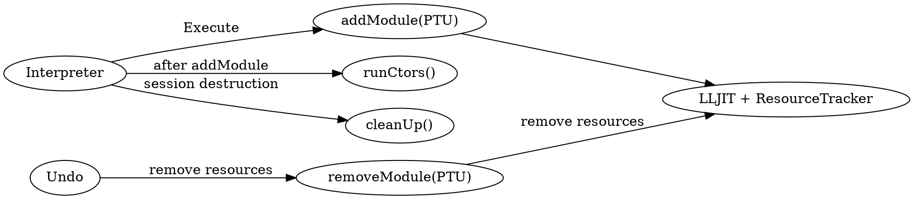

# Part 6 — Advanced JIT Customization

[← Part 5 — Values, Objects and Lifetimes](part_5_values_and_data.md) | [Part 7 — A Callable C++ Kernel →](part_7_capstone.md)

You can now change the execution machinery without changing the C++ language frontend. Work through one hook at a time: consumers, generated helpers, LLJIT configuration, object linking and executor control.



## Section 6.1 — Subclassing `Interpreter` with an `ASTConsumer`

Suppose your host wants to react whenever Clang finishes a declaration: record a new class, inspect a function or collect information from each input. An `ASTConsumer` provides callbacks at those points in compilation, so the host can observe what the parser produces.

Attach a consumer through an interpreter subclass and compare the same inputs with a session created by `Interpreter::create`. Watch when the callbacks run and what setup differs between the construction paths. That comparison matters because changing how the interpreter is constructed can also change services such as its runtime prelude and value printing.

The protected `Interpreter` constructor accepts an `ASTConsumer`, giving a subclass access to frontend callbacks. The subclass must provide an initially successful `llvm::Error` and handle the constructor's result explicitly.

<!-- runnable-example: 6.1 -->

`examples/p06_consumer.cpp`:

```cpp
#include <clang/AST/ASTConsumer.h>
#include <clang/AST/ASTContext.h>
#include <clang/AST/Decl.h>
#include <clang/Frontend/CompilerInstance.h>
#include <clang/Interpreter/Interpreter.h>
#include <clang/Interpreter/Value.h>
#include <cstdio>
#include <cstdlib>
#include <llvm/ADT/StringRef.h>
#include <llvm/Support/CommandLine.h>
#include <llvm/Support/Error.h>
#include <llvm/Support/TargetSelect.h>
#include <llvm/Support/raw_ostream.h>
#include <memory>
#include <string>
#include <utility>
#include <vector>

using namespace clang;

namespace {

// Logs what the parser produces. HandleTopLevelDecl runs once per top-level
// declaration group while an input is being parsed; HandleTranslationUnit once
// per input (the incremental parser ends every input like a tiny translation
// unit).
class LogConsumer : public ASTConsumer {
  unsigned &Input;

public:
  explicit LogConsumer(unsigned &Input) : Input(Input) {}

  // Clang calls this during parsing; a declaration group can contain several
  // declarations.
  bool HandleTopLevelDecl(DeclGroupRef DG) override {
    for (Decl *D : DG) {
      llvm::outs() << "  [consumer] input " << Input << ": "
                   << D->getDeclKindName();
      if (auto *ND = llvm::dyn_cast<NamedDecl>(D)) {
        llvm::outs() << " '" << ND->getQualifiedNameAsString() << "'";
      }
      llvm::outs() << "\n";
    }
    return true;
  }

  // This callback marks one incremental input ending, rather than the whole
  // session.
  void HandleTranslationUnit(ASTContext &) override {
    llvm::outs() << "  [consumer] input " << Input
                 << ": end of translation unit\n";
  }
};

// The protected constructor is only reachable from a subclass. It takes the
// executor builder (nullptr = default) and the consumer; it does NOT parse the
// runtime prelude that Interpreter::create() adds afterwards.
class LoggingInterpreter : public Interpreter {
public:
  LoggingInterpreter(std::unique_ptr<CompilerInstance> CI, llvm::Error &Err,
                     std::unique_ptr<ASTConsumer> C)
      : Interpreter(std::move(CI), Err, /*IEB=*/nullptr, std::move(C)) {}
};

} // namespace

// Keep inputs separate: each accepted input adds to the same compiler session.
const std::vector<std::string> SourceInputs = {
    R"cpp(
int a = 41;
)cpp",
    R"cpp(
int next() {
  return ++a;
}
)cpp",
    R"cpp(
struct S {
  int x;
};
)cpp",
    R"cpp(
next();
)cpp",
    R"cpp(
a
)cpp",
    R"cpp(
__CLANG_REPL__
)cpp",
};

int main(int argc, const char **argv) {
  // Register typed host options before parsing argv; Clang receives its own
  // flag list.
  llvm::cl::OptionCategory Options("JIT example options");

  llvm::cl::list<std::string> CompilerFlags(
      llvm::cl::Positional, llvm::cl::ZeroOrMore,
      llvm::cl::desc("<compiler flags after -->"), llvm::cl::cat(Options));
  llvm::cl::HideUnrelatedOptions(Options);
  // Fill the registered options; malformed host arguments stop before compiler
  // setup.
  if (!llvm::cl::ParseCommandLineOptions(argc, argv, "Clang JIT API example\n",
                                         &llvm::errs())) {
    return 2;
  }

  // Register LLVM's native target and assembly support for generated code.
  llvm::InitializeNativeTarget();
  llvm::InitializeNativeTargetAsmPrinter();
  llvm::InitializeNativeTargetAsmParser();
  std::setvbuf(stdout, nullptr, _IONBF, 0);
  llvm::outs().SetUnbuffered();

  std::vector<std::string> Inputs;
  for (const std::string &Code : SourceInputs) {
    if (!llvm::StringRef(Code).starts_with("//")) {
      Inputs.push_back(Code);
    }
  }

  // 1. The subclass. The consumer needs to know the input number, so the
  //    counter lives outside both.
  unsigned Input = 0;
  llvm::outs()
      << "== LoggingInterpreter (protected constructor + LogConsumer)\n";
  {
    std::vector<const char *> CompilerArguments;
    for (const std::string &Flag : CompilerFlags) {
      CompilerArguments.push_back(Flag.c_str());
    }
    clang::IncrementalCompilerBuilder CompilerBuilder;
    // Configure the embedded compiler, independently of the host build flags.
    // These argument strings must remain alive until CreateCpp() finishes.
    CompilerBuilder.SetCompilerArgs(CompilerArguments);

    // CreateCpp returns an owned CompilerInstance or an error inside Expected.
    auto CompilerOrError = CompilerBuilder.CreateCpp();
    // Extract the failed Expected with takeError(); logging consumes that
    // Error.
    if (!CompilerOrError) {
      llvm::logAllUnhandledErrors(CompilerOrError.takeError(), llvm::errs(),
                                  "error: ");
      return 1;
    }
    auto CI = std::move(*CompilerOrError);
    llvm::Error Err = llvm::Error::success();
    LoggingInterpreter I(std::move(CI), Err,
                         std::make_unique<LogConsumer>(Input));
    if (llvm::Error Error = std::move(Err)) {
      llvm::logAllUnhandledErrors(std::move(Error), llvm::errs(), "error: ");
      return 1;
    }

    for (const std::string &Code : Inputs) {
      ++Input;
      llvm::outs() << "input " << Input << ": " << Code << "\n";
      Value V;
      // Compile this input, then submit its module and run its initializers.
      if (llvm::Error Error = I.ParseAndExecute(Code, &V)) {
        llvm::logAllUnhandledErrors(std::move(Error), llvm::errs(), "error: ");
      }
      if (V.isValid()) {
        std::string ValueText;
        if (!V.isValid()) {
          ValueText = "<invalid Value>\n";
        } else {
          llvm::raw_string_ostream OutputForValueText(ValueText);
          V.print(OutputForValueText);
        }
        llvm::outs() << "  value: " << ValueText;
      }
    }

    unsigned Undone = 0;
    while (
        true) { // Undo returns an Error: success means "undid one more input"
      // Remove recent accepted inputs and their symbols; earlier writes and I/O
      // remain.
      if (llvm::Error E = I.Undo()) {
        llvm::consumeError(std::move(E));
        break;
      }
      ++Undone;
    }
    llvm::outs() << "undo: " << Undone
                 << " inputs undone, then \"No input left to undo\"\n";
  }

  // 2. The stock interpreter, same inputs, no consumer.
  llvm::outs()
      << "\n== Interpreter::create() (runtime prelude + value printing)\n";
  {
    std::vector<const char *> CompilerArguments2;
    for (const std::string &Flag : CompilerFlags) {
      CompilerArguments2.push_back(Flag.c_str());
    }
    clang::IncrementalCompilerBuilder CompilerBuilder2;
    CompilerBuilder2.SetCompilerArgs(CompilerArguments2);
    auto CompilerOrError2 = CompilerBuilder2.CreateCpp();
    if (!CompilerOrError2) {
      llvm::logAllUnhandledErrors(CompilerOrError2.takeError(), llvm::errs(),
                                  "compiler: ");
      return 1;
    }

    // Give the session the compiler and prepare its runtime prelude.
    auto InterpreterOrError =
        clang::Interpreter::create(std::move(*CompilerOrError2), nullptr);
    if (!InterpreterOrError) {
      llvm::logAllUnhandledErrors(InterpreterOrError.takeError(), llvm::errs(),
                                  "error: ");
      return 1;
    }
    auto I = std::move(*InterpreterOrError);
    unsigned N = 0;
    for (const std::string &Code : Inputs) {
      ++N;
      llvm::outs() << "input " << N << ": " << Code << "\n";
      if (llvm::Error Error = I->ParseAndExecute(Code)) {
        llvm::logAllUnhandledErrors(std::move(Error), llvm::errs(), "error: ");
      }
    }
    unsigned Undone = 0;
    while (true) {
      if (llvm::Error E = I->Undo()) {
        llvm::consumeError(std::move(E));
        break;
      }
      ++Undone;
    }
    llvm::outs() << "undo: " << Undone
                 << " inputs undone, then \"No input left to undo\"\n";
  }
  return 0;
}
```

Linux:

```bash
export LLVM="${LLVM:-$(llvm-config-22 --prefix)}"
mkdir -p out
"$LLVM/bin/clang++" $("$LLVM/bin/llvm-config" --cxxflags) -std=c++20 -pthread \
  examples/p06_consumer.cpp -L"$LLVM/lib" -Wl,-rpath,"$LLVM/lib" \
  -Wl,--export-dynamic -lclang-cpp -lLLVM -o out/p06_consumer
out/p06_consumer -- -std=c++20 -resource-dir "$("$LLVM/bin/clang++" -print-resource-dir)" --gcc-toolchain=/usr
```

macOS:

```bash
export LLVM="${LLVM:-$(brew --prefix llvm)}"
mkdir -p out
"$LLVM/bin/clang++" $("$LLVM/bin/llvm-config" --cxxflags) -std=c++20 -pthread \
  examples/p06_consumer.cpp -L"$LLVM/lib" -Wl,-rpath,"$LLVM/lib" \
  -lclang-cpp -lLLVM -o out/p06_consumer
out/p06_consumer -- -std=c++20 -resource-dir "$("$LLVM/bin/clang++" -print-resource-dir)" -nostdinc++ -isystem "$LLVM/include/c++/v1" -isysroot "$(xcrun --show-sdk-path)"
```

<!-- /runnable-example -->

| Parameter | Meaning |
|-----------|---------|
| `Instance` | the `CompilerInstance` from `IncrementalCompilerBuilder` (configured directly with `SetCompilerArgs` and `CreateCpp` below) |
| `Err` | an out-parameter, initialised to `Error::success()` by you, checked by you (an unchecked `Error` aborts) |
| `IEB` | how to build the executor; `nullptr` = the default in-process LLJIT (Sections 6.3 to 6.6) |
| `Consumer` | your `ASTConsumer`; `nullptr` = the interpreter's own value-printing consumer |

`HandleTopLevelDecl` receives declaration groups during parsing. `HandleTranslationUnit` marks the end of an input. A group can contain several declarations, so count its elements rather than assuming one callback means one variable.

Calling the constructor directly differs from `Interpreter::create`: the factory also installs the runtime prelude and marks its boundary for undo. Those private factory steps do not happen automatically in the subclass.

Inspect how the frontend combines consumers:

```bash
sed -n '/^IncrementalAction::CreateASTConsumer/,/^}/p' reference/clang-22.x/lib/Interpreter/IncrementalAction.cpp
```

```text expected
IncrementalAction::CreateASTConsumer(CompilerInstance & /*CI*/,
                                     StringRef InFile) {
  std::unique_ptr<ASTConsumer> C =
      WrapperFrontendAction::CreateASTConsumer(this->CI, InFile);

  if (Consumer) {
    std::vector<std::unique_ptr<ASTConsumer>> Cs;
    Cs.push_back(std::move(Consumer));
    Cs.push_back(std::move(C));
    return std::make_unique<MultiplexConsumer>(std::move(Cs));
  }

  return std::make_unique<InProcessPrintingASTConsumer>(std::move(C), Interp);
}
```

With a supplied consumer, `CreateASTConsumer` multiplexes it with CodeGen. Without one, the normal path adds `InProcessPrintingASTConsumer`, which rewrites semicolon-less expressions for capture. The custom-consumer path replaces that printing wrapper.

Compare the subclass and stock interpreter:

```bash
build/bin/p06_consumer manifests/p06_consumer.repl
```

```text expected
== LoggingInterpreter (protected constructor + LogConsumer)
  [consumer] input 0: end of translation unit
input 1: int a = 41;
  [consumer] input 1: Var 'a'
  [consumer] input 1: end of translation unit
input 2: int next() { return ++a; }
  [consumer] input 2: Function 'next'
  [consumer] input 2: end of translation unit
input 3: struct S { int x; };
  [consumer] input 3: CXXRecord 'S'
  [consumer] input 3: end of translation unit
input 4: next();
  [consumer] input 4: TopLevelStmt
  [consumer] input 4: end of translation unit
input 5: a
  [consumer] input 5: TopLevelStmt
  [consumer] input 5: end of translation unit
input 6: __CLANG_REPL__
In file included from <<< inputs >>>:1:
input_line_5:1:1: error: use of undeclared identifier '__CLANG_REPL__'
    1 | __CLANG_REPL__
      | ^~~~~~~~~~~~~~
  [consumer] input 6: TopLevelStmt
error: Parsing failed.
undo: 5 inputs undone, then "No input left to undo"

== Interpreter::create() (runtime prelude + value printing)
input 1: int a = 41;
input 2: int next() { return ++a; }
input 3: struct S { int x; };
input 4: next();
input 5: a
(int) 42
input 6: __CLANG_REPL__
(int) 1
undo: 6 inputs undone, then "No input left to undo"
```

The subclass logs variables, functions, records and top-level statements. A callback can occur before an input later fails, so its observation is not proof of acceptance. The subclass also has no captured result for `a` and no prelude definition of `__CLANG_REPL__`. The stock interpreter retains both.

For observation without replacing capture, a Clang plugin can add a consumer beside the normal one. The embedding host passes the plugin options and calls `CompilerInstance::LoadRequestedPlugins()` before transferring the compiler to `Interpreter::create`. On macOS:

```bash
mkdir -p out
$LLVM/bin/clang++ -std=c++17 -fno-rtti -fPIC -shared -I$LLVM/include -undefined dynamic_lookup \
  manifests/p02_plugin.cpp -o out/p06_printdecls.dylib
build/bin/p04_hello 'int a = 41;' 'struct S { int x; };' 'a' -- \
  -Xclang -load -Xclang out/p06_printdecls.dylib \
  -Xclang -add-plugin -Xclang print-decls
```

```text expected
[print-decls] CXXRecord '__clang_Interpreter_NewTag'
[print-decls] Var '__ci_newtag'
[print-decls] Function 'operator new'
[print-decls] FunctionTemplate '__clang_Interpreter_SetValueCopyArr'
[print-decls] FunctionTemplate '__clang_Interpreter_SetValueCopyArr'
[print-decls] LinkageSpec
[print-decls] LinkageSpec
input: int a = 41;
[print-decls] Var 'a'
input: struct S { int x; };
[print-decls] CXXRecord 'S'
input: a
[print-decls] TopLevelStmt
(int) 41
```

On Linux, link the plugin against the matching installation:

```bash
"$LLVM/bin/clang++" -std=c++17 -fno-rtti -fPIC -shared \
  -I"$LLVM/include" manifests/p02_plugin.cpp \
  -L"$LLVM/lib" -lclang-cpp -lLLVM -o out/p06_printdecls.so
build/bin/p04_hello 'int a = 41;' 'a' -- \
  -Xclang -load -Xclang out/p06_printdecls.so \
  -Xclang -add-plugin -Xclang print-decls
```

The plugin observes the prelude as well as user inputs, while the standard printing wrapper still captures expressions. A subclass instead gives the embedding application direct ownership of its extended interpreter interface.

Predict the log for two variables in one declaration group:

```bash
mkdir -p out
printf '%s\n' 'int a = 1, b = 2;' > out/p06_v1.repl
build/bin/p06_consumer out/p06_v1.repl | sed -n '/^input 1/,/^undo/{p;/^undo/q;}'
```

```text expected
input 1: int a = 1, b = 2;
  [consumer] input 1: Var 'a'
  [consumer] input 1: Var 'b'
  [consumer] input 1: end of translation unit
undo: 1 inputs undone, then "No input left to undo"
```

One group callback visits two `VarDecl`s, followed by one end-of-input callback.

> [!hint]- Where did expression capture disappear?
> Compare the two branches in `CreateASTConsumer`.

> [!success]- Follow the consumer chain
> The custom branch contains the supplied consumer and CodeGen, without the wrapper that creates capture calls. Adding an observer through a plugin preserves that wrapper.

Add a record, function and variable to a copied consumer fixture. Count functions in `HandleTopLevelDecl` and compare that count with end-of-input calls. Keep separate counts for observations and accepted inputs.

---

## Section 6.2 — Reflection-driven code injection

Imagine that every class submitted to the session should acquire a printer showing its field names and values. Clang already has the class declaration and its fields in the AST, so the host can use that information to generate another piece of C++.

Observe the completed class, build a printing function from its fields, then submit that generated source after the current input has finished. Follow those three stages separately. The exercise shows how compiler metadata can drive new code while keeping generation and compilation outside a callback that is still handling the original parse.

Use the callback to collect candidate records, then generate source only after the input has finished successfully. `HandleTagDeclDefinition` announces a completed body; `CXXRecordDecl::fields()` supplies its fields, types and access.

<!-- runnable-example: 6.2 -->

`examples/p06_inject.cpp`:

```cpp
#include <clang/AST/ASTConsumer.h>
#include <clang/AST/ASTContext.h>
#include <clang/AST/DeclCXX.h>
#include <clang/Frontend/CompilerInstance.h>
#include <clang/Interpreter/Interpreter.h>
#include <clang/Interpreter/Value.h>
#include <cstdio>
#include <cstdlib>
#include <llvm/ADT/StringRef.h>
#include <llvm/Support/CommandLine.h>
#include <llvm/Support/Error.h>
#include <llvm/Support/TargetSelect.h>
#include <llvm/Support/raw_ostream.h>
#include <memory>
#include <string>
#include <utility>
#include <vector>

using namespace clang;

namespace {

class RecordWatcher : public ASTConsumer {
public:
  Interpreter *Interp = nullptr; // for --unsafe only
  bool Unsafe = false;
  std::vector<const CXXRecordDecl *> Pending;

  // Called by the parser when a tag (struct/class/union/enum) definition is
  // complete. We are in the middle of parsing the user's input.
  void HandleTagDeclDefinition(TagDecl *D) override {
    auto *R = llvm::dyn_cast<CXXRecordDecl>(D);
    if (!R || R->isImplicit() || R->isLambda() || R->isUnion() ||
        R->getDescribedClassTemplate() || R->getDeclContext()->isRecord() ||
        R->getDeclContext()->isFunctionOrMethod() || R->getName().empty()) {
      return;
    }
    // Headers define classes too; only the ones typed at the prompt (memory
    // buffers named input_line_<N>) are interesting.
    const SourceManager &SM = R->getASTContext().getSourceManager();
    if (!llvm::StringRef(SM.getPresumedLoc(SM.getExpansionLoc(R->getLocation()))
                             .getFilename())
             .starts_with("input_line_")) {
      return;
    }
    llvm::outs() << "  [watch] saw class " << R->getQualifiedNameAsString()
                 << "\n";
    if (!Unsafe) {
      // Record the declaration only; starting another parse inside this
      // callback would re-enter Clang.
      Pending.push_back(R);
      return;
    }
    std::string Why;
    std::string PrinterSource;
    bool Supported = true;

    const ASTContext &Ctx = R->getASTContext();
    std::string Name = R->getQualifiedNameAsString();
    std::string Body = R"cpp(
  os << ")cpp" + Name + R"cpp({"
)cpp";
    bool First = true;
    // Use field declarations and access control to generate code that can
    // legally read the record.
    for (const FieldDecl *F : R->fields()) {
      if (F->getAccess() != AS_public) {
        Why = "field '" + F->getNameAsString() + "' is not public";
        Supported = false;
        break;
      }
      QualType T = F->getType().getCanonicalType();
      std::string Field = R"cpp(v.)cpp" + F->getNameAsString();
      std::string Value;
      if (T->isEnumeralType()) {
        Value = R"cpp(static_cast<long long>()cpp" + Field + R"cpp())cpp";
      } else if (T->isBooleanType()) {
        Value = R"cpp(()cpp" + Field + R"cpp( ? "true" : "false"))cpp";
      } else if (Ctx.getAsConstantArrayType(T)) {
        Value = R"cpp(
[&] {
  std::ostringstream text;
  const char *separator = "";
  text << "{";
  for (const auto &element : )cpp" +
                Field + R"cpp() {
    text << separator << element;
    separator = ", ";
  }
  text << "}";
  return text.str();
}()
)cpp";
      } else {
        Value = Field;
      }
      Body += std::string(R"cpp(
      << ")cpp") +
              (First ? "" : ", ") + F->getNameAsString() + R"cpp(=" << )cpp" +
              Value;
      First = false;
    }
    Body += R"cpp(
      << "}";
  return os;
)cpp";
    if (Supported) {
      PrinterSource = R"cpp(
std::ostream &operator<<(std::ostream &os, const )cpp" +
                      Name + R"cpp( &v) {
)cpp" + Body + R"cpp(
}
)cpp";
    }

    std::string Src = PrinterSource;
    llvm::outs() << "  [inject] (from inside the callback)\n";
    if (llvm::Error Error = Interp->ParseAndExecute(Src)) {
      llvm::logAllUnhandledErrors(std::move(Error), llvm::errs(), "error: ");
    } // re-enters the parser while it is parsing
  }
};

class WatchingInterpreter : public Interpreter {
public:
  WatchingInterpreter(std::unique_ptr<CompilerInstance> CI, llvm::Error &Err,
                      std::unique_ptr<ASTConsumer> C)
      : Interpreter(std::move(CI), Err, nullptr, std::move(C)) {}
};

} // namespace

// Keep inputs separate: each accepted input adds to the same compiler session.
const std::vector<std::string> SourceInputs = {
    R"cpp(
struct Point {
  int x, y;
};
)cpp",
    R"cpp(
std::cout << Point{3, 4} << "\n";
)cpp",
    R"cpp(
struct Person {
  std::string name;
  int age;
  bool admin;
  double score;
};
)cpp",
    R"cpp(
std::cout << Person{"Ada", 36, true, 9.5} << "\n";
)cpp",
    R"cpp(
enum class Color { Red, Green };
)cpp",
    R"cpp(
struct Pixel {
  Point at;
  Color color;
  int rgb[3];
};
)cpp",
    R"cpp(
std::cout << Pixel{{1, 2}, Color::Green, {255, 128, 0}} << "\n";
)cpp",
    R"cpp(
class Secret {
  int hidden = 1;

public:
  int shown = 2;
};
)cpp",
};

int main(int argc, const char **argv) {
  // Register typed host options before parsing argv; Clang receives its own
  // flag list.
  llvm::cl::OptionCategory Options("JIT example options");
  llvm::cl::opt<bool> Unsafe(
      "unsafe",
      llvm::cl::desc("Inject immediately inside the callback to demonstrate "
                     "reentrancy failure"),
      llvm::cl::cat(Options), llvm::cl::init(false));
  llvm::cl::list<std::string> CompilerFlags(
      llvm::cl::Positional, llvm::cl::ZeroOrMore,
      llvm::cl::desc("<compiler flags after -->"), llvm::cl::cat(Options));
  llvm::cl::HideUnrelatedOptions(Options);
  // Fill the registered options; malformed host arguments stop before compiler
  // setup.
  if (!llvm::cl::ParseCommandLineOptions(argc, argv, "Clang JIT API example\n",
                                         &llvm::errs())) {
    return 2;
  }

  // Register LLVM's native target and assembly support for generated code.
  llvm::InitializeNativeTarget();
  llvm::InitializeNativeTargetAsmPrinter();
  llvm::InitializeNativeTargetAsmParser();
  std::setvbuf(stdout, nullptr, _IONBF, 0);
  llvm::outs().SetUnbuffered();

  auto W = std::make_unique<RecordWatcher>();
  RecordWatcher *Watcher = W.get();
  Watcher->Unsafe = Unsafe;
  std::vector<const char *> CompilerArguments;
  for (const std::string &Flag : CompilerFlags) {
    CompilerArguments.push_back(Flag.c_str());
  }
  clang::IncrementalCompilerBuilder CompilerBuilder;
  // Configure the embedded compiler, independently of the host build flags.
  // These argument strings must remain alive until CreateCpp() finishes.
  CompilerBuilder.SetCompilerArgs(CompilerArguments);

  // CreateCpp returns an owned CompilerInstance or an error inside Expected.
  auto CompilerOrError = CompilerBuilder.CreateCpp();
  // Extract the failed Expected with takeError(); logging consumes that Error.
  if (!CompilerOrError) {
    llvm::logAllUnhandledErrors(CompilerOrError.takeError(), llvm::errs(),
                                "error: ");
    return 1;
  }
  auto CI = std::move(*CompilerOrError);
  llvm::Error Err = llvm::Error::success();
  // The protected constructor accepts this consumer but does not install the
  // factory runtime prelude.
  WatchingInterpreter I(std::move(CI), Err, std::move(W));
  if (llvm::Error Error = std::move(Err)) {
    llvm::logAllUnhandledErrors(std::move(Error), llvm::errs(), "error: ");
    return 1;
  }
  Watcher->Interp = &I;

  if (llvm::Error Error = I.ParseAndExecute(R"cpp(
#include <iostream>
)cpp")) {
    llvm::logAllUnhandledErrors(std::move(Error), llvm::errs(), "error: ");
  }
  if (llvm::Error Error = I.ParseAndExecute(R"cpp(
#include <sstream>
)cpp")) {
    llvm::logAllUnhandledErrors(std::move(Error), llvm::errs(), "error: ");
  }
  if (llvm::Error Error = I.ParseAndExecute(R"cpp(
#include <string>
)cpp")) {
    llvm::logAllUnhandledErrors(std::move(Error), llvm::errs(), "error: ");
  }

  {
    for (const std::string &Code : SourceInputs) {
      if (llvm::StringRef(Code).starts_with("//")) {
        continue;
      }
      llvm::outs() << "input: " << Code << "\n";
      llvm::Error InputError2 = I.ParseAndExecute(Code);
      bool InputAccepted1 = !InputError2;
      if (InputError2) {
        llvm::logAllUnhandledErrors(std::move(InputError2), llvm::errs(),
                                    "error: ");
      }
      // A rejected input invalidates its pending declarations; never generate
      // from those pointers.
      if (!InputAccepted1) {
        Watcher->Pending
            .clear(); // the input was rolled back: its classes do not exist
        continue;
      }

      // The input is finished: nothing is parsing, so injecting is safe now.
      std::vector<const CXXRecordDecl *> Todo;
      // The input has finished, so consume its accepted records before
      // submitting generated source.
      Todo.swap(Watcher->Pending);
      for (const CXXRecordDecl *R : Todo) {
        std::string Why;
        std::string PrinterSource2;
        bool Supported = true;

        const ASTContext &Ctx = R->getASTContext();
        std::string Name = R->getQualifiedNameAsString();
        std::string Body = R"cpp(
  os << ")cpp" + Name + R"cpp({"
)cpp";
        bool First = true;
        for (const FieldDecl *F : R->fields()) {
          if (F->getAccess() != AS_public) {
            Why = "field '" + F->getNameAsString() + "' is not public";
            Supported = false;
            break;
          }
          QualType T = F->getType().getCanonicalType();
          std::string Field = R"cpp(v.)cpp" + F->getNameAsString();
          std::string Value;
          if (T->isEnumeralType()) {
            Value = R"cpp(static_cast<long long>()cpp" + Field + R"cpp())cpp";
          } else if (T->isBooleanType()) {
            Value = R"cpp(()cpp" + Field + R"cpp( ? "true" : "false"))cpp";
          } else if (Ctx.getAsConstantArrayType(T)) {
            Value = R"cpp(
[&] {
  std::ostringstream text;
  const char *separator = "";
  text << "{";
  for (const auto &element : )cpp" +
                    Field + R"cpp() {
    text << separator << element;
    separator = ", ";
  }
  text << "}";
  return text.str();
}()
)cpp";
          } else {
            Value = Field;
          }
          Body += std::string(R"cpp(
      << ")cpp") + (First ? "" : ", ") +
                  F->getNameAsString() + R"cpp(=" << )cpp" + Value;
          First = false;
        }
        Body += R"cpp(
      << "}";
  return os;
)cpp";
        if (Supported) {
          PrinterSource2 = R"cpp(
std::ostream &operator<<(std::ostream &os, const )cpp" +
                           Name + R"cpp( &v) {
)cpp" + Body + R"cpp(
}
)cpp";
        }

        std::string Src = PrinterSource2;
        if (Src.empty()) {
          llvm::outs() << "  [inject] skipped " << R->getQualifiedNameAsString()
                       << ": " << Why << "\n";
          continue;
        }
        llvm::outs() << "  [inject] " << Src << "\n";
        // The generated operator is another C++ input and needs its own
        // compilation error handling.
        if (llvm::Error Error = I.ParseAndExecute(Src)) {
          llvm::logAllUnhandledErrors(std::move(Error), llvm::errs(),
                                      "error: ");
        }
      }
    }
  }
  return 0;
}
```

Linux:

```bash
export LLVM="${LLVM:-$(llvm-config-22 --prefix)}"
mkdir -p out
"$LLVM/bin/clang++" $("$LLVM/bin/llvm-config" --cxxflags) -std=c++20 -pthread \
  examples/p06_inject.cpp -L"$LLVM/lib" -Wl,-rpath,"$LLVM/lib" \
  -Wl,--export-dynamic -lclang-cpp -lLLVM -o out/p06_inject
out/p06_inject -- -std=c++20 -resource-dir "$("$LLVM/bin/clang++" -print-resource-dir)" --gcc-toolchain=/usr
```

macOS:

```bash
export LLVM="${LLVM:-$(brew --prefix llvm)}"
mkdir -p out
"$LLVM/bin/clang++" $("$LLVM/bin/llvm-config" --cxxflags) -std=c++20 -pthread \
  examples/p06_inject.cpp -L"$LLVM/lib" -Wl,-rpath,"$LLVM/lib" \
  -lclang-cpp -lLLVM -o out/p06_inject
out/p06_inject -- -std=c++20 -resource-dir "$("$LLVM/bin/clang++" -print-resource-dir)" -nostdinc++ -isystem "$LLVM/include/c++/v1" -isysroot "$(xcrun --show-sdk-path)"
```

<!-- /runnable-example -->

The generator builds an ordinary `operator<<` that names and streams public fields. It handles enums and arrays explicitly, and skips classes whose private data cannot be read by that free function. The host loop drains the pending records after `ParseAndExecute` returns.

Follow the order in the reference run:

```bash
build/bin/p06_inject manifests/p06_reflect.repl
```

```text expected
input: struct Point { int x, y; };
  [watch] saw class Point
  [inject] std::ostream &operator<<(std::ostream &os, const Point &v) { return os << "Point{" << "x=" << v.x << ", y=" << v.y << "}"; }
input: std::cout << Point{3, 4} << "\n";
Point{x=3, y=4}
input: struct Person { std::string name; int age; bool admin; double score; };
  [watch] saw class Person
  [inject] std::ostream &operator<<(std::ostream &os, const Person &v) { return os << "Person{" << "name=" << v.name << ", age=" << v.age << ", admin=" << (v.admin ? "true" : "false") << ", score=" << v.score << "}"; }
input: std::cout << Person{"Ada", 36, true, 9.5} << "\n";
Person{name=Ada, age=36, admin=true, score=9.5}
input: enum class Color { Red, Green };
input: struct Pixel { Point at; Color color; int rgb[3]; };
  [watch] saw class Pixel
  [inject] std::ostream &operator<<(std::ostream &os, const Pixel &v) { return os << "Pixel{" << "at=" << v.at << ", color=" << static_cast<long long>(v.color) << ", rgb=" << [&] { std::ostringstream t; const char *sep = ""; t << "{"; for (const auto &e : v.rgb) { t << sep << e; sep = ", "; } t << "}"; return t.str(); }() << "}"; }
input: std::cout << Pixel{{1, 2}, Color::Green, {255, 128, 0}} << "\n";
Pixel{at=Point{x=1, y=2}, color=1, rgb={255, 128, 0}}
input: class Secret { int hidden = 1; public: int shown = 2; };
  [watch] saw class Secret
  [inject] skipped Secret: field 'hidden' is not public
```

`Point`'s printer is available when the later `Pixel` printer is compiled, so the latter can stream its nested point. `Secret` is skipped instead of emitting an invalid private-field access. A printer generated after an input cannot help a stream expression earlier in that same input.

The optional unsafe mode injects source from inside the callback:

```bash
mkdir -p out
head -4 manifests/p06_reflect.repl > out/p06_unsafe.repl
build/bin/p06_inject --unsafe out/p06_unsafe.repl 2>&1 | head -9 | cut -c1-110
```

```text expected
input: struct Point { int x, y; };
  [watch] saw class Point
  [inject] (from inside the callback)
In file included from <<< inputs >>>:1:
input_line_4:1:125: error: expected ';' after struct
    1 | std::ostream &operator<<(std::ostream &os, const Point &v) { return os << "Point{" << "x=" << v.x << "
      |
      |
error: Parsing failed.
```

At that moment, the parser has not even consumed the record's closing semicolon. Starting another parse re-enters the active parser and preprocessor, so generated tokens arrive inside the unfinished declaration. Record observations in callbacks and act after parsing returns. Walking `PTU.TUPart` after `Parse` is another way to collect declarations while retaining the stock interpreter's capture behavior.

Generated C++ also needs ordinary error handling. Predict which printer fails when a public field itself has an unprintable type:

```bash
printf '%s\n' \
  'struct Window { int id; };' \
  'std::cout << Window{7} << "\n";' \
  'class Vault { int pin = 1; public: int open = 2; };' \
  'struct Door { int id; Vault v; };' \
  'struct Wall { int id; };' \
  'std::cout << Wall{8} << "\n";' > out/p06_v2.repl
build/bin/p06_inject out/p06_v2.repl 2>&1 | grep -E '^input|skipped|error:|^Wall|^Window' | cut -c1-120
```

```text expected
input: struct Window { int id; };
input: std::cout << Window{7} << "\n";
Window{id=7}
input: class Vault { int pin = 1; public: int open = 2; };
  [inject] skipped Vault: field 'pin' is not public
input: struct Door { int id; Vault v; };
input_line_8:1:109: error: invalid operands to binary expression ('basic_ostream<char, std::char_traits<char>>' and 'con
input_line_4:1:15: note: candidate function not viable: no known conversion from 'const Vault' to 'const Window' for 2nd
input_line_8:1:15: note: candidate function not viable: no known conversion from 'const Vault' to 'const Door' for 2nd a
error: Parsing failed.
input: struct Wall { int id; };
input: std::cout << Wall{8} << "\n";
Wall{id=8}
```

`Vault` is skipped, `Door`'s printer fails, and the later `Wall` succeeds in this ordering. Reversing the order exposes a less local failure:

```bash
printf '%s\n' \
  'class Vault { int pin = 1; public: int open = 2; };' \
  'struct Door { int id; Vault v; };' \
  'struct Window { int id; };' \
  'std::cout << Window{7} << "\n";' > out/p06_v2b.repl
build/bin/p06_inject out/p06_v2b.repl 2>&1 | grep -E 'JIT session|^Window' | cut -c1-70
```

```text expected
JIT session error: Symbols not found: [ __ZNSt3__1lsB9nqe220108INS_11c
```

In the recorded LLVM 22.1.8/libc++ setup, rolling back the failed input loses a deferred inline stream definition needed by later code. Re-including a guarded header does not recreate it. Validate generated code where practical, using a separate compiler with the required declarations, and rebuild the session when shared compiler state cannot recover reliably.

> [!hint]- When may the pending declaration pointers be used?
> A callback may have observed declarations from an input that later fails.

> [!success]- Follow acceptance and ownership
> Use them only after the defining input succeeds, and before undo or session replacement invalidates that input. Discard pending entries associated with rejected input rather than generating from stale declarations.

Add a public field in a copied reflection fixture and inspect the generated operator before its next use. Then change the generated formatting. Identify which behavior comes from the original record and which comes from source the host injected.

---

## Section 6.3 — A custom `LLJIT` builder

The interpreter's default JIT configuration handles ordinary compilation and linking for you. A host may eventually need more control: publishing a private callback, observing unresolved symbols or restoring debugger support around a customized setup.

Supply an `LLJITBuilder` and use its creation callback to reach the JIT being built. Explore the symbol-registration and lookup-tracing options, then follow how they affect a call from generated code. Notice which useful defaults you must provide explicitly once you take responsibility for constructing the JIT.

`IncrementalExecutorBuilder::JITBuilder` lets the host supply an `LLJITBuilder`. Its notify-created callback receives the constructed JIT before user inputs are compiled, making it a useful place to install symbols and generators.

<!-- runnable-example: 6.3 -->

`examples/p06_jit.cpp`:

```cpp
#include <algorithm>
#include <clang/Frontend/CompilerInstance.h>
#include <clang/Interpreter/Interpreter.h>
#include <clang/Interpreter/Value.h>
#include <cstdint>
#include <cstdio>
#include <cstdlib>
#include <llvm/ADT/StringRef.h>
#include <llvm/ExecutionEngine/Orc/AbsoluteSymbols.h>
#include <llvm/ExecutionEngine/Orc/Debugging/DebuggerSupport.h>
#include <llvm/ExecutionEngine/Orc/ExecutionUtils.h>
#include <llvm/ExecutionEngine/Orc/LLJIT.h>
#include <llvm/Support/CommandLine.h>
#include <llvm/Support/Error.h>
#include <llvm/Support/TargetSelect.h>
#include <llvm/Support/raw_ostream.h>
#include <memory>
#include <set>
#include <string>
#include <utility>
#include <vector>

using namespace clang;
using namespace llvm::orc;

// The GDB JIT interface: LLVM's debugger support appends one entry here for
// every JIT'd object it registers. Its head stays null if nobody registers.
struct jit_descriptor {
  uint32_t version, action_flag;
  void *relevant_entry, *first_entry;
};
extern "C" jit_descriptor __jit_debug_descriptor;

static int host_secret() { return 42; }

// An exported function, for contrast: no --abs needed.
extern "C" int host_exported() { return 7; }

namespace {

// Wraps another generator. tryToGenerate() is called with the set of symbols
// that no definition in the JITDylib satisfies; we log the names, then let the
// wrapped generator (the process-symbol search) have its turn.
class TraceGenerator : public DefinitionGenerator {
public:
  TraceGenerator(std::unique_ptr<DefinitionGenerator> Inner,
                 std::set<std::string> &Seen)
      : Inner(std::move(Inner)), Seen(Seen) {}

  llvm::Error tryToGenerate(LookupState &LS, LookupKind K, JITDylib &JD,
                            JITDylibLookupFlags Flags,
                            const SymbolLookupSet &Symbols) override {
    for (const auto &KV : Symbols) {
      Seen.insert((*KV.first).str());
    }
    return Inner->tryToGenerate(LS, K, JD, Flags, Symbols);
  }

private:
  std::unique_ptr<DefinitionGenerator> Inner;
  std::set<std::string> &Seen;
};

} // namespace

// Keep inputs separate: each accepted input adds to the same compiler session.
const std::vector<std::string> SourceInputs = {
    R"cpp(
#include <stdio.h>
)cpp",
    R"cpp(
extern "C" int host_exported();
)cpp",
    R"cpp(
extern "C" int host_secret();
)cpp",
    R"cpp(
printf("exported: %d\n", host_exported());
)cpp",
    R"cpp(
printf("secret: %d\n", host_secret());
)cpp",
};

int main(int argc, const char **argv) {
  // Register typed host options before parsing argv; Clang receives its own
  // flag list.
  llvm::cl::OptionCategory Options("JIT example options");
  llvm::cl::opt<bool> Abs(
      "abs", llvm::cl::desc("Publish host_secret as an absolute symbol"),
      llvm::cl::cat(Options), llvm::cl::init(false));
  llvm::cl::opt<bool> Trace("trace",
                            llvm::cl::desc("Trace unresolved symbol requests"),
                            llvm::cl::cat(Options), llvm::cl::init(false));
  llvm::cl::opt<bool> Debugger("debugger",
                               llvm::cl::desc("Enable debugger registration"),
                               llvm::cl::cat(Options), llvm::cl::init(false));
  llvm::cl::list<std::string> CompilerFlags(
      llvm::cl::Positional, llvm::cl::ZeroOrMore,
      llvm::cl::desc("<compiler flags after -->"), llvm::cl::cat(Options));
  llvm::cl::HideUnrelatedOptions(Options);
  // Fill the registered options; malformed host arguments stop before compiler
  // setup.
  if (!llvm::cl::ParseCommandLineOptions(argc, argv, "Clang JIT API example\n",
                                         &llvm::errs())) {
    return 2;
  }

  // Register LLVM's native target and assembly support for generated code.
  llvm::InitializeNativeTarget();
  llvm::InitializeNativeTargetAsmPrinter();
  llvm::InitializeNativeTargetAsmParser();
  std::setvbuf(stdout, nullptr, _IONBF, 0);
  llvm::outs().SetUnbuffered();

  LLJIT *JIT = nullptr;
  std::set<std::string> Seen;

  auto JB = std::make_unique<LLJITBuilder>();
  if (Debugger) {
    // A custom builder replaces defaults; register debugger support before
    // platform setup.
    JB->setPrePlatformSetup([](LLJIT &J) {
      consumeError(enableDebuggerSupport(J)); // what the default builder does
      return llvm::Error::success();
    });
  }
  // Called once the LLJIT exists, before the interpreter runs any code: the
  // only moment a plain LLJITBuilder lets you reach the LLJIT&.
  JB->setNotifyCreatedCallback([&](LLJIT &J) -> llvm::Error {
    JIT = &J;
    JITDylib &Main = J.getMainJITDylib();
    if (Abs) {
      SymbolMap M;
      // Intern the target's symbol spelling and associate it with this
      // process-local callable address.
      M[J.mangleAndIntern("host_secret")] = {
          ExecutorAddr::fromPtr(&host_secret),
          llvm::JITSymbolFlags::Exported | llvm::JITSymbolFlags::Callable};
      // Define the private callback directly in the main JITDylib so fallback
      // lookup is unnecessary.
      if (llvm::Error E = Main.define(absoluteSymbols(std::move(M)))) {
        return E;
      }
    }
    if (Trace) {
      // Fallback lookup searches exported symbols in the current process with
      // the target prefix.
      auto Process = DynamicLibrarySearchGenerator::GetForCurrentProcess(
          J.getDataLayout().getGlobalPrefix());
      if (!Process) {
        return Process.takeError();
      }
      Main.addGenerator(
          std::make_unique<TraceGenerator>(std::move(*Process), Seen));
    }
    return llvm::Error::success();
  });

  auto IEB = std::make_unique<IncrementalExecutorBuilder>();
  IEB->JITBuilder = std::move(JB);
  std::vector<const char *> CompilerArguments;
  for (const std::string &Flag : CompilerFlags) {
    CompilerArguments.push_back(Flag.c_str());
  }
  clang::IncrementalCompilerBuilder CompilerBuilder;
  // Configure the embedded compiler, independently of the host build flags.
  // These argument strings must remain alive until CreateCpp() finishes.
  CompilerBuilder.SetCompilerArgs(CompilerArguments);
  // CreateCpp returns an owned CompilerInstance or an error inside Expected.
  auto CompilerOrError = CompilerBuilder.CreateCpp();
  // Extract the failed Expected with takeError(); logging consumes that Error.
  if (!CompilerOrError) {
    llvm::logAllUnhandledErrors(CompilerOrError.takeError(), llvm::errs(),
                                "compiler: ");
    return 1;
  }

  // Give the session the compiler and prepare its runtime prelude.
  auto InterpreterOrError =
      clang::Interpreter::create(std::move(*CompilerOrError), std::move(IEB));
  if (!InterpreterOrError) {
    llvm::logAllUnhandledErrors(InterpreterOrError.takeError(), llvm::errs(),
                                "error: ");
    return 1;
  }
  std::unique_ptr<Interpreter> I = std::move(*InterpreterOrError);
  llvm::outs() << "LLJIT reached through the callback: " << (JIT ? "yes" : "no")
               << "\n";

  {
    for (const std::string &Code : SourceInputs) {
      if (llvm::StringRef(Code).starts_with("//")) {
        continue;
      }
      llvm::outs() << "input: " << Code << "\n";
      // Compile this input, then submit its module and run its initializers.
      if (llvm::Error Error = I->ParseAndExecute(Code)) {
        llvm::logAllUnhandledErrors(std::move(Error), llvm::errs(), "error: ");
      }
    }
  }

  llvm::outs() << "registered with debuggers (__jit_debug_descriptor): "
               << (__jit_debug_descriptor.first_entry ? "yes" : "no") << "\n";
  if (Trace) {
    llvm::outs() << "symbols the main JITDylib could not resolve itself:\n";
    for (const std::string &S : Seen) {
      llvm::outs() << "  " << S << "\n";
    }
  }
  return 0;
}
```

Linux:

```bash
export LLVM="${LLVM:-$(llvm-config-22 --prefix)}"
mkdir -p out
"$LLVM/bin/clang++" $("$LLVM/bin/llvm-config" --cxxflags) -std=c++20 -pthread \
  examples/p06_jit.cpp -L"$LLVM/lib" -Wl,-rpath,"$LLVM/lib" \
  -Wl,--export-dynamic -lclang-cpp -lLLVM -o out/p06_jit
out/p06_jit --abs --trace -- -std=c++20 -resource-dir "$("$LLVM/bin/clang++" -print-resource-dir)" --gcc-toolchain=/usr
```

macOS:

```bash
export LLVM="${LLVM:-$(brew --prefix llvm)}"
mkdir -p out
"$LLVM/bin/clang++" $("$LLVM/bin/llvm-config" --cxxflags) -std=c++20 -pthread \
  examples/p06_jit.cpp -L"$LLVM/lib" -Wl,-rpath,"$LLVM/lib" \
  -lclang-cpp -lLLVM -o out/p06_jit
out/p06_jit --abs --trace -- -std=c++20 -resource-dir "$("$LLVM/bin/clang++" -print-resource-dir)" -nostdinc++ -isystem "$LLVM/include/c++/v1" -isysroot "$(xcrun --show-sdk-path)"
```

<!-- /runnable-example -->

Begin with the reference run that has only process-export lookup:

```bash
build/bin/p06_jit manifests/p06_hostcall.repl 2>&1 | sed -E 's/\{ \(main, .*$/{ (main, ...) }/'
```

```text expected
LLJIT reached through the callback: yes
input: #include <stdio.h>
input: extern "C" int host_exported();
input: extern "C" int host_secret();
input: printf("exported: %d\n", host_exported());
exported: 7
input: printf("secret: %d\n", host_secret());
JIT session error: Symbols not found: [ _host_secret ]
error: Failed to materialize symbols: { (main, ...) }
registered with debuggers (__jit_debug_descriptor): no
```

The exported function resolves, but `host_secret` has internal linkage and cannot be found that way. Publish its address in the main `JITDylib` with `absoluteSymbols`:

```bash
build/bin/p06_jit --abs manifests/p06_hostcall.repl 2>&1
```

```text expected
LLJIT reached through the callback: yes
input: #include <stdio.h>
input: extern "C" int host_exported();
input: extern "C" int host_secret();
input: printf("exported: %d\n", host_exported());
exported: 7
input: printf("secret: %d\n", host_secret());
secret: 42
registered with debuggers (__jit_debug_descriptor): no
```

`mangleAndIntern` derives the target spelling and interns the symbol name. The registered callable address satisfies lookup before process search. A stateful callable still needs a suitable function interface or trampoline; an arbitrary captured lambda or C++ member pointer is not interchangeable with a plain function address.

A `DefinitionGenerator` can observe unresolved names and then delegate to the process-search generator:

```bash
build/bin/p06_jit --abs --trace manifests/p06_hostcall.repl 2>&1 | sed -n '/^symbols/,$p'
```

```text expected
symbols the main JITDylib could not resolve itself:
  _host_exported
  _printf
```

The explicit secret definition prevents that name from reaching the fallback. `printf` and the exported callback still need process lookup. This trace distinguishes a definition installed by the host from one discovered elsewhere.

A custom builder also replaces defaults. Inspect the standard construction path:

```bash
sed -n '/^createDefaultJITBuilder/,/^}/p' reference/clang-22.x/lib/Interpreter/IncrementalExecutor.cpp
```

```text expected
createDefaultJITBuilder(llvm::orc::JITTargetMachineBuilder JTMB) {
  auto JITBuilder = std::make_unique<llvm::orc::LLJITBuilder>();
  JITBuilder->setJITTargetMachineBuilder(std::move(JTMB));
  JITBuilder->setPrePlatformSetup([](llvm::orc::LLJIT &J) {
    // Try to enable debugging of JIT'd code (only works with JITLink for
    // ELF and MachO).
    consumeError(llvm::orc::enableDebuggerSupport(J));
    return llvm::Error::success();
  });
  return std::move(JITBuilder);
}
```

The default selects the target machine and enables debugger registration. A plain builder detects the host, which is appropriate only when generated code targets it. Cross-target configuration needs an appropriate `JITTargetMachineBuilder` and platform setup. Debugger support must also be restored explicitly; compile with debug information to make that registration useful:

```bash
for opt in "" "--debugger"; do
  echo "options: --abs $opt"
  build/bin/p06_jit --abs $opt manifests/p06_hostcall.repl -- -g 2>&1 | tail -1
done
```

```text expected
options: --abs
registered with debuggers (__jit_debug_descriptor): no
options: --abs --debugger
registered with debuggers (__jit_debug_descriptor): yes
```

The descriptor reports whether generated code was registered. Supplying `-g` creates debug information but does not by itself add the missing registration hook.

Predict the trace without an absolute definition:

```bash
build/bin/p06_jit --trace manifests/p06_hostcall.repl 2>&1 | sed -E 's/\{ \(main, .*$/{ (main, ...) }/' | sed -n '/^input: printf("secret/,$p'
```

```text expected
input: printf("secret: %d\n", host_secret());
JIT session error: Symbols not found: [ _host_secret ]
error: Failed to materialize symbols: { (main, ...) }
registered with debuggers (__jit_debug_descriptor): no
symbols the main JITDylib could not resolve itself:
  _host_exported
  _host_secret
  _printf
```

The private name now reaches the generator and still fails process lookup. Tracing reveals the missing definition; registering the address changes resolution.

> [!hint]- Where should host-defined absolute symbols go?
> Separate the JIT's definitions from its view of existing process symbols.

> [!success]- Follow the lookup namespace
> Install them in the main `JITDylib`. The process-symbols dylib represents non-JIT code discovered from the process; it is not the destination for generated definitions.

Register another callback in a copied example and compare the trace with `mangleAndIntern`'s spelling. Explain which defaults your builder preserves and which custom behavior it adds.

---

## Section 6.4 — Capturing object code

LLVM IR explains the compiler's intermediate work, but sometimes you need to inspect the actual object code prepared for linking. You might want to examine a generated function's instructions or see which symbols an object defines and which it still needs.

Use the object-linking layer's return-buffer callback to save those object files. Relate a captured object to the source input that produced it, inspect its symbols, and compare optimization settings. The callback gives you a concrete artifact to study at the boundary between code generation and runtime linking.

`ObjectLinkingLayer::setReturnObjectBuffer` receives an object's buffer after JITLink has finished using it. Install the hook through the JIT's creation callback:

<!-- runnable-example: 6.4 -->

`examples/p06_objects.cpp`:

```cpp
#include <algorithm>
#include <clang/Frontend/CompilerInstance.h>
#include <clang/Interpreter/Interpreter.h>
#include <clang/Interpreter/Value.h>
#include <cstdint>
#include <cstdio>
#include <cstdlib>
#include <llvm/ADT/StringRef.h>
#include <llvm/ExecutionEngine/Orc/LLJIT.h>
#include <llvm/ExecutionEngine/Orc/ObjectLinkingLayer.h>
#include <llvm/Object/ObjectFile.h>
#include <llvm/Support/CommandLine.h>
#include <llvm/Support/Error.h>
#include <llvm/Support/FileSystem.h>
#include <llvm/Support/MemoryBuffer.h>
#include <llvm/Support/Path.h>
#include <llvm/Support/TargetSelect.h>
#include <llvm/Support/raw_ostream.h>
#include <memory>
#include <mutex>
#include <string>
#include <utility>
#include <vector>

using namespace clang;
using namespace llvm::orc;

// Keep inputs separate: each accepted input adds to the same compiler session.
const std::vector<std::string> SourceInputs = {
    R"cpp(
int sum_to(int n) {
  int s = 0;
  for (int i = 1; i <= n; ++i)
    s += i * i;
  return s;
}
)cpp",
    R"cpp(
sum_to(10)
)cpp",
    R"cpp(
int twice(int v) {
  return 2 * v;
}
)cpp",
    R"cpp(
twice(sum_to(3))
)cpp",
};

int main(int argc, const char **argv) {
  // Register typed host options before parsing argv; Clang receives its own
  // flag list.
  llvm::cl::OptionCategory Options("JIT example options");
  llvm::cl::opt<std::string> OutDir(
      "output-dir", llvm::cl::desc("Directory for captured object files"),
      llvm::cl::cat(Options), llvm::cl::init("objects"));
  llvm::cl::list<std::string> CompilerFlags(
      llvm::cl::Positional, llvm::cl::ZeroOrMore,
      llvm::cl::desc("<compiler flags after -->"), llvm::cl::cat(Options));
  llvm::cl::HideUnrelatedOptions(Options);
  // Fill the registered options; malformed host arguments stop before compiler
  // setup.
  if (!llvm::cl::ParseCommandLineOptions(argc, argv, "Clang JIT API example\n",
                                         &llvm::errs())) {
    return 2;
  }

  // Register LLVM's native target and assembly support for generated code.
  llvm::InitializeNativeTarget();
  llvm::InitializeNativeTargetAsmPrinter();
  llvm::InitializeNativeTargetAsmParser();
  std::setvbuf(stdout, nullptr, _IONBF, 0);
  llvm::outs().SetUnbuffered();

  if (llvm::Error Error =
          llvm::errorCodeToError(llvm::sys::fs::create_directories(OutDir))) {
    llvm::logAllUnhandledErrors(std::move(Error), llvm::errs(), "error: ");
    return 1;
  }

  // Filled by the JIT. In-process, the callback has been observed on the
  // calling thread only; the mutex is defensive (other executors may return
  // buffers from worker threads). The order is what varies: one lookup can
  // materialize several lazy modules, in hash order, so each batch is sorted
  // before naming the files.
  std::vector<std::unique_ptr<llvm::MemoryBuffer>> Objs;
  std::mutex ObjsMutex;

  auto JB = std::make_unique<LLJITBuilder>();
  // Install the object-layer hook once the JIT exists, before input
  // materialization.
  JB->setNotifyCreatedCallback([&](LLJIT &J) -> llvm::Error {
    // On macOS and Linux the object layer is JITLink's ObjectLinkingLayer
    // (RuntimeDyld-based RTDyldObjectLinkingLayer has a different hook).
    auto *OL = llvm::dyn_cast<ObjectLinkingLayer>(&J.getObjLinkingLayer());
    if (!OL) {
      return llvm::make_error<llvm::StringError>(
          "not an ObjectLinkingLayer", llvm::inconvertibleErrorCode());
    }
    // JITLink returns the original object buffer after linking; executable
    // memory is separate.
    // Retain this buffer for symbol inspection or disassembly, not as a
    // callable address.
    OL->setReturnObjectBuffer([&](std::unique_ptr<llvm::MemoryBuffer> MB) {
      std::lock_guard<std::mutex> Lock(ObjsMutex);
      Objs.push_back(std::move(MB));
    });
    return llvm::Error::success();
  });
  auto IEB = std::make_unique<IncrementalExecutorBuilder>();
  IEB->JITBuilder = std::move(JB);
  std::vector<const char *> CompilerArguments;
  for (const std::string &Flag : CompilerFlags) {
    CompilerArguments.push_back(Flag.c_str());
  }
  clang::IncrementalCompilerBuilder CompilerBuilder;
  // Configure the embedded compiler, independently of the host build flags.
  // These argument strings must remain alive until CreateCpp() finishes.
  CompilerBuilder.SetCompilerArgs(CompilerArguments);
  // CreateCpp returns an owned CompilerInstance or an error inside Expected.
  auto CompilerOrError = CompilerBuilder.CreateCpp();
  // Extract the failed Expected with takeError(); logging consumes that Error.
  if (!CompilerOrError) {
    llvm::logAllUnhandledErrors(CompilerOrError.takeError(), llvm::errs(),
                                "compiler: ");
    return 1;
  }

  // Give the session the compiler and prepare its runtime prelude.
  auto InterpreterOrError =
      clang::Interpreter::create(std::move(*CompilerOrError), std::move(IEB));
  if (!InterpreterOrError) {
    llvm::logAllUnhandledErrors(InterpreterOrError.takeError(), llvm::errs(),
                                "error: ");
    return 1;
  }
  std::unique_ptr<Interpreter> I = std::move(*InterpreterOrError);

  // The external symbols an object defines (internal helpers hidden), sorted.

  size_t Written = 0;

  {

    std::lock_guard<std::mutex> Lock(ObjsMutex);
    // Objects with defined symbols first, by name; the rest (statement-only
    // modules) after them.
    std::stable_sort(
        Objs.begin() + Written, Objs.end(), [&](const auto &A, const auto &B) {
          std::vector<std::string> ObjectSymbols701;
          auto ObjectForObjectSymbols701 =
              llvm::object::ObjectFile::createObjectFile(
                  (*A).getMemBufferRef());
          if (!ObjectForObjectSymbols701) {
            llvm::logAllUnhandledErrors(ObjectForObjectSymbols701.takeError(),
                                        llvm::errs(), "object: ");
          } else {
            for (const llvm::object::SymbolRef &SymbolForObjectSymbols701 :
                 (*ObjectForObjectSymbols701)->symbols()) {
              auto FlagsForObjectSymbols701 =
                  SymbolForObjectSymbols701.getFlags();
              if (!FlagsForObjectSymbols701) {
                llvm::logAllUnhandledErrors(
                    FlagsForObjectSymbols701.takeError(), llvm::errs(),
                    "symbol: ");
                continue;
              }
              if (!(*FlagsForObjectSymbols701 &
                    llvm::object::SymbolRef::SF_Global) ||
                  (*FlagsForObjectSymbols701 &
                   llvm::object::SymbolRef::SF_Undefined)) {
                continue;
              }
              auto NameForObjectSymbols701 =
                  SymbolForObjectSymbols701.getName();
              if (!NameForObjectSymbols701) {
                llvm::logAllUnhandledErrors(NameForObjectSymbols701.takeError(),
                                            llvm::errs(), "symbol name: ");
                continue;
              }
              if (!NameForObjectSymbols701->starts_with("__GLOBAL__") &&
                  !NameForObjectSymbols701->starts_with("____orc")) {
                ObjectSymbols701.push_back(NameForObjectSymbols701->str());
              }
            }
          }
          llvm::sort(ObjectSymbols701);
          std::vector<std::string> ObjectSymbols702;
          auto ObjectForObjectSymbols702 =
              llvm::object::ObjectFile::createObjectFile(
                  (*B).getMemBufferRef());
          if (!ObjectForObjectSymbols702) {
            llvm::logAllUnhandledErrors(ObjectForObjectSymbols702.takeError(),
                                        llvm::errs(), "object: ");
          } else {
            for (const llvm::object::SymbolRef &SymbolForObjectSymbols702 :
                 (*ObjectForObjectSymbols702)->symbols()) {
              auto FlagsForObjectSymbols702 =
                  SymbolForObjectSymbols702.getFlags();
              if (!FlagsForObjectSymbols702) {
                llvm::logAllUnhandledErrors(
                    FlagsForObjectSymbols702.takeError(), llvm::errs(),
                    "symbol: ");
                continue;
              }
              if (!(*FlagsForObjectSymbols702 &
                    llvm::object::SymbolRef::SF_Global) ||
                  (*FlagsForObjectSymbols702 &
                   llvm::object::SymbolRef::SF_Undefined)) {
                continue;
              }
              auto NameForObjectSymbols702 =
                  SymbolForObjectSymbols702.getName();
              if (!NameForObjectSymbols702) {
                llvm::logAllUnhandledErrors(NameForObjectSymbols702.takeError(),
                                            llvm::errs(), "symbol name: ");
                continue;
              }
              if (!NameForObjectSymbols702->starts_with("__GLOBAL__") &&
                  !NameForObjectSymbols702->starts_with("____orc")) {
                ObjectSymbols702.push_back(NameForObjectSymbols702->str());
              }
            }
          }
          llvm::sort(ObjectSymbols702);
          auto DA = ObjectSymbols701, DB = ObjectSymbols702;
          if (DA.empty() != DB.empty()) {
            return DB.empty();
          }
          return DA < DB;
        });
    for (; Written < Objs.size(); ++Written) {
      llvm::SmallString<128> Path(OutDir);
      llvm::sys::path::append(Path,
                              llvm::formatv("{0:02}.o", Written + 1).str());
      std::error_code EC;
      llvm::raw_fd_ostream OS(Path, EC);
      if (EC) {
        if (llvm::Error Error = llvm::errorCodeToError(EC)) {
          llvm::logAllUnhandledErrors(std::move(Error), llvm::errs(),
                                      "error: ");
          return 1;
        }
      }
      OS << Objs[Written]->getBuffer();
      // Mach-O 64-bit magic, little endian: CF FA ED FE.
      bool MachO = Objs[Written]->getBuffer().take_front(4) ==
                   llvm::StringRef("\xcf\xfa\xed\xfe", 4);
      bool ELF =
          Objs[Written]->getBuffer().take_front(4) == llvm::StringRef("\x7f"
                                                                      "ELF",
                                                                      4);
      llvm::outs() << "  -> " << Path
                   << (MachO ? "  (Mach-O object)"
                       : ELF ? "  (ELF object)"
                             : "  (other object)")
                   << "\n";
      std::vector<std::string> ObjectSymbols703;
      auto ObjectForObjectSymbols703 =
          llvm::object::ObjectFile::createObjectFile(
              (*Objs[Written]).getMemBufferRef());
      if (!ObjectForObjectSymbols703) {
        llvm::logAllUnhandledErrors(ObjectForObjectSymbols703.takeError(),
                                    llvm::errs(), "object: ");
      } else {
        for (const llvm::object::SymbolRef &SymbolForObjectSymbols703 :
             (*ObjectForObjectSymbols703)->symbols()) {
          auto FlagsForObjectSymbols703 = SymbolForObjectSymbols703.getFlags();
          if (!FlagsForObjectSymbols703) {
            llvm::logAllUnhandledErrors(FlagsForObjectSymbols703.takeError(),
                                        llvm::errs(), "symbol: ");
            continue;
          }
          if (!(*FlagsForObjectSymbols703 &
                llvm::object::SymbolRef::SF_Global) ||
              (*FlagsForObjectSymbols703 &
               llvm::object::SymbolRef::SF_Undefined)) {
            continue;
          }
          auto NameForObjectSymbols703 = SymbolForObjectSymbols703.getName();
          if (!NameForObjectSymbols703) {
            llvm::logAllUnhandledErrors(NameForObjectSymbols703.takeError(),
                                        llvm::errs(), "symbol name: ");
            continue;
          }
          if (!NameForObjectSymbols703->starts_with("__GLOBAL__") &&
              !NameForObjectSymbols703->starts_with("____orc")) {
            ObjectSymbols703.push_back(NameForObjectSymbols703->str());
          }
        }
      }
      llvm::sort(ObjectSymbols703);
      for (const std::string &N : ObjectSymbols703) {
        llvm::outs() << "       defines " << N << "\n";
      }
    }

  } // objects produced while the interpreter started (the prelude)
  llvm::outs() << "objects after startup: " << Objs.size() << "\n";
  {
    for (const std::string &Code : SourceInputs) {
      if (llvm::StringRef(Code).starts_with("//")) {
        continue;
      }
      llvm::outs() << "input: " << Code << "\n";
      // Compile this input, then submit its module and run its initializers.
      if (llvm::Error Error = I->ParseAndExecute(Code)) {
        llvm::logAllUnhandledErrors(std::move(Error), llvm::errs(), "error: ");
      }
      {

        std::lock_guard<std::mutex> Lock(ObjsMutex);
        // Objects with defined symbols first, by name; the rest (statement-only
        // modules) after them.
        std::stable_sort(
            Objs.begin() + Written, Objs.end(),
            [&](const auto &A, const auto &B) {
              std::vector<std::string> ObjectSymbols704;
              auto ObjectForObjectSymbols704 =
                  llvm::object::ObjectFile::createObjectFile(
                      (*A).getMemBufferRef());
              if (!ObjectForObjectSymbols704) {
                llvm::logAllUnhandledErrors(
                    ObjectForObjectSymbols704.takeError(), llvm::errs(),
                    "object: ");
              } else {
                for (const llvm::object::SymbolRef &SymbolForObjectSymbols704 :
                     (*ObjectForObjectSymbols704)->symbols()) {
                  auto FlagsForObjectSymbols704 =
                      SymbolForObjectSymbols704.getFlags();
                  if (!FlagsForObjectSymbols704) {
                    llvm::logAllUnhandledErrors(
                        FlagsForObjectSymbols704.takeError(), llvm::errs(),
                        "symbol: ");
                    continue;
                  }
                  if (!(*FlagsForObjectSymbols704 &
                        llvm::object::SymbolRef::SF_Global) ||
                      (*FlagsForObjectSymbols704 &
                       llvm::object::SymbolRef::SF_Undefined)) {
                    continue;
                  }
                  auto NameForObjectSymbols704 =
                      SymbolForObjectSymbols704.getName();
                  if (!NameForObjectSymbols704) {
                    llvm::logAllUnhandledErrors(
                        NameForObjectSymbols704.takeError(), llvm::errs(),
                        "symbol name: ");
                    continue;
                  }
                  if (!NameForObjectSymbols704->starts_with("__GLOBAL__") &&
                      !NameForObjectSymbols704->starts_with("____orc")) {
                    ObjectSymbols704.push_back(NameForObjectSymbols704->str());
                  }
                }
              }
              llvm::sort(ObjectSymbols704);
              std::vector<std::string> ObjectSymbols705;
              auto ObjectForObjectSymbols705 =
                  llvm::object::ObjectFile::createObjectFile(
                      (*B).getMemBufferRef());
              if (!ObjectForObjectSymbols705) {
                llvm::logAllUnhandledErrors(
                    ObjectForObjectSymbols705.takeError(), llvm::errs(),
                    "object: ");
              } else {
                for (const llvm::object::SymbolRef &SymbolForObjectSymbols705 :
                     (*ObjectForObjectSymbols705)->symbols()) {
                  auto FlagsForObjectSymbols705 =
                      SymbolForObjectSymbols705.getFlags();
                  if (!FlagsForObjectSymbols705) {
                    llvm::logAllUnhandledErrors(
                        FlagsForObjectSymbols705.takeError(), llvm::errs(),
                        "symbol: ");
                    continue;
                  }
                  if (!(*FlagsForObjectSymbols705 &
                        llvm::object::SymbolRef::SF_Global) ||
                      (*FlagsForObjectSymbols705 &
                       llvm::object::SymbolRef::SF_Undefined)) {
                    continue;
                  }
                  auto NameForObjectSymbols705 =
                      SymbolForObjectSymbols705.getName();
                  if (!NameForObjectSymbols705) {
                    llvm::logAllUnhandledErrors(
                        NameForObjectSymbols705.takeError(), llvm::errs(),
                        "symbol name: ");
                    continue;
                  }
                  if (!NameForObjectSymbols705->starts_with("__GLOBAL__") &&
                      !NameForObjectSymbols705->starts_with("____orc")) {
                    ObjectSymbols705.push_back(NameForObjectSymbols705->str());
                  }
                }
              }
              llvm::sort(ObjectSymbols705);
              auto DA = ObjectSymbols704, DB = ObjectSymbols705;
              if (DA.empty() != DB.empty()) {
                return DB.empty();
              }
              return DA < DB;
            });
        for (; Written < Objs.size(); ++Written) {
          llvm::SmallString<128> Path(OutDir);
          llvm::sys::path::append(Path,
                                  llvm::formatv("{0:02}.o", Written + 1).str());
          std::error_code EC;
          llvm::raw_fd_ostream OS(Path, EC);
          if (EC) {
            if (llvm::Error Error = llvm::errorCodeToError(EC)) {
              llvm::logAllUnhandledErrors(std::move(Error), llvm::errs(),
                                          "error: ");
              return 1;
            }
          }
          OS << Objs[Written]->getBuffer();
          // Mach-O 64-bit magic, little endian: CF FA ED FE.
          bool MachO = Objs[Written]->getBuffer().take_front(4) ==
                       llvm::StringRef("\xcf\xfa\xed\xfe", 4);
          bool ELF =
              Objs[Written]->getBuffer().take_front(4) == llvm::StringRef("\x7f"
                                                                          "ELF",
                                                                          4);
          llvm::outs() << "  -> " << Path
                       << (MachO ? "  (Mach-O object)"
                           : ELF ? "  (ELF object)"
                                 : "  (other object)")
                       << "\n";
          std::vector<std::string> ObjectSymbols706;
          auto ObjectForObjectSymbols706 =
              llvm::object::ObjectFile::createObjectFile(
                  (*Objs[Written]).getMemBufferRef());
          if (!ObjectForObjectSymbols706) {
            llvm::logAllUnhandledErrors(ObjectForObjectSymbols706.takeError(),
                                        llvm::errs(), "object: ");
          } else {
            for (const llvm::object::SymbolRef &SymbolForObjectSymbols706 :
                 (*ObjectForObjectSymbols706)->symbols()) {
              auto FlagsForObjectSymbols706 =
                  SymbolForObjectSymbols706.getFlags();
              if (!FlagsForObjectSymbols706) {
                llvm::logAllUnhandledErrors(
                    FlagsForObjectSymbols706.takeError(), llvm::errs(),
                    "symbol: ");
                continue;
              }
              if (!(*FlagsForObjectSymbols706 &
                    llvm::object::SymbolRef::SF_Global) ||
                  (*FlagsForObjectSymbols706 &
                   llvm::object::SymbolRef::SF_Undefined)) {
                continue;
              }
              auto NameForObjectSymbols706 =
                  SymbolForObjectSymbols706.getName();
              if (!NameForObjectSymbols706) {
                llvm::logAllUnhandledErrors(NameForObjectSymbols706.takeError(),
                                            llvm::errs(), "symbol name: ");
                continue;
              }
              if (!NameForObjectSymbols706->starts_with("__GLOBAL__") &&
                  !NameForObjectSymbols706->starts_with("____orc")) {
                ObjectSymbols706.push_back(NameForObjectSymbols706->str());
              }
            }
          }
          llvm::sort(ObjectSymbols706);
          for (const std::string &N : ObjectSymbols706) {
            llvm::outs() << "       defines " << N << "\n";
          }
        }
      }
    }
  }
  return 0;
}
```

Linux:

```bash
export LLVM="${LLVM:-$(llvm-config-22 --prefix)}"
mkdir -p out
"$LLVM/bin/clang++" $("$LLVM/bin/llvm-config" --cxxflags) -std=c++20 -pthread \
  examples/p06_objects.cpp -L"$LLVM/lib" -Wl,-rpath,"$LLVM/lib" \
  -Wl,--export-dynamic -lclang-cpp -lLLVM -o out/p06_objects
out/p06_objects --output-dir=out/objects -- -std=c++20 -resource-dir "$("$LLVM/bin/clang++" -print-resource-dir)" --gcc-toolchain=/usr
```

macOS:

```bash
export LLVM="${LLVM:-$(brew --prefix llvm)}"
mkdir -p out
"$LLVM/bin/clang++" $("$LLVM/bin/llvm-config" --cxxflags) -std=c++20 -pthread \
  examples/p06_objects.cpp -L"$LLVM/lib" -Wl,-rpath,"$LLVM/lib" \
  -lclang-cpp -lLLVM -o out/p06_objects
out/p06_objects --output-dir=out/objects -- -std=c++20 -resource-dir "$("$LLVM/bin/clang++" -print-resource-dir)" -nostdinc++ -isystem "$LLVM/include/c++/v1" -isysroot "$(xcrun --show-sdk-path)"
```

<!-- /runnable-example -->

The cast establishes that the active layer is JITLink's `ObjectLinkingLayer`; another layer requires its own hook. The callback protects its collection because compilation can involve worker threads. One lookup can materialize several modules, so the tool sorts captured batches by defined symbol names before assigning filenames.

Watch when files appear:

```bash
build/bin/p06_objects out/p06_objs manifests/p06_objs.repl
```

```text expected
objects after startup: 0
input: int sum_to(int n) { int s = 0; for (int i = 1; i <= n; ++i) s += i * i; return s; }
input: sum_to(10)
(int) 385
  -> out/p06_objs/01.o  (Mach-O object)
       defines __Z6sum_toi
  -> out/p06_objs/02.o  (Mach-O object)
input: int twice(int v) { return 2 * v; }
input: twice(sum_to(3))
(int) 28
  -> out/p06_objs/03.o  (Mach-O object)
       defines __Z5twicei
  -> out/p06_objs/04.o  (Mach-O object)
```

Parsing `sum_to` creates IR, but its object appears when the later call needs it. The function and its caller can therefore produce objects during the same operation. This is ORC materialization: adding a module and compiling every function to machine code need not happen at the same moment.

Read the captured symbol tables:

```bash
$LLVM/bin/llvm-nm out/p06_objs/01.o
$LLVM/bin/llvm-nm -u out/p06_objs/02.o
```

```text expected
0000000000000000 T __Z6sum_toi
0000000000000000 t ltmp0
0000000000000058 s ltmp1
__Z6sum_toi
___clang_Interpreter_SetValueNoAlloc
```

The function object defines `sum_to`; the statement object refers to it and to capture support. The recorded files use Mach-O spelling, while Linux produces ELF. `llvm-nm` and `llvm-objdump` can inspect either target's corresponding objects.

Predict how optimization changes the function's machine instructions:

```bash
for opt in O0 O2; do
  build/bin/p06_objects out/p06_objs_$opt manifests/p06_objs.repl -- -$opt > /dev/null 2>&1
  f=out/p06_objs_$opt/01.o
  echo "-$opt: $($LLVM/bin/llvm-objdump -d --no-show-raw-insn $f | grep -cE '^ +[0-9a-f]+:') instructions," \
       "$($LLVM/bin/llvm-objdump -d --no-show-raw-insn $f | grep -cE '	(ldr|str)') loads/stores"
done
$LLVM/bin/llvm-objdump -d --no-show-raw-insn out/p06_objs_O2/01.o | sed -n '/^000/,$p'
```

```text expected
-O0: 21 instructions, 12 loads/stores
-O2: 17 instructions, 0 loads/stores
0000000000000000 <ltmp0>:
       0:      	subs	w8, w0, #0x1
       4:      	b.lt	0x3c <ltmp0+0x3c>
       8:      	sub	w9, w0, #0x2
       c:      	umull	x8, w8, w9
      10:      	sub	w9, w0, #0x3
      14:      	mul	w9, w8, w9
      18:      	lsr	w9, w9, #1
      1c:      	mov	w10, #0x5556            ; =21846
      20:      	movk	w10, #0x5555, lsl #16
      24:      	lsr	x8, x8, #1
      28:      	add	w8, w8, w8, lsl #2
      2c:      	madd	w8, w9, w10, w8
      30:      	add	w8, w8, w0, lsl #2
      34:      	sub	w0, w8, #0x3
      38:      	ret
      3c:      	mov	w0, #0x0                ; =0
      40:      	ret
```

In this recorded target's output, `-O2` eliminates the stack traffic and replaces the loop with arithmetic. The exact instruction counts describe this compilation. Follow the computation in disassembly rather than assuming those counts on another architecture.

Locate the separate leaf function:

```bash
$LLVM/bin/llvm-nm out/p06_objs/03.o
```

```text expected
0000000000000000 T __Z5twicei
0000000000000000 t ltmp0
0000000000000018 s ltmp1
```

`twice` defines a symbol without referencing another session function. Compare it with the caller object's undefined symbols to distinguish generated computation from linking dependencies.

> [!hint]- Why can the original object buffer be released after linking?
> The executable allocation and object file are different storage.

> [!success]- Follow the two copies
> JITLink has installed the relocated code in executable memory. The returned buffer remains an object file for inspection; it is not the memory being called and does not report the final live addresses.

Change one function in a copied fixture and capture into a new directory. Compare its symbols and disassembly with the first capture. Explain what an object cache would additionally need: dependency-aware keys and a reuse path, along with compiler state that these object files do not reconstruct.

---

## Section 6.5 — Writing your own `IncrementalExecutor`

The interpreter does not need to know every detail of the backend that executes its modules. It talks to an `IncrementalExecutor` interface for operations such as adding a module, running constructors, finding symbols and cleaning up.

Implement that interface around an `LLJIT` and log the requests as inputs are executed, undone and destroyed. Follow both the sequence of calls and the ownership of each module's LLVM context. This makes the compiler/executor boundary visible and shows what a different execution backend would have to supply.

Supply a custom `IncrementalExecutor` through its builder to take responsibility for module addition, initialization, lookup, removal and cleanup.

<!-- runnable-example: 6.5 -->

`examples/p06_executor.cpp`:

```cpp
#include <algorithm>
#include <clang/AST/ASTContext.h>
#include <clang/Basic/TargetInfo.h>
#include <clang/Frontend/CompilerInstance.h>
#include <clang/Interpreter/Interpreter.h>
#include <clang/Interpreter/PartialTranslationUnit.h>
#include <clang/Interpreter/Value.h>
#include <cstdio>
#include <cstdlib>
#include <llvm/ADT/SmallVector.h>
#include <llvm/ADT/StringRef.h>
#include <llvm/Bitcode/BitcodeReader.h>
#include <llvm/Bitcode/BitcodeWriter.h>
#include <llvm/ExecutionEngine/Orc/ExecutionUtils.h>
#include <llvm/ExecutionEngine/Orc/LLJIT.h>
#include <llvm/IR/Module.h>
#include <llvm/Support/CommandLine.h>
#include <llvm/Support/Error.h>
#include <llvm/Support/MemoryBuffer.h>
#include <llvm/Support/TargetSelect.h>
#include <llvm/Support/raw_ostream.h>
#include <memory>
#include <string>
#include <utility>
#include <vector>

using namespace clang;
using namespace llvm::orc;

namespace {

class LoggingExecutor : public IncrementalExecutor {
public:
  explicit LoggingExecutor(std::unique_ptr<LLJIT> J) : JIT(std::move(J)) {}

  // 1. A new module arrived: hand it to the JIT, remember its ResourceTracker.
  llvm::Error addModule(PartialTranslationUnit &PTU) override {
    llvm::Module &M = *PTU.TheModule;
    std::vector<std::string> Defined;
    for (llvm::Function &F : M) {
      if (!F.isDeclaration()) {
        Defined.push_back(F.getName().str());
      }
    }
    llvm::sort(Defined);
    llvm::outs() << "  [executor] addModule " << M.getName() << ": defines";
    for (const std::string &N : Defined) {
      llvm::outs() << " " << N;
    }
    llvm::outs() << "\n";

    // The round trip: bitcode out of the interpreter's context, into ours.
    llvm::SmallVector<char, 0> Bitcode;
    llvm::raw_svector_ostream OS(Bitcode);
    // Serialize before changing contexts: a Module cannot be paired with an
    // unrelated context lock.
    llvm::WriteBitcodeToFile(M, OS);
    auto Ctx = std::make_unique<llvm::LLVMContext>();
    auto Copy = llvm::parseBitcodeFile(
        llvm::MemoryBufferRef(llvm::StringRef(Bitcode.data(), Bitcode.size()),
                              M.getName()),
        *Ctx);
    if (!Copy) {
      return Copy.takeError();
    }
    PTU.TheModule.reset(); // like OrcIncrementalExecutor: the executor consumes
                           // the module

    // Track this input's allocations so Undo can remove the matching module
    // resources.
    ResourceTrackerSP RT = JIT->getMainJITDylib().createResourceTracker();
    Trackers[&PTU] = RT;
    // Transfer both the recreated module and its owning ThreadSafeContext into
    // LLJIT.
    return JIT->addIRModule(
        RT,
        ThreadSafeModule(std::move(*Copy), ThreadSafeContext(std::move(Ctx))));
  }

  // 2. Undo: drop everything the module defined.
  llvm::Error removeModule(PartialTranslationUnit &PTU) override {
    llvm::outs() << "  [executor] removeModule\n";
    auto It = Trackers.find(&PTU);
    if (It == Trackers.end()) {
      return llvm::Error::success();
    }
    ResourceTrackerSP RT = std::move(It->second);
    Trackers.erase(It);
    return RT->remove();
  }

  // 3. Run the static initializers of everything added so far.
  llvm::Error runCtors() const override {
    llvm::outs() << "  [executor] runCtors\n";
    return JIT->initialize(JIT->getMainJITDylib());
  }

  // 4. Shutdown: run the static destructors.
  llvm::Error cleanUp() override {
    llvm::outs() << "  [executor] cleanUp\n";
    return JIT->deinitialize(JIT->getMainJITDylib());
  }

  llvm::Expected<llvm::orc::ExecutorAddr>
  getSymbolAddress(llvm::StringRef Name, SymbolNameKind Kind) const override {
    llvm::outs() << "  [executor] getSymbolAddress " << Name << " ("
                 << (Kind == IRName ? "IRName" : "LinkerName") << ")\n";
    ExecutionSession &ES = JIT->getExecutionSession();
    auto SO = makeJITDylibSearchOrder({&JIT->getMainJITDylib(),
                                       JIT->getPlatformJITDylib().get(),
                                       JIT->getProcessSymbolsJITDylib().get()});
    // Search the selected dylibs; IR names need target mangling, linker names
    // are already spelled.
    auto Sym = ES.lookup(SO, Kind == LinkerName ? ES.intern(Name)
                                                : JIT->mangleAndIntern(Name));
    if (!Sym) {
      return Sym.takeError();
    }
    return Sym->getAddress();
  }

  // 5. Library loading: make the symbols of a shared library visible to JIT'd
  // code.
  llvm::Error LoadDynamicLibrary(const char *Name) override {
    llvm::outs() << "  [executor] LoadDynamicLibrary "
                 << llvm::sys::path::filename(Name) << "\n";
    auto Gen = DynamicLibrarySearchGenerator::Load(
        Name, JIT->getDataLayout().getGlobalPrefix());
    if (!Gen) {
      return Gen.takeError();
    }
    JIT->getProcessSymbolsJITDylib()->addGenerator(std::move(*Gen));
    return llvm::Error::success();
  }

private:
  std::unique_ptr<LLJIT> JIT;
  llvm::DenseMap<PartialTranslationUnit *, ResourceTrackerSP> Trackers;
};

} // namespace

// Keep inputs separate: each accepted input adds to the same compiler session.
const std::vector<std::string> SourceInputs = {
    R"cpp(
#include <stdio.h>
)cpp",
    R"cpp(
int answer() {
  return 42;
}
)cpp",
    R"cpp(
struct Bye {
  ~Bye() {
    printf("static destructor ran\n");
  }
} bye;
)cpp",
    R"cpp(
answer()
)cpp",
    R"cpp(
printf("still alive\n");
)cpp",
};

int main(int argc, const char **argv) {
  // Register typed host options before parsing argv; Clang receives its own
  // flag list.
  llvm::cl::OptionCategory Options("JIT example options");

  llvm::cl::list<std::string> CompilerFlags(
      llvm::cl::Positional, llvm::cl::ZeroOrMore,
      llvm::cl::desc("<compiler flags after -->"), llvm::cl::cat(Options));
  llvm::cl::HideUnrelatedOptions(Options);
  // Fill the registered options; malformed host arguments stop before compiler
  // setup.
  if (!llvm::cl::ParseCommandLineOptions(argc, argv, "Clang JIT API example\n",
                                         &llvm::errs())) {
    return 2;
  }

  // Register LLVM's native target and assembly support for generated code.
  llvm::InitializeNativeTarget();
  llvm::InitializeNativeTargetAsmPrinter();
  llvm::InitializeNativeTargetAsmParser();
  std::setvbuf(stdout, nullptr, _IONBF, 0);
  llvm::outs().SetUnbuffered();

  auto IEB = std::make_unique<IncrementalExecutorBuilder>();
  auto ExecutorOrError = LLJITBuilder().create();
  if (!ExecutorOrError) {
    llvm::logAllUnhandledErrors(ExecutorOrError.takeError(), llvm::errs(),
                                "error: ");
    return 1;
  }
  // Supply this executor implementation; the interpreter will invoke its six
  // virtual operations.
  IEB->IE = std::make_unique<LoggingExecutor>(std::move(*ExecutorOrError));

  llvm::outs() << "creating the interpreter (it runs the runtime prelude "
                  "through the executor)\n";
  std::vector<const char *> CompilerArguments;
  for (const std::string &Flag : CompilerFlags) {
    CompilerArguments.push_back(Flag.c_str());
  }
  clang::IncrementalCompilerBuilder CompilerBuilder;
  // Configure the embedded compiler, independently of the host build flags.
  // These argument strings must remain alive until CreateCpp() finishes.
  CompilerBuilder.SetCompilerArgs(CompilerArguments);
  // CreateCpp returns an owned CompilerInstance or an error inside Expected.
  auto CompilerOrError = CompilerBuilder.CreateCpp();
  // Extract the failed Expected with takeError(); logging consumes that Error.
  if (!CompilerOrError) {
    llvm::logAllUnhandledErrors(CompilerOrError.takeError(), llvm::errs(),
                                "compiler: ");
    return 1;
  }

  // Give the session the compiler and prepare its runtime prelude.
  auto InterpreterOrError =
      clang::Interpreter::create(std::move(*CompilerOrError), std::move(IEB));
  if (!InterpreterOrError) {
    llvm::logAllUnhandledErrors(InterpreterOrError.takeError(), llvm::errs(),
                                "error: ");
    return 1;
  }
  std::unique_ptr<Interpreter> I = std::move(*InterpreterOrError);

  {
    for (const std::string &Code : SourceInputs) {
      if (llvm::StringRef(Code).starts_with("//")) {
        continue;
      }
      llvm::outs() << "input: " << Code << "\n";
      // Compile this input, then submit its module and run its initializers.
      if (llvm::Error Error = I->ParseAndExecute(Code)) {
        llvm::logAllUnhandledErrors(std::move(Error), llvm::errs(), "error: ");
      }
    }
  }

  // Remove one accepted input through the API, without a command language.
  if (llvm::Error Error = I->ParseAndExecute(R"cpp(
int scratch = 1;
)cpp")) {
    llvm::logAllUnhandledErrors(std::move(Error), llvm::errs(), "error: ");
    return 1;
  }
  // Remove recent accepted inputs and their symbols; earlier writes and I/O
  // remain.
  if (llvm::Error Error = I->Undo()) {
    llvm::logAllUnhandledErrors(std::move(Error), llvm::errs(), "error: ");
    return 1;
  }

  std::string LinkerName;
  llvm::DataLayout TargetLayout(
      I->getASTContext().getTargetInfo().getDataLayoutString());
  if (char Prefix = TargetLayout.getGlobalPrefix()) {
    LinkerName += Prefix;
  }
  LinkerName += "_Z6answerv";
  for (auto [Name, Kind] :
       {std::pair<std::string, const char *>{"_Z6answerv", "IR name"},
        std::pair<std::string, const char *>{LinkerName, "linker name"}}) {
    llvm::outs() << "lookup by " << Kind << " " << Name << ":\n";
    auto Addr = Kind[0] == 'I'
                    ? I->getSymbolAddress(llvm::StringRef(Name))
                    : I->getSymbolAddressFromLinkerName(llvm::StringRef(Name));
    llvm::outs() << "  -> " << (Addr ? "found" : "not found") << "\n";
    if (!Addr) {
      llvm::consumeError(Addr.takeError());
    }
  }

  llvm::outs() << "destroying the interpreter\n";
  I.reset();
  llvm::outs() << "done\n";
  return 0;
}
```

Linux:

```bash
export LLVM="${LLVM:-$(llvm-config-22 --prefix)}"
mkdir -p out
"$LLVM/bin/clang++" $("$LLVM/bin/llvm-config" --cxxflags) -std=c++20 -pthread \
  examples/p06_executor.cpp -L"$LLVM/lib" -Wl,-rpath,"$LLVM/lib" \
  -Wl,--export-dynamic -lclang-cpp -lLLVM -o out/p06_executor
out/p06_executor -- -std=c++20 -resource-dir "$("$LLVM/bin/clang++" -print-resource-dir)" --gcc-toolchain=/usr
```

macOS:

```bash
export LLVM="${LLVM:-$(brew --prefix llvm)}"
mkdir -p out
"$LLVM/bin/clang++" $("$LLVM/bin/llvm-config" --cxxflags) -std=c++20 -pthread \
  examples/p06_executor.cpp -L"$LLVM/lib" -Wl,-rpath,"$LLVM/lib" \
  -lclang-cpp -lLLVM -o out/p06_executor
out/p06_executor -- -std=c++20 -resource-dir "$("$LLVM/bin/clang++" -print-resource-dir)" -nostdinc++ -isystem "$LLVM/include/c++/v1" -isysroot "$(xcrun --show-sdk-path)"
```

<!-- /runnable-example -->

| Virtual | Called by | What `LoggingExecutor` does |
|---------|-----------|------------------------------|
| `addModule(PTU)` | `Execute(PTU)` | takes `PTU.TheModule`, adds it to the JIT under a new `ResourceTracker` |
| `runCtors()` | `Execute(PTU)`, right after `addModule` | `JIT->initialize(MainJD)`: static initializers and the input's `__stmts__` code |
| `removeModule(PTU)` | `Undo` | `RT->remove()` for the tracker made in `addModule` |
| `cleanUp()` | `~Interpreter` | `JIT->deinitialize(MainJD)`: static destructors |
| `getSymbolAddress(name, kind)` | `Interpreter::getSymbolAddress*`, value printing | `ES.lookup` in main, platform and process dylibs |
| `LoadDynamicLibrary(path)` | `Interpreter::LoadDynamicLibrary` (`%lib`) | adds a `DynamicLibrarySearchGenerator` for the library |

Read `addModule` with ownership in mind. The incoming module belongs to the interpreter's LLVM context, but `ThreadSafeModule` also needs the matching `ThreadSafeContext`. That context is private in this version. The example serializes to bitcode and parses it into a context it owns, then adds the replacement module under a `ResourceTracker`.

This round trip has a per-input cost. Adding a compiled object directly would require preserving constructor and destructor handling that the demonstrated IR platform obtains by examining the module. The example keeps the IR path so initialization remains visible.

Follow the protocol log:

```bash
build/bin/p06_executor manifests/p06_protocol.repl 2>&1
```

```text expected
creating the interpreter (it runs the runtime prelude through the executor)
  [executor] addModule incr_module_0: defines
  [executor] runCtors
input: #include <stdio.h>
  [executor] addModule incr_module_1: defines
  [executor] runCtors
input: int answer() { return 42; }
  [executor] addModule incr_module_2: defines _Z6answerv
  [executor] runCtors
input: struct Bye { ~Bye() { printf("static destructor ran\n"); } } bye;
  [executor] addModule incr_module_3: defines _GLOBAL__sub_I_incr_module_3 _ZN3ByeD1Ev _ZN3ByeD2Ev __clang_call_terminate __cxx_global_var_init
  [executor] runCtors
input: answer()
  [executor] addModule incr_module_4: defines _GLOBAL__sub_I_incr_module_4 __stmts__0
  [executor] runCtors
(int) 42
input: int scratch = 1;
  [executor] addModule incr_module_5: defines
  [executor] runCtors
input: Undo()
  [executor] removeModule
input: printf("still alive\n");
  [executor] addModule incr_module_6: defines _GLOBAL__sub_I_incr_module_6 __stmts__0
  [executor] runCtors
still alive
lookup by IR name _Z6answerv:
  [executor] getSymbolAddress _Z6answerv (IRName)
  -> found
lookup by linker name __Z6answerv:
  [executor] getSymbolAddress __Z6answerv (LinkerName)
  -> found
destroying the interpreter
  [executor] cleanUp
static destructor ran
done
```

Creation already uses the executor for the runtime prelude. Each `Execute` calls `addModule` and then `runCtors`; adding the module alone does not run its top-level statements. A global with a destructor also emits initialization that registers later cleanup.

`Undo` reaches `removeModule`, where the corresponding tracker removes code. It does not automatically undo memory writes or safely retire every global object. Explicit lookup reaches `getSymbolAddress`, and interpreter destruction reaches `cleanUp`, which deinitializes the JIT before the executor disappears.

Predict the counts, including the prelude:

```bash
build/bin/p06_executor manifests/p06_protocol.repl 2>&1 | grep -oE 'addModule|runCtors|removeModule|cleanUp' | sort | uniq -c
```

```text expected
   7 addModule
   1 cleanUp
   1 removeModule
   7 runCtors
```

The seven executed modules give seven additions and seven constructor runs. The fixture performs one removal, and session destruction performs one cleanup. The lookup operations do not add modules.

> [!hint]- Why reset the original `PTU.TheModule` after transferring its content?
> The executor has already created its own context-owned module.

> [!success]- Follow module ownership
> Releasing the original avoids retaining a second IR copy for every input. The executor defines this ownership policy; retaining an inspection copy is possible but costs memory.

Add counters to a copied executor and submit a declaration, a call and an undo. Compare their effects with the callbacks, retaining the resource tracker and initialization logic rather than replacing those operations with log messages.

---

## Section 6.6 — Out-of-process execution from the API

So far the compiler host and generated code have shared one process. Running the generated code in a separate executor changes that relationship: the executor has its own memory, process identity and failure lifecycle, while the host retains the compiler session.

Configure a spawned executor and then connect to one that is already listening. Compare the host and executor identities, and trace which operations need communication between them. The crash experiment then follows what happens to the connection and cleanup when the executor disappears; a remote address cannot simply be used as a local host pointer.

The executor builder describes how to start or connect to the process that will own executable code:

| Field | Meaning |
|-------|---------|
| `IsOutOfProcess` | use a remote executor |
| `OOPExecutor` | path of `llvm-jitlink-executor`; the interpreter `fork()`s and `exec()`s it with a pair of pipes |
| `OOPExecutorConnect` | `host:port` of an executor that is already listening; no fork |
| `CustomizeFork` | a `std::function<void()>` run in the **child**, between `fork` and `exec` |
| `ExecutorPID` | filled in by the builder with the child's PID |
| `OrcRuntimePath` | the ORC runtime archive; set by `UpdateOrcRuntimePathCB`, which must run as the driver callback of the *compiler* builder (the example registers the callback directly on its compiler builder) |
| `UseSharedMemory`, `SlabAllocateSize` | shared-memory transport; availability depends on the platform and runtime setup |

The compiler builder's runtime-path callback locates the ORC runtime archive. On Ubuntu's LLVM 22 package layout, the example also checks `lib/clang/22/lib/linux/liborc_rt-<arch>.a`. An explicitly supplied runtime path takes precedence.

`CustomizeFork` redirects output in the child before `exec`; that interval permits only appropriate async-signal-safe operations. The generated code flushes its own output after execution begins.

<!-- runnable-example: 6.6 -->

`examples/p06_oop.cpp`:

```cpp
#include <cerrno>
#include <clang/Driver/Compilation.h>
#include <clang/Driver/Driver.h>
#include <clang/Driver/ToolChain.h>
#include <clang/Frontend/CompilerInstance.h>
#include <clang/Interpreter/Interpreter.h>
#include <clang/Interpreter/Value.h>
#include <csignal>
#include <cstdint>
#include <cstdio>
#include <cstdlib>
#include <fcntl.h>
#include <filesystem>
#include <functional>
#include <llvm/ADT/SmallVector.h>
#include <llvm/ADT/StringRef.h>
#include <llvm/ExecutionEngine/Orc/LLJIT.h>
#include <llvm/Support/CommandLine.h>
#include <llvm/Support/Error.h>
#include <llvm/Support/FileSystem.h>
#include <llvm/Support/MemoryBuffer.h>
#include <llvm/Support/TargetSelect.h>
#include <llvm/Support/raw_ostream.h>
#include <memory>
#include <netinet/in.h>
#include <optional>
#include <string>
#include <sys/socket.h>
#include <sys/wait.h>
#include <system_error>
#include <unistd.h>
#include <utility>
#include <vector>

#if defined(__linux__)

#include <atomic>
#include <cerrno>
#include <memory>

#include <sys/socket.h>
#include <unistd.h>

#include "llvm/ExecutionEngine/Orc/Shared/SimpleRemoteEPCUtils.h"

// LLVM 22 closes the socket while another thread is blocked in read(). Linux
// requires shutdown() to wake that reader before SimpleRemoteEPC waits for it.
// Compose the public transport API; keep a duplicate solely for shutdown so a
// descriptor closed internally by LLVM cannot be reused underneath this code.
class SocketTransport final : public llvm::orc::SimpleRemoteEPCTransport {
public:
  static llvm::Expected<std::unique_ptr<SocketTransport>>
  Create(llvm::orc::SimpleRemoteEPCTransportClient &Client, int FD) {
    int ShutdownFD = dup(FD);
    if (ShutdownFD < 0) {
      int Error = errno;
      close(FD);
      return llvm::errorCodeToError(
          std::error_code(Error, std::generic_category()));
    }
    // Wrap LLVM's FD transport while retaining a descriptor that can wake the
    // Linux reader.
    auto Inner = llvm::orc::FDSimpleRemoteEPCTransport::Create(Client, FD);
    if (!Inner) {
      close(ShutdownFD);
      close(FD);
      return Inner.takeError();
    }
    return std::make_unique<SocketTransport>(ShutdownFD, std::move(*Inner));
  }

  SocketTransport(
      int FD, std::unique_ptr<llvm::orc::FDSimpleRemoteEPCTransport> Transport)
      : ShutdownFD(FD), Inner(std::move(Transport)) {}

  ~SocketTransport() override { disconnect(); }

  llvm::Error start() override { return Inner->start(); }

  llvm::Error sendMessage(llvm::orc::SimpleRemoteEPCOpcode Op, uint64_t Seq,
                          llvm::orc::ExecutorAddr Tag,
                          llvm::ArrayRef<char> Args) override {
    return Inner->sendMessage(Op, Seq, Tag, Args);
  }

  void disconnect() override {
    if (!Disconnected.exchange(true)) {
      shutdown(ShutdownFD, SHUT_RDWR);
      close(ShutdownFD);
      Inner->disconnect();
    }
  }

private:
  int ShutdownFD;
  std::unique_ptr<llvm::orc::FDSimpleRemoteEPCTransport> Inner;
  std::atomic<bool> Disconnected{false};
};

#endif

#if defined(__linux__)
#include "llvm/ExecutionEngine/Orc/SimpleRemoteEPC.h"
#endif

using namespace clang;

static std::string ExecutorPath;
// Absolute, because the child and the doc commands must agree on the file.
static const char *ChildStdout = "executor_stdout.txt";

int main(int argc, const char **argv) {
  // Register typed host options before parsing argv; Clang receives its own
  // flag list.
  llvm::cl::OptionCategory Options("JIT example options");
  llvm::cl::opt<std::string> Mode(
      "mode", llvm::cl::desc("Executor demonstration: spawn, crash or connect"),
      llvm::cl::cat(Options), llvm::cl::Required);
  llvm::cl::opt<bool> Destroy(
      "destroy",
      llvm::cl::desc("Destroy the engine after the crash demonstration"),
      llvm::cl::cat(Options), llvm::cl::init(false));
  llvm::cl::list<std::string> CompilerFlags(
      llvm::cl::Positional, llvm::cl::ZeroOrMore,
      llvm::cl::desc("<compiler flags after -->"), llvm::cl::cat(Options));
  llvm::cl::HideUnrelatedOptions(Options);
  // Fill the registered options; malformed host arguments stop before compiler
  // setup.
  if (!llvm::cl::ParseCommandLineOptions(argc, argv, "Clang JIT API example\n",
                                         &llvm::errs())) {
    return 2;
  }

  // Register LLVM's native target and assembly support for generated code.
  llvm::InitializeNativeTarget();
  llvm::InitializeNativeTargetAsmPrinter();
  llvm::InitializeNativeTargetAsmParser();
  std::setvbuf(stdout, nullptr, _IONBF, 0);
  llvm::outs().SetUnbuffered();
  const char *Prefix = std::getenv("LLVM");
  if (!Prefix) {
    llvm::errs() << "Set LLVM to the LLVM 22 installation prefix.\n";
    return 2;
  }
  ExecutorPath = std::string(Prefix) + "/bin/llvm-jitlink-executor";
  if (Mode == "spawn") {
    {

      auto ExecutorOptions = std::make_unique<IncrementalExecutorBuilder>();
      // Keep Clang in the host and place generated code in an executor with a
      // separate address space.
      ExecutorOptions->IsOutOfProcess = true;
      ExecutorOptions->OOPExecutor = ExecutorPath;
      // This callback runs between fork and exec: restrict it to
      // async-signal-safe operations.
      ExecutorOptions->CustomizeFork = [] {
        int FD = open(ChildStdout, O_WRONLY | O_CREAT | O_TRUNC, 0644);
        if (FD >= 0) {
          dup2(FD, STDOUT_FILENO);
          close(FD);
        }
      };

      std::vector<const char *> CompilerArguments;
      for (const std::string &Flag : (CompilerFlags)) {
        CompilerArguments.push_back(Flag.c_str());
      }
      clang::IncrementalCompilerBuilder CompilerBuilder;
      // Configure the embedded compiler, independently of the host build flags.
      // These argument strings must remain alive until CreateCpp() finishes.
      CompilerBuilder.SetCompilerArgs(CompilerArguments);
      if (ExecutorOptions && ExecutorOptions->IsOutOfProcess &&
          ExecutorOptions->OrcRuntimePath.empty()) {
        // Inspect Clang's selected toolchain while building its invocation to
        // locate the ORC runtime.
        CompilerBuilder.SetDriverCompilationCallback(
            [Executor = ExecutorOptions.get()](
                const clang::driver::Compilation &C) -> llvm::Error {
              llvm::Error E = Executor->UpdateOrcRuntimePathCB(C);
              if (!E) {
                return llvm::Error::success();
              }
              const auto &TC = C.getDefaultToolChain();
              // Ubuntu's compiler-rt package uses lib/linux/liborc_rt-<arch>.a,
              // while LLVM 22's discovery can look in a target-triple
              // directory.
              if (TC.getTriple().isOSLinux()) {
                const std::string Arch = TC.getArchName().str();
                for (const std::string &Name :
                     {"liborc_rt-" + Arch + ".a",
                      "libclang_rt.orc_rt-" + Arch + ".a"}) {
                  auto Path = std::filesystem::path(C.getDriver().ResourceDir) /
                              "lib" / "linux" / Name;
                  std::error_code EC;
                  if (std::filesystem::is_regular_file(Path, EC)) {
                    llvm::consumeError(std::move(E));
                    Executor->OrcRuntimePath = Path.string();
                    return llvm::Error::success();
                  }
                }
              }
              return E;
            });
      }
      // CreateCpp returns an owned CompilerInstance or an error inside
      // Expected.
      auto CompilerOrError = CompilerBuilder.CreateCpp();
      // Extract the failed Expected with takeError(); logging consumes that
      // Error.
      if (!CompilerOrError) {
        llvm::logAllUnhandledErrors(CompilerOrError.takeError(), llvm::errs(),
                                    "compiler: ");
        return 1;
      }

      // Give the session the compiler and prepare its runtime prelude.
      auto InterpreterOrError = clang::Interpreter::create(
          std::move(*CompilerOrError), std::move(ExecutorOptions));
      if (!InterpreterOrError) {
        llvm::logAllUnhandledErrors(InterpreterOrError.takeError(),
                                    llvm::errs(), "error: ");
        return 1;
      }
      std::unique_ptr<Interpreter> I = std::move(*InterpreterOrError);
      uint32_t PID = I->getIncrementalExecutorBuilder().ExecutorPID;
      llvm::outs() << "ExecutorPID != host pid: "
                   << (PID != 0 && PID != uint32_t(getpid()) ? "yes" : "no")
                   << "\n";
      {
        auto &&IArgument = (*I);
        auto &&ExecutorPIDArgument = (PID);

        // Compile this input, then submit its module and run its initializers.
        if (llvm::Error Error = (IArgument).ParseAndExecute(R"cpp(
#include <stdio.h>
)cpp")) {
          llvm::logAllUnhandledErrors(std::move(Error), llvm::errs(),
                                      "error: ");
        }
        if (llvm::Error Error = (IArgument).ParseAndExecute(R"cpp(
#include <unistd.h>
)cpp")) {
          llvm::logAllUnhandledErrors(std::move(Error), llvm::errs(),
                                      "error: ");
        }
        if (llvm::Error Error = (IArgument).ParseAndExecute(
                R"cpp(
printf("hello from the JIT\n");
printf("pid %d\n", (int)getpid());
fflush(stdout);
)cpp")) {
          llvm::logAllUnhandledErrors(std::move(Error), llvm::errs(),
                                      "error: ");
        }
        std::string ExecutorOutput;
        auto Buffer = llvm::MemoryBuffer::getFile((ChildStdout));
        ExecutorOutput = Buffer ? (*Buffer)->getBuffer().str() : std::string();
        std::string Out = ExecutorOutput;
        llvm::outs() << "child stdout file:\n";
        int Pid = 0;
        llvm::SmallVector<llvm::StringRef, 4> Lines;
        llvm::StringRef(Out).split(Lines, '\n', -1, false);
        for (llvm::StringRef L : Lines) {
          if (L.starts_with("pid ")) {
            L.drop_front(4).getAsInteger(10, Pid);
            llvm::outs() << "  pid <number>\n";
          } else {
            llvm::outs() << "  " << L << "\n";
          }
        }
        llvm::outs() << "JIT pid == ExecutorPID: "
                     << (uint32_t(Pid) == ExecutorPIDArgument ? "yes" : "no")
                     << "\n";
        llvm::outs() << "JIT pid != host pid:    "
                     << (Pid != getpid() ? "yes" : "no") << "\n";
      }

      llvm::outs() << "value printing:\n";
      Value V;
      if (llvm::Error E = I->ParseAndExecute(R"cpp(
6 * 7
)cpp",
                                             &V)) {
        llvm::outs() << "  error: " << (llvm::toString((std::move(E)))) << "\n";
      }
      llvm::outs() << "  V.isValid(): " << (V.isValid() ? "yes" : "no") << "\n";
      llvm::outs() << "plain statements still work:\n";
      if (llvm::Error Error = I->ParseAndExecute(
              R"cpp(
printf("after the failed expression\n");
fflush(stdout);
)cpp")) {
        llvm::logAllUnhandledErrors(std::move(Error), llvm::errs(), "error: ");
      }
      std::string ExecutorOutput2;
      auto Buffer = llvm::MemoryBuffer::getFile((ChildStdout));
      ExecutorOutput2 = Buffer ? (*Buffer)->getBuffer().str() : std::string();
      std::string Out = ExecutorOutput2;
      size_t At = Out.rfind("after");
      llvm::outs() << "  "
                   << (At == std::string::npos ? "(nothing)\n"
                                               : Out.substr(At));
      return 0;
    }
  }
  if (Mode == "crash") {
    {

      auto ExecutorOptions2 = std::make_unique<IncrementalExecutorBuilder>();
      ExecutorOptions2->IsOutOfProcess = true;
      ExecutorOptions2->OOPExecutor = ExecutorPath;
      ExecutorOptions2->CustomizeFork = [] {
        int FD = open(ChildStdout, O_WRONLY | O_CREAT | O_TRUNC, 0644);
        if (FD >= 0) {
          dup2(FD, STDOUT_FILENO);
          close(FD);
        }
      };

      std::vector<const char *> CompilerArguments2;
      for (const std::string &Flag : (CompilerFlags)) {
        CompilerArguments2.push_back(Flag.c_str());
      }
      clang::IncrementalCompilerBuilder CompilerBuilder2;
      CompilerBuilder2.SetCompilerArgs(CompilerArguments2);
      if (ExecutorOptions2 && ExecutorOptions2->IsOutOfProcess &&
          ExecutorOptions2->OrcRuntimePath.empty()) {
        CompilerBuilder2.SetDriverCompilationCallback(
            [Executor = ExecutorOptions2.get()](
                const clang::driver::Compilation &C) -> llvm::Error {
              llvm::Error E = Executor->UpdateOrcRuntimePathCB(C);
              if (!E) {
                return llvm::Error::success();
              }
              const auto &TC = C.getDefaultToolChain();
              // Ubuntu's compiler-rt package uses lib/linux/liborc_rt-<arch>.a,
              // while LLVM 22's discovery can look in a target-triple
              // directory.
              if (TC.getTriple().isOSLinux()) {
                const std::string Arch = TC.getArchName().str();
                for (const std::string &Name :
                     {"liborc_rt-" + Arch + ".a",
                      "libclang_rt.orc_rt-" + Arch + ".a"}) {
                  auto Path = std::filesystem::path(C.getDriver().ResourceDir) /
                              "lib" / "linux" / Name;
                  std::error_code EC;
                  if (std::filesystem::is_regular_file(Path, EC)) {
                    llvm::consumeError(std::move(E));
                    Executor->OrcRuntimePath = Path.string();
                    return llvm::Error::success();
                  }
                }
              }
              return E;
            });
      }
      auto CompilerOrError2 = CompilerBuilder2.CreateCpp();
      if (!CompilerOrError2) {
        llvm::logAllUnhandledErrors(CompilerOrError2.takeError(), llvm::errs(),
                                    "compiler: ");
        return 1;
      }

      auto InterpreterOrError2 = clang::Interpreter::create(
          std::move(*CompilerOrError2), std::move(ExecutorOptions2));
      if (!InterpreterOrError2) {
        llvm::logAllUnhandledErrors(InterpreterOrError2.takeError(),
                                    llvm::errs(), "error: ");
        return 1;
      }
      std::unique_ptr<Interpreter> I = std::move(*InterpreterOrError2);
      uint32_t PID = I->getIncrementalExecutorBuilder().ExecutorPID;
      if (llvm::Error Error = I->ParseAndExecute(R"cpp(
#include <stdio.h>
)cpp")) {
        llvm::logAllUnhandledErrors(std::move(Error), llvm::errs(), "error: ");
      }

      llvm::outs() << "input 1: a null write in JIT code\n";
      if (llvm::Error E = I->ParseAndExecute(R"cpp(
*(volatile int *)0 = 1;
)cpp")) {
        llvm::outs() << "  ParseAndExecute -> error: "
                     << (llvm::toString((std::move(E)))) << "\n";
      }

      // Bounded wait: if the executor somehow survived, do not block forever.
      int Status = 0;
      pid_t R = 0;
      for (int Try = 0; Try < 100 && R == 0; ++Try) {
        R = waitpid(PID, &Status, WNOHANG);
        if (R == 0) {
          usleep(20000);
        }
      }
      if (R == 0) {
        kill(PID, SIGKILL);
        R = waitpid(PID, &Status, 0);
      }
      llvm::outs() << "host: still running, executor reaped: "
                   << (R == pid_t(PID) ? "yes" : "no") << "\n";
      if (R == pid_t(PID) && WIFSIGNALED(Status)) {
        llvm::outs() << "executor died from signal " << WTERMSIG(Status)
                     << " (SIGSEGV is " << SIGSEGV << ")\n";
      }

      llvm::outs() << "input 2: a harmless statement\n";
      if (llvm::Error E = I->ParseAndExecute(R"cpp(
printf("anyone there?\n");
)cpp")) {
        llvm::outs() << "  ParseAndExecute -> error: "
                     << (llvm::toString((std::move(E)))) << "\n";
      } else {
        llvm::outs() << "  ParseAndExecute -> ok\n";
      }

      // ~Interpreter() calls IncrementalExecutor::cleanUp(), which has to talk
      // to the dead executor; the failure is report_fatal_error() (an abort).
      // The default is to leak the interpreter: the process is about to exit
      // anyway.
      if (Destroy) {
        llvm::outs() << "destroying the interpreter\n";
        I.reset();
      } else {
        llvm::outs() << "leaking the interpreter on purpose: its destructor "
                        "would abort\n";
        (void)I.release();
      }
      return 0;
    }
  }
  if (Mode == "connect") {
    {

      int PortNumber = 0;

      int S = socket(AF_INET, SOCK_STREAM, 0);
      sockaddr_in A{};
      A.sin_family = AF_INET;
      A.sin_addr.s_addr = htonl(INADDR_LOOPBACK);
      socklen_t Len = sizeof A;

      if (S >= 0 && bind(S, (sockaddr *)&A, sizeof A) == 0 &&
          getsockname(S, (sockaddr *)&A, &Len) == 0) {
        PortNumber = ntohs(A.sin_port);
      }
      if (S >= 0) {
        close(S);
      }

      int Port = PortNumber;
      std::string Addr = "127.0.0.1:" + std::to_string(Port);
      std::string Spec = "listen=" + Addr;

      // Start the executor ourselves and send its stdout to a file.
      pid_t Child = fork();
      if (Child == 0) {
        {

          int FD = open(ChildStdout, O_WRONLY | O_CREAT | O_TRUNC, 0644);
          if (FD >= 0) {
            dup2(FD, STDOUT_FILENO);
            close(FD);
          }
        }
        execl(ExecutorPath.c_str(), ExecutorPath.c_str(), Spec.c_str(),
              (char *)nullptr);
        _exit(127);
      }
      llvm::outs() << "executor started on a free localhost port\n";

      // The executor needs a moment before it listens: retry the attach. (A
      // probe connection would use up the executor's single accept(), so the
      // retry is the real attach.)
      llvm::Expected<std::unique_ptr<Interpreter>> IOrErr =
          llvm::make_error<llvm::StringError>("not tried", std::error_code());
      for (int Try = 0; Try < 100; ++Try) {
        llvm::consumeError(IOrErr.takeError());
        auto IEB = std::make_unique<IncrementalExecutorBuilder>();
        IEB->IsOutOfProcess = true;
        // Attach to the listening executor instead of spawning it; its
        // addresses remain remote.
        IEB->OOPExecutorConnect = Addr; // note: OOPExecutor stays empty
        // Validate the compiler before opening the remote transport.
        std::vector<const char *> CompilerArguments3;
        for (const std::string &Flag : (CompilerFlags)) {
          CompilerArguments3.push_back(Flag.c_str());
        }
        clang::IncrementalCompilerBuilder CompilerBuilder3;
        CompilerBuilder3.SetCompilerArgs(CompilerArguments3);
        if (IEB && IEB->IsOutOfProcess && IEB->OrcRuntimePath.empty()) {
          CompilerBuilder3.SetDriverCompilationCallback(
              [Executor = IEB.get()](
                  const clang::driver::Compilation &C) -> llvm::Error {
                llvm::Error E = Executor->UpdateOrcRuntimePathCB(C);
                if (!E) {
                  return llvm::Error::success();
                }
                const auto &TC = C.getDefaultToolChain();
                // Ubuntu's compiler-rt package uses
                // lib/linux/liborc_rt-<arch>.a, while LLVM 22's discovery can
                // look in a target-triple directory.
                if (TC.getTriple().isOSLinux()) {
                  const std::string Arch = TC.getArchName().str();
                  for (const std::string &Name :
                       {"liborc_rt-" + Arch + ".a",
                        "libclang_rt.orc_rt-" + Arch + ".a"}) {
                    auto Path =
                        std::filesystem::path(C.getDriver().ResourceDir) /
                        "lib" / "linux" / Name;
                    std::error_code EC;
                    if (std::filesystem::is_regular_file(Path, EC)) {
                      llvm::consumeError(std::move(E));
                      Executor->OrcRuntimePath = Path.string();
                      return llvm::Error::success();
                    }
                  }
                }
                return E;
              });
        }
        auto CompilerOrError3 = CompilerBuilder3.CreateCpp();
        if (!CompilerOrError3) {
          IOrErr = CompilerOrError3.takeError();
          break;
        }

#if defined(__linux__)
        // Use a socket-aware transport on LLVM 22/Linux. The default FD
        // transport closes a descriptor without waking its blocking reader
        // during teardown.
        int FD = socket(AF_INET, SOCK_STREAM, 0);
        sockaddr_in Endpoint{};
        Endpoint.sin_family = AF_INET;
        Endpoint.sin_addr.s_addr = htonl(INADDR_LOOPBACK);
        Endpoint.sin_port = htons(Port);
        if (FD < 0 || connect(FD, reinterpret_cast<sockaddr *>(&Endpoint),
                              sizeof Endpoint) != 0) {
          int Error = errno;
          if (FD >= 0) {
            close(FD);
          }
          IOrErr = llvm::errorCodeToError(
              std::error_code(Error, std::generic_category()));
          usleep(20000);
          continue;
        }
        auto Control = llvm::orc::SimpleRemoteEPC::Create<SocketTransport>(
            std::make_unique<llvm::orc::DynamicThreadPoolTaskDispatcher>(
                std::nullopt),
            llvm::orc::SimpleRemoteEPC::Setup{}, FD);
        if (!Control) {
          IOrErr = Control.takeError();
          break;
        }
        auto Builder = std::make_unique<llvm::orc::LLJITBuilder>();
        Builder->setExecutorProcessControl(std::move(*Control));
        Builder->setPlatformSetUp([Config = IEB.get()](llvm::orc::LLJIT &J) {
          return llvm::orc::ExecutorNativePlatform(Config->OrcRuntimePath)(J);
        });
        IEB->ExecutorPID =
            uint32_t(-1); // connecting does not tell us the remote PID
        IEB->JITBuilder = std::move(Builder);
#endif
        IOrErr = clang::Interpreter::create(std::move(*CompilerOrError3),
                                            std::move(IEB));
        if (IOrErr) {
          break;
        }
        usleep(20000);
      }
      if (!IOrErr) {
        llvm::outs() << "attach failed: "
                     << (llvm::toString((IOrErr.takeError()))) << "\n";
        kill(Child, SIGKILL);
        waitpid(Child, nullptr, 0);
        return 1;
      }
      std::unique_ptr<Interpreter> I = std::move(*IOrErr);
      llvm::outs() << "attached via OOPExecutorConnect\n";
      // No fork happened; the builder leaves ExecutorPID at (uint32_t)-1.
      llvm::outs() << "ExecutorPID is (uint32_t)-1: "
                   << (I->getIncrementalExecutorBuilder().ExecutorPID ==
                               uint32_t(-1)
                           ? "yes"
                           : "no")
                   << "\n";
      if (llvm::Error Error = I->ParseAndExecute(R"cpp(
#include <stdio.h>
)cpp")) {
        llvm::logAllUnhandledErrors(std::move(Error), llvm::errs(), "error: ");
      }
      if (llvm::Error Error = I->ParseAndExecute(R"cpp(
#include <unistd.h>
)cpp")) {
        llvm::logAllUnhandledErrors(std::move(Error), llvm::errs(), "error: ");
      }
      if (llvm::Error Error = I->ParseAndExecute(
              R"cpp(
printf("hello over TCP\n");
printf("pid %d\n", (int)getpid());
fflush(stdout);
)cpp")) {
        llvm::logAllUnhandledErrors(std::move(Error), llvm::errs(), "error: ");
      }
      std::string ExecutorOutput3;
      auto Buffer = llvm::MemoryBuffer::getFile((ChildStdout));
      ExecutorOutput3 = Buffer ? (*Buffer)->getBuffer().str() : std::string();
      std::string Out = ExecutorOutput3;
      int Pid = 0;
      llvm::SmallVector<llvm::StringRef, 4> Lines;
      llvm::StringRef(Out).split(Lines, '\n', -1, false);
      llvm::outs() << "remote executor stdout file:\n";
      for (llvm::StringRef L : Lines) {
        if (L.starts_with("pid ")) {
          L.drop_front(4).getAsInteger(10, Pid);
          llvm::outs() << "  pid <number>\n";
        } else {
          llvm::outs() << "  " << L << "\n";
        }
      }
      llvm::outs() << "JIT pid == the executor we started: "
                   << (Pid == Child ? "yes" : "no") << "\n";
      llvm::outs() << "JIT pid != host pid:                "
                   << (Pid != getpid() ? "yes" : "no") << "\n";

      I.reset(); // cleanUp() over the socket, then the connection closes
      int Status = 0;
      // The executor exits when its client disconnects; if not, make sure it
      // does.
      if (waitpid(Child, &Status, WNOHANG) == 0) {
        kill(Child, SIGTERM);
        waitpid(Child, &Status, 0);
      }
      return 0;
    }
  }
  llvm::errs() << "usage: p06_oop --mode=spawn|crash|connect\n";
  return 2;
}
```

Linux:

```bash
export LLVM="${LLVM:-$(llvm-config-22 --prefix)}"
mkdir -p out
"$LLVM/bin/clang++" $("$LLVM/bin/llvm-config" --cxxflags) -std=c++20 -pthread \
  examples/p06_oop.cpp -L"$LLVM/lib" -Wl,-rpath,"$LLVM/lib" \
  -Wl,--export-dynamic -lclang-cpp -lLLVM -o out/p06_oop
out/p06_oop --mode=spawn -- -std=c++20 -resource-dir "$("$LLVM/bin/clang++" -print-resource-dir)" --gcc-toolchain=/usr
out/p06_oop --mode=connect -- -std=c++20 -resource-dir "$("$LLVM/bin/clang++" -print-resource-dir)" --gcc-toolchain=/usr
```

macOS:

```bash
export LLVM="${LLVM:-$(brew --prefix llvm)}"
mkdir -p out
"$LLVM/bin/clang++" $("$LLVM/bin/llvm-config" --cxxflags) -std=c++20 -pthread \
  examples/p06_oop.cpp -L"$LLVM/lib" -Wl,-rpath,"$LLVM/lib" \
  -lclang-cpp -lLLVM -o out/p06_oop
out/p06_oop --mode=spawn -- -std=c++20 -resource-dir "$("$LLVM/bin/clang++" -print-resource-dir)" -nostdinc++ -isystem "$LLVM/include/c++/v1" -isysroot "$(xcrun --show-sdk-path)"
out/p06_oop --mode=connect -- -std=c++20 -resource-dir "$("$LLVM/bin/clang++" -print-resource-dir)" -nostdinc++ -isystem "$LLVM/include/c++/v1" -isysroot "$(xcrun --show-sdk-path)"
```

<!-- /runnable-example -->

Compare the process identities and output destination:

```bash
build/bin/p06_oop spawn 2>&1
```

```text expected
ExecutorPID != host pid: yes
child stdout file:
  hello from the JIT
  pid <number>
JIT pid == ExecutorPID: yes
JIT pid != host pid:    yes
value printing:
JIT session error: Symbols not found: [ ___clang_Interpreter_SetValueNoAlloc ]
  error: dlupdate failed
  V.isValid(): no
plain statements still work:
  after the failed expression
```

The JIT's `getpid()` returns the executor's PID, and its output arrives in the child file. An `ExecutorAddr` names storage in that process; casting it to a host pointer cannot make the address local.

The captured expression fails because `__clang_Interpreter_SetValueNoAlloc` lives in the host, while the executor lacks that capture support. LLVM 22.1.8's remote path can run these declarations and statements but cannot return Values through the in-process capture mechanism. The following plain statement still works, showing that this failure did not itself kill the executor.

The crash mode exercises a different boundary:

```bash
build/bin/p06_oop crash 2>&1
```

```text expected
input 1: a null write in JIT code
  ParseAndExecute -> error: disconnecting
host: still running, executor reaped: yes
executor died from signal 11 (SIGSEGV is 11)
input 2: a harmless statement
JIT session error: FD-transport disconnected
  ParseAndExecute -> error: disconnecting
leaking the interpreter on purpose: its destructor would abort
```

The null write kills the executor and disconnects the session. The host receives an error and can inspect the child status, but the same interpreter cannot execute another input. Continuing requires a new session.

Cleanup also needs a live executor:

```bash
build/bin/p06_oop crash destroy 2>&1 | tail -2
echo "exit status: ${PIPESTATUS[0]}"
```

```text expected
JIT session error: FD-transport disconnected
LLVM ERROR: Failed to clean up IncrementalExecutor: disconnecting
exit status: 134
```

In this version, destroying the interpreter after disconnection can abort the host when cleanup fails. The diagnostic tool's process-exit path deliberately releases ownership; a longer-lived application needs an explicit failure and teardown policy. The protected `ResetExecutor()` used by an interpreter subclass can avoid calling a dead executor. A separate process provides a failure boundary, but does not by itself restrict filesystem or network access.

Connection mode attaches over TCP instead of forking. On Linux, the source's `SocketTransport` composes the public transport interface and calls `shutdown` before close, waking a reader that could otherwise remain blocked during teardown. The macOS branch uses the default transport.

```bash
build/bin/p06_oop connect 2>&1
```

```text expected
executor started on a free localhost port
attached via OOPExecutorConnect
ExecutorPID is (uint32_t)-1: yes
remote executor stdout file:
  hello over TCP
  pid <number>
JIT pid == the executor we started: yes
JIT pid != host pid:                yes
```

The reference tool starts a listener and retries the actual attachment until it is ready. A probe connection would consume this single-connection executor. Since the builder did not spawn it, `ExecutorPID` remains its sentinel value rather than identifying the listener. Using another machine also requires a compatible target and runtime setup; host addresses cannot cross that connection.

Predict which lines were printed by the executor, then inspect its file:

```bash
build/bin/p06_oop spawn > /dev/null 2>&1; sed 's/[0-9][0-9]*$/<number>/' out/p06_child_stdout.txt
```

```text expected
hello from the JIT
pid <number>
after the failed expression
```

The statement after the unsupported capture still printed there, confirming where that work executed.

> [!hint]- Which process exits if generated code calls `exit(3)`?
> Follow where that native call executes.

> [!success]- Follow the process boundary
> In-process execution exits the host. Remote execution exits the executor, disconnecting its interpreter; host survival still depends on handling the broken session's cleanup correctly.

Run the standalone spawn and connect paths and follow their shutdown. Locate where child output is flushed and where addresses remain executor-local. Keep deliberate crash experiments in their separate invocations.

---

## Section 6.7 — Eval-style programming: JIT code calls the interpreter

Generated code can call a host callback, and that callback may itself ask the interpreter to compile more source. This makes it possible for a running C++ function to construct another function and request its compilation during execution.

Follow such a request back through `ParseAndExecute`, then find and call the function it created. Compare immediate compilation with placing the request in a queue for the host to process later. The timing matters: the interpreter may be executing user code, handling a compiler callback or tearing down, and those states do not permit the same kinds of re-entry.

The host publishes callbacks that submit source and resolve a name through the live interpreter. Generated code can call those callbacks using the same host integration as Part 3.

<!-- runnable-example: 6.7 -->

`examples/p06_eval.cpp`:

```cpp
#include <clang/Frontend/CompilerInstance.h>
#include <clang/Interpreter/Interpreter.h>
#include <clang/Interpreter/Value.h>
#include <cstdio>
#include <cstdlib>
#include <llvm/ADT/StringRef.h>
#include <llvm/Support/CommandLine.h>
#include <llvm/Support/Error.h>
#include <llvm/Support/TargetSelect.h>
#include <llvm/Support/raw_ostream.h>
#include <memory>
#include <string>
#include <utility>
#include <vector>

using namespace clang;

static Interpreter *Live = nullptr;
static std::vector<std::string> Deferred;
static int Depth = 0;

extern "C" int evaluateSource(const char *Code) {
  ++Depth;
  llvm::outs() << "  [host] evaluateSource (depth " << Depth << "): " << Code
               << "\n";
  // Re-enter only from the demonstrated execution phase, after the outer parse
  // has finished.
  // The same interpreter cannot be parsed concurrently or used during its
  // teardown.
  llvm::Error InputError2 = Live->ParseAndExecute(Code);
  bool InputAccepted1 = !InputError2;
  if (InputError2) {
    llvm::logAllUnhandledErrors(std::move(InputError2), llvm::errs(),
                                "error: ");
  }
  bool OK = InputAccepted1;
  llvm::outs() << "  [host] evaluateSource returns " << (OK ? 0 : 1) << "\n";
  --Depth;
  return OK ? 0 : 1;
}

extern "C" int deferSource(const char *Code) {
  llvm::outs() << "  [host] deferSource queued: " << Code << "\n";
  // Copy the request without compiling; the host drains it after the active
  // input returns.
  Deferred.push_back(Code);
  return 0;
}

extern "C" double evaluateDouble(const char *Code) {
  Value V;
  // Capture into this existing Value, avoiding return-by-value moves in LLVM
  // 22.1.8.
  if (llvm::Error E = Live->ParseAndExecute(Code, &V)) {
    llvm::logAllUnhandledErrors(std::move(E), llvm::errs(), "error: ");
    return -1;
  }
  return V.isValid() && V.getKind() == Value::K_Double ? V.getDouble() : -2;
}

extern "C" void *lookupFunction(const char *Name) {
  // Resolve a runtime address; lookup may compile/link a module on demand.
  // The session owns code/storage; function-pointer types must match the ABI.
  auto Addr = Live->getSymbolAddress(Name);
  if (!Addr) {
    llvm::consumeError(Addr.takeError());
    return nullptr;
  }
  return Addr->toPtr<void *>();
}

// Keep inputs separate: each accepted input adds to the same compiler session.
const std::vector<std::string> SourceInputs = {
    R"cpp(
#include <stdio.h>
)cpp",
    R"cpp(
extern "C" int evaluateSource(const char *code);
)cpp",
    R"cpp(
extern "C" void *lookupFunction(const char *name);
)cpp",
    R"cpp(
evaluateSource(R"definition(
int made_by_eval(int x) {
  return x + 1;
}
)definition");
)cpp",
    R"cpp(
printf("made_by_eval(41) = %d\n", made_by_eval(41));
)cpp",
    R"cpp(
#include <string>
)cpp",
    R"cpp(
long gen_and_call(int n, long x) {
  std::string name = "pow" + std::to_string(n), body = "x";
  for (int k = 1; k < n; ++k)
    body += " * x";
  std::string source = R"function(
extern "C" long )function" + name + R"function((long x) {
  return )function" + body + R"function(;
}
)function";
  evaluateSource(source.c_str());
  return ((long (*)(long))lookupFunction(name.c_str()))(x);
}
)cpp",
    R"cpp(
for (int n = 1; n <= 4; ++n)
  printf("pow%d(3) = %ld\n", n, gen_and_call(n, 3));
)cpp",
};

int main(int argc, const char **argv) {
  // Register typed host options before parsing argv; Clang receives its own
  // flag list.
  llvm::cl::OptionCategory Options("JIT example options");

  llvm::cl::list<std::string> CompilerFlags(
      llvm::cl::Positional, llvm::cl::ZeroOrMore,
      llvm::cl::desc("<compiler flags after -->"), llvm::cl::cat(Options));
  llvm::cl::HideUnrelatedOptions(Options);
  // Fill the registered options; malformed host arguments stop before compiler
  // setup.
  if (!llvm::cl::ParseCommandLineOptions(argc, argv, "Clang JIT API example\n",
                                         &llvm::errs())) {
    return 2;
  }

  // Register LLVM's native target and assembly support for generated code.
  llvm::InitializeNativeTarget();
  llvm::InitializeNativeTargetAsmPrinter();
  llvm::InitializeNativeTargetAsmParser();
  std::setvbuf(stdout, nullptr, _IONBF, 0);
  llvm::outs().SetUnbuffered();

  std::vector<const char *> CompilerArguments;
  for (const std::string &Flag : CompilerFlags) {
    CompilerArguments.push_back(Flag.c_str());
  }
  clang::IncrementalCompilerBuilder CompilerBuilder;
  // Configure the embedded compiler, independently of the host build flags.
  // These argument strings must remain alive until CreateCpp() finishes.
  CompilerBuilder.SetCompilerArgs(CompilerArguments);
  // CreateCpp returns an owned CompilerInstance or an error inside Expected.
  auto CompilerOrError = CompilerBuilder.CreateCpp();
  // Extract the failed Expected with takeError(); logging consumes that Error.
  if (!CompilerOrError) {
    llvm::logAllUnhandledErrors(CompilerOrError.takeError(), llvm::errs(),
                                "compiler: ");
    return 1;
  }

  // Give the session the compiler and prepare its runtime prelude.
  auto InterpreterOrError =
      clang::Interpreter::create(std::move(*CompilerOrError), nullptr);
  if (!InterpreterOrError) {
    llvm::logAllUnhandledErrors(InterpreterOrError.takeError(), llvm::errs(),
                                "error: ");
    return 1;
  }
  std::unique_ptr<Interpreter> I = std::move(*InterpreterOrError);
  Live = I.get();

  {
    for (const std::string &Code : SourceInputs) {
      if (llvm::StringRef(Code).starts_with("//")) {
        continue;
      }
      llvm::outs() << "input: "
                   << (Code.size() > 72 ? Code.substr(0, 72) + " ..." : Code)
                   << "\n";
      if (llvm::Error Error = I->ParseAndExecute(Code)) {
        llvm::logAllUnhandledErrors(std::move(Error), llvm::errs(), "error: ");
      }
      // The safe pattern: the input has returned, nothing is executing in the
      // JIT, so it is fine to feed the interpreter again.
      // Drain queued requests while the session is idle; a request may enqueue
      // more source.
      for (size_t N = 0; N < Deferred.size(); ++N) {
        std::string Q = Deferred[N];
        llvm::outs() << "  [host] running deferred: " << Q << "\n";
        if (llvm::Error Error = I->ParseAndExecute(Q)) {
          llvm::logAllUnhandledErrors(std::move(Error), llvm::errs(),
                                      "error: ");
        }
      }
      Deferred.clear();
    }
  }
  return 0;
}
```

Linux:

```bash
export LLVM="${LLVM:-$(llvm-config-22 --prefix)}"
mkdir -p out
"$LLVM/bin/clang++" $("$LLVM/bin/llvm-config" --cxxflags) -std=c++20 -pthread \
  examples/p06_eval.cpp -L"$LLVM/lib" -Wl,-rpath,"$LLVM/lib" \
  -Wl,--export-dynamic -lclang-cpp -lLLVM -o out/p06_eval
out/p06_eval -- -std=c++20 -resource-dir "$("$LLVM/bin/clang++" -print-resource-dir)" --gcc-toolchain=/usr
```

macOS:

```bash
export LLVM="${LLVM:-$(brew --prefix llvm)}"
mkdir -p out
"$LLVM/bin/clang++" $("$LLVM/bin/llvm-config" --cxxflags) -std=c++20 -pthread \
  examples/p06_eval.cpp -L"$LLVM/lib" -Wl,-rpath,"$LLVM/lib" \
  -lclang-cpp -lLLVM -o out/p06_eval
out/p06_eval -- -std=c++20 -resource-dir "$("$LLVM/bin/clang++" -print-resource-dir)" -nostdinc++ -isystem "$LLVM/include/c++/v1" -isysroot "$(xcrun --show-sdk-path)"
```

<!-- /runnable-example -->

Follow the reference example that generates powers on demand:

```bash
build/bin/p06_eval manifests/p06_eval.repl 2>&1
```

```text expected
input: #include <stdio.h>
input: extern "C" int repl_eval(const char *code);
input: extern "C" void *repl_lookup(const char *name);
input: repl_eval("int made_by_eval(int x) { return x + 1; }");
  [host] repl_eval (depth 1): int made_by_eval(int x) { return x + 1; }
  [host] repl_eval returns 0
input: printf("made_by_eval(41) = %d\n", made_by_eval(41));
made_by_eval(41) = 42
input: #include <string>
input: long gen_and_call(int n, long x) { std::string name = "pow" + std::to_st ...
input: for (int n = 1; n <= 4; ++n) printf("pow%d(3) = %ld\n", n, gen_and_call( ...
  [host] repl_eval (depth 1): extern "C" long pow1(long x) { return x; }
  [host] repl_eval returns 0
pow1(3) = 3
  [host] repl_eval (depth 1): extern "C" long pow2(long x) { return x * x; }
  [host] repl_eval returns 0
pow2(3) = 9
  [host] repl_eval (depth 1): extern "C" long pow3(long x) { return x * x * x; }
  [host] repl_eval returns 0
pow3(3) = 27
  [host] repl_eval (depth 1): extern "C" long pow4(long x) { return x * x * x * x; }
  [host] repl_eval returns 0
pow4(3) = 81
```

The outer input is already compiled when it calls `repl_eval`. The nested source defines a new function, and `repl_lookup` resolves it at runtime. The outer code cannot call that newly created function by source name, because it did not exist when the outer input was parsed. It can call the correctly typed address returned after the nested compilation.

The tested execution path can also nest another level, handle an inner error and run from a global initializer:

```bash
build/bin/p06_eval manifests/p06_eval_edges.repl 2>&1
```

```text expected
input: extern "C" int repl_eval(const char *code);
input: repl_eval("repl_eval(\"int nested() { return 7; }\");")
  [host] repl_eval (depth 1): repl_eval("int nested() { return 7; }");
  [host] repl_eval (depth 2): int nested() { return 7; }
  [host] repl_eval returns 0
  [host] repl_eval returns 0
(int) 0
input: nested()
(int) 7
input: repl_eval("1 + 1")
  [host] repl_eval (depth 1): 1 + 1
(int) 2
  [host] repl_eval returns 0
(int) 0
input: repl_eval("int bad = ;")
  [host] repl_eval (depth 1): int bad = ;
In file included from <<< inputs >>>:1:
input_line_9:1:11: error: expected expression
    1 | int bad = ;
      |           ^
error: Parsing failed.
  [host] repl_eval returns 1
(int) 1
input: int boot = repl_eval("int from_init = 5;");
  [host] repl_eval (depth 1): int from_init = 5;
  [host] repl_eval returns 0
input: from_init
(int) 5
```

Output follows execution order, so a nested expression can print before the outer call returns. The callback converts a nested API failure to its own status, allowing the outer generated statement to decide whether to continue.

This works under specific conditions: parsing the outer input has finished, the interpreter remains alive, and operations are serialized. Re-entering from a compiler callback violates that first condition. Teardown violates another:

```bash
build/bin/p06_eval manifests/p06_eval_dtor.repl 2>&1 | grep -E '^(input|  \[host\])'
echo "exit status: ${PIPESTATUS[0]}"
```

```text expected
input: extern "C" int repl_eval(const char *code);
input: struct Late { ~Late() { repl_eval("int too_late = 1;"); } } late;
  [host] repl_eval (depth 1): int too_late = 1;
exit status: 139
```

A static destructor that requests compilation during interpreter destruction can reach an already-destroyed parser. The recorded crash is a lifecycle failure, not a supported evaluation phase. Concurrent calls also need host serialization; the successful nested examples do not establish general thread safety.

When immediate compilation is unnecessary, let the callback queue source and drain it in the host after the current input returns:

```bash
build/bin/p06_eval manifests/p06_defer.repl 2>&1
```

```text expected
input: extern "C" int repl_eval(const char *code);
input: extern "C" int repl_defer(const char *code);
input: repl_eval("1 + 1")
  [host] repl_eval (depth 1): 1 + 1
(int) 2
  [host] repl_eval returns 0
(int) 0
input: repl_defer("1 + 1")
  [host] repl_defer queued: 1 + 1
(int) 0
  [host] running deferred: 1 + 1
(int) 2
```

The outer input finishes before deferred output begins. This makes input boundaries easier to manage, at the cost of making the newly generated function unavailable to the requesting input. Drain the queue only while the session is live and idle, and stop accepting work during shutdown.

A deferred input can enqueue another. Predict the order:

```bash
mkdir -p out
printf '%s\n' 'extern "C" int repl_defer(const char *code);' \
  'repl_defer("repl_defer(\"int again = 2;\");")' 'again' > out/p06_v7.repl
build/bin/p06_eval out/p06_v7.repl 2>&1
```

```text expected
input: extern "C" int repl_defer(const char *code);
input: repl_defer("repl_defer(\"int again = 2;\");")
  [host] repl_defer queued: repl_defer("int again = 2;");
(int) 0
  [host] running deferred: repl_defer("int again = 2;");
  [host] repl_defer queued: int again = 2;
  [host] running deferred: int again = 2;
input: again
(int) 2
```

The host's draining loop picks up the added request before moving to the next user input, so `again` exists when queried.

> [!hint]- Why can runtime lookup call `pow3` when a written `pow3(3)` cannot?
> Compare the time of source lookup with the time of address lookup.

> [!success]- Follow the binding time
> Clang resolves names while compiling the outer input. The callback resolves an address later, after nested compilation has defined the function.

Replace an immediate request in a copied fixture with deferred work and predict the output order. Follow queue ownership, error reporting and shutdown, and keep currently executing code alive until its calls have returned.

---

## Section 6.8 — Syntax-only interpreters

A snippet-checking service needs to answer whether source is valid and what it declares. It can use the interpreter's retained compiler state without creating executable code for every request.

Configure a syntax-only interpreter, collect diagnostics and inspect each input's declarations. Compare accepted and rejected inputs while checking that no LLVM module or executor is available. This applies the earlier parsing/execution distinction to a host whose useful result is compiler information rather than a native function call.

`-fsyntax-only` selects a frontend action without CodeGen. The interpreter still owns AST and semantic state, but each PTU has a null `TheModule` and there is no executor to request.

The host installs a diagnostic consumer before creating the interpreter, then uses each returned PTU to list accepted declarations:

<!-- runnable-example: 6.8 -->

`examples/p06_check.cpp`:

```cpp
#include <clang/AST/ASTContext.h>
#include <clang/AST/Decl.h>
#include <clang/Basic/Diagnostic.h>
#include <clang/Basic/SourceManager.h>
#include <clang/Frontend/CompilerInstance.h>
#include <clang/Interpreter/Interpreter.h>
#include <clang/Interpreter/PartialTranslationUnit.h>
#include <clang/Interpreter/Value.h>
#include <cstdio>
#include <cstdlib>
#include <llvm/ADT/StringRef.h>
#include <llvm/Support/CommandLine.h>
#include <llvm/Support/Error.h>
#include <llvm/Support/TargetSelect.h>
#include <llvm/Support/raw_ostream.h>
#include <memory>
#include <string>
#include <utility>
#include <vector>

using namespace clang;

namespace {

// Collects diagnostics as "line:col: severity: message" strings.
class Collector : public DiagnosticConsumer {
public:
  std::vector<std::string> Messages;

  void HandleDiagnostic(DiagnosticsEngine::Level Level,
                        const Diagnostic &Info) override {
    DiagnosticConsumer::HandleDiagnostic(
        Level, Info); // keeps the error/warning counts
    llvm::SmallString<256> Text;
    // Collect Clang's expanded diagnostic text; API errors alone do not contain
    // this detail.
    Info.FormatDiagnostic(Text);
    const char *Sev = Level == DiagnosticsEngine::Error     ? "error"
                      : Level == DiagnosticsEngine::Warning ? "warning"
                      : Level == DiagnosticsEngine::Note    ? "note"
                                                            : "other";
    std::string Where;
    if (Info.hasSourceManager() && Info.getLocation().isValid()) {
      PresumedLoc P =
          Info.getSourceManager().getPresumedLoc(Info.getLocation());
      if (P.isValid()) {
        Where = std::to_string(P.getLine()) + ":" +
                std::to_string(P.getColumn()) + ": ";
      }
    }
    Messages.push_back(Where + Sev + ": " + Text.str().str());
  }
};

} // namespace

// Keep inputs separate: each accepted input adds to the same compiler session.
const std::vector<std::string> SourceInputs = {
    R"cpp(
#include <vector>
)cpp",
    R"cpp(
struct Point {
  int x, y;
};
)cpp",
    R"cpp(
int area(Point p) {
  return p.x * p.y;
}
)cpp",
    R"cpp(
int broken(Point p) {
  return p.z;
}
)cpp",
    R"cpp(
int uses_area() {
  return area(Point{2, 3});
}
)cpp",
    R"cpp(
auto v = std::vector<int>{1, 2, 3};
)cpp",
    R"cpp(
undeclared_function(1);
)cpp",
    R"cpp(
template <class T> T twice(T v) {
  return v + v;
}
)cpp",
    R"cpp(
double d = twice(1.5);
)cpp",
};

int main(int argc, const char **argv) {
  // Register typed host options before parsing argv; Clang receives its own
  // flag list.
  llvm::cl::OptionCategory Options("JIT example options");

  llvm::cl::list<std::string> CompilerFlags(
      llvm::cl::Positional, llvm::cl::ZeroOrMore,
      llvm::cl::desc("<compiler flags after -->"), llvm::cl::cat(Options));
  llvm::cl::HideUnrelatedOptions(Options);
  // Fill the registered options; malformed host arguments stop before compiler
  // setup.
  if (!llvm::cl::ParseCommandLineOptions(argc, argv, "Clang JIT API example\n",
                                         &llvm::errs())) {
    return 2;
  }

  // Register LLVM's native target and assembly support for generated code.
  llvm::InitializeNativeTarget();
  llvm::InitializeNativeTargetAsmPrinter();
  llvm::InitializeNativeTargetAsmParser();
  std::setvbuf(stdout, nullptr, _IONBF, 0);
  llvm::outs().SetUnbuffered();

  CompilerFlags.push_back("-fsyntax-only");

  std::vector<const char *> CompilerArguments;
  for (const std::string &Flag : CompilerFlags) {
    CompilerArguments.push_back(Flag.c_str());
  }
  clang::IncrementalCompilerBuilder CompilerBuilder;
  // Configure the embedded compiler, independently of the host build flags.
  // These argument strings must remain alive until CreateCpp() finishes.
  CompilerBuilder.SetCompilerArgs(CompilerArguments);

  // CreateCpp returns an owned CompilerInstance or an error inside Expected.
  auto CompilerOrError = CompilerBuilder.CreateCpp();
  // Extract the failed Expected with takeError(); logging consumes that Error.
  if (!CompilerOrError) {
    llvm::logAllUnhandledErrors(CompilerOrError.takeError(), llvm::errs(),
                                "error: ");
    return 1;
  }
  auto CI = std::move(*CompilerOrError);
  auto *Diags = new Collector;
  // The compiler owns this heap consumer and receives diagnostics from session
  // creation onward.
  CI->getDiagnostics().setClient(Diags, /*ShouldOwnClient=*/true);
  // Give the session the compiler and prepare its runtime prelude.
  auto InterpreterOrError = Interpreter::create(std::move(CI));
  if (!InterpreterOrError) {
    llvm::logAllUnhandledErrors(InterpreterOrError.takeError(), llvm::errs(),
                                "error: ");
    return 1;
  }
  std::unique_ptr<Interpreter> I = std::move(*InterpreterOrError);

  // No CodeGenerator -> no executor. The interpreter says so.
  // Syntax-only has no code generator: consume the expected failure instead of
  // assuming an executor.
  if (auto EE = I->getExecutionEngine()) {
    llvm::outs() << "execution engine: present\n";
  } else {
    llvm::outs() << "execution engine: " << llvm::toString(EE.takeError())
                 << "\n";
  }

  unsigned N = 0;
  {
    for (const std::string &Code : SourceInputs) {
      if (llvm::StringRef(Code).starts_with("//")) {
        continue;
      }
      ++N;
      Diags->Messages.clear();
      llvm::outs() << "[" << N << "] " << Code << "\n";
      // Type-check this input; syntax-only mode builds an AST but no LLVM
      // module.
      auto PTU = I->Parse(Code);
      if (!PTU) {
        llvm::consumeError(PTU.takeError()); // just "Parsing failed."; the
                                             // details are in Diags
        llvm::outs() << "    rejected\n";
      } else {
        // Only what the input itself wrote: an #include also puts every
        // declaration of the header into the PTU; those live in other files.
        const SourceManager &SM = I->getCompilerInstance()->getSourceManager();
        std::string Names;
        // Inspect accepted declarations directly; no generated code is required
        // to read the AST.
        for (Decl *D : PTU->TUPart->decls()) {
          // Every input is a memory buffer named input_line_<N>.
          auto Location =
              SM.getPresumedLoc(SM.getExpansionLoc(D->getLocation()));
          if (!Location.isValid() || !llvm::StringRef(Location.getFilename())
                                          .starts_with("input_line_")) {
            continue;
          }
          if (auto *ND = llvm::dyn_cast<NamedDecl>(D)) {
            if (ND->isImplicit()) {
              continue;
            }
            Names += std::string(Names.empty() ? "" : ", ") +
                     D->getDeclKindName() + " " + ND->getNameAsString();
          } else if (llvm::isa<TopLevelStmtDecl>(D)) {
            Names += std::string(Names.empty() ? "" : ", ") + "(statement)";
          }
        }
        llvm::outs() << "    accepted; declares: "
                     << (Names.empty() ? "nothing" : Names)
                     << "; has IR: " << (PTU->TheModule ? "yes" : "no") << "\n";
      }
      for (const std::string &M : Diags->Messages) {
        llvm::outs() << "    " << M << "\n";
      }
    }
  }

  // ParseAndExecute still works: with no module to run, it is Parse plus
  // nothing.
  // With no generated module, ParseAndExecute finishes after compiler analysis.
  llvm::Error InputError2 = I->ParseAndExecute(R"cpp(
int tail_decl = 1;
)cpp");
  bool InputAccepted1 = !InputError2;
  if (InputError2) {
    llvm::logAllUnhandledErrors(std::move(InputError2), llvm::errs(),
                                "error: ");
  }
  bool OK = InputAccepted1;
  llvm::outs() << "ParseAndExecute(\"int tail_decl = 1;\"): "
               << (OK ? "ok" : "error") << "\n";
  return 0;
}
```

Linux:

```bash
export LLVM="${LLVM:-$(llvm-config-22 --prefix)}"
mkdir -p out
"$LLVM/bin/clang++" $("$LLVM/bin/llvm-config" --cxxflags) -std=c++20 -pthread \
  examples/p06_check.cpp -L"$LLVM/lib" -Wl,-rpath,"$LLVM/lib" \
  -Wl,--export-dynamic -lclang-cpp -lLLVM -o out/p06_check
out/p06_check -- -std=c++20 -resource-dir "$("$LLVM/bin/clang++" -print-resource-dir)" --gcc-toolchain=/usr
```

macOS:

```bash
export LLVM="${LLVM:-$(brew --prefix llvm)}"
mkdir -p out
"$LLVM/bin/clang++" $("$LLVM/bin/llvm-config" --cxxflags) -std=c++20 -pthread \
  examples/p06_check.cpp -L"$LLVM/lib" -Wl,-rpath,"$LLVM/lib" \
  -lclang-cpp -lLLVM -o out/p06_check
out/p06_check -- -std=c++20 -resource-dir "$("$LLVM/bin/clang++" -print-resource-dir)" -nostdinc++ -isystem "$LLVM/include/c++/v1" -isysroot "$(xcrun --show-sdk-path)"
```

<!-- /runnable-example -->

Predict which snippets fail language checking:

```bash
build/bin/p06_check manifests/p06_snippets.repl 2>&1
```

```text expected
execution engine: Operation failed. No code generator available
[1] #include <vector>
    accepted; declares: nothing; has IR: no
[2] struct Point { int x, y; };
    accepted; declares: CXXRecord Point; has IR: no
[3] int area(Point p) { return p.x * p.y; }
    accepted; declares: Function area; has IR: no
[4] int broken(Point p) { return p.z; }
    rejected
    1:32: error: no member named 'z' in 'Point'
[5] int uses_area() { return area(Point{2, 3}); }
    accepted; declares: Function uses_area; has IR: no
[6] auto v = std::vector<int>{1, 2, 3};
    accepted; declares: Var v; has IR: no
[7] undeclared_function(1);
    rejected
    1:1: error: use of undeclared identifier 'undeclared_function'
[8] template <class T> T twice(T v) { return v + v; }
    accepted; declares: FunctionTemplate twice; has IR: no
[9] double d = twice(1.5);
    accepted; declares: Var d; has IR: no
ParseAndExecute("int tail_decl = 1;"): ok
```

Missing members and undeclared functions are rejected by Sema. Templates and included headers are still processed. The tool filters declarations by input-buffer location, so a header input can be accepted while listing no user declarations. That filtering is a presentation choice, not evidence that the header was ignored.

`ParseAndExecute` can return success here because it skips execution when no module exists. No generated statements or capture calls run, so success means compiler acceptance. A simple rejected input is cleaned up; the broader shared-state recovery limits still apply.

`-Xclang -ast-dump` selects another non-code-generating action:

```bash
build/bin/p06_check manifests/p06_dump.repl -- -Xclang -ast-dump 2>&1 | sed -n '/^\[1\]/,$p' | sed -E 's/0x[0-9a-f]+/0xADDR/g'
```

```text expected
[1] struct Point { int x, y; };
TranslationUnitDecl 0xADDR prev 0xADDR <<invalid sloc>> <invalid sloc>
`-CXXRecordDecl 0xADDR <input_line_1:1:1, col:26> col:8 struct Point definition
  |-DefinitionData pass_in_registers aggregate standard_layout trivially_copyable pod trivial literal
  | |-DefaultConstructor exists trivial needs_implicit
  | |-CopyConstructor simple trivial has_const_param needs_implicit implicit_has_const_param
  | |-MoveConstructor exists simple trivial needs_implicit
  | |-CopyAssignment simple trivial has_const_param needs_implicit implicit_has_const_param
  | |-MoveAssignment exists simple trivial needs_implicit
  | `-Destructor simple irrelevant trivial needs_implicit
  |-CXXRecordDecl 0xADDR <col:1, col:8> col:8 implicit struct Point
  |-FieldDecl 0xADDR <col:16, col:20> col:20 x 'int'
  `-FieldDecl 0xADDR <col:16, col:23> col:23 y 'int'
    accepted; declares: CXXRecord Point; has IR: no
[2] int area(Point p) { return p.x * p.y; }
TranslationUnitDecl 0xADDR prev 0xADDR <<invalid sloc>> <invalid sloc>
`-FunctionDecl 0xADDR <input_line_2:1:1, col:39> col:5 area 'int (Point)'
  |-ParmVarDecl 0xADDR <col:10, col:16> col:16 used p 'Point'
  `-CompoundStmt 0xADDR <col:19, col:39>
    `-ReturnStmt 0xADDR <col:21, col:36>
      `-BinaryOperator 0xADDR <col:28, col:36> 'int' '*'
        |-ImplicitCastExpr 0xADDR <col:28, col:30> 'int' <LValueToRValue>
        | `-MemberExpr 0xADDR <col:28, col:30> 'int' lvalue .x 0xADDR
        |   `-DeclRefExpr 0xADDR <col:28> 'Point' lvalue ParmVar 0xADDR 'p' 'Point'
        `-ImplicitCastExpr 0xADDR <col:34, col:36> 'int' <LValueToRValue>
          `-MemberExpr 0xADDR <col:34, col:36> 'int' lvalue .y 0xADDR
            `-DeclRefExpr 0xADDR <col:34> 'Point' lvalue ParmVar 0xADDR 'p' 'Point'
    accepted; declares: Function area; has IR: no
TranslationUnitDecl 0xADDR prev 0xADDR <<invalid sloc>> <invalid sloc>
`-VarDecl 0xADDR <input_line_3:1:1, col:17> col:5 tail_decl 'int' cinit
  `-IntegerLiteral 0xADDR <col:17> 'int' 1
ParseAndExecute("int tail_decl = 1;"): ok
```

The action prints each input's translation-unit part before the host reports acceptance. Its `prev` links connect earlier parts. `-Xclang -ast-print` gives a source-oriented view; supported incremental actions are a fixed set in this version, rather than every Clang driver action.

Predict the executor request and the malformed record's diagnostic:

```bash
mkdir -p out
printf '%s\n' 'struct Broken { int x }' 'int fine = 1;' > out/p06_v8.repl
build/bin/p06_check out/p06_v8.repl 2>&1
```

```text expected
execution engine: Operation failed. No code generator available
[1] struct Broken { int x }
    rejected
    1:22: error: expected ';' at end of declaration list
    1:24: error: expected ';' after struct
[2] int fine = 1;
    accepted; declares: Var fine; has IR: no
ParseAndExecute("int tail_decl = 1;"): ok
```

The executor request reports that no code generator is available. The source error includes its position, while the later valid declaration can still be accepted in this simple case.

> [!hint]- Can a PCH help a checker that never executes code?
> The cost of parsing headers exists before CodeGen.

> [!success]- Follow the frontend cost
> A compatible PCH can save repeated header parsing. It does not require an executor, because this configuration never produces executable modules.

Add a declaration with a global initializer to a copied checker fixture. Inspect its AST and observe the absence of runtime effects. Extend the host's report to include diagnostic severity without adding `Execute`.

---

## Section 6.9 — Choose an extension boundary

You now have several ways to extend the engine, but each acts at a different point. Observing a class definition belongs near the parser; publishing a callback belongs in symbol resolution; choosing where code runs belongs at the executor boundary.

Pick one requirement for your host and trace where it enters that sequence. Use the comparison below to choose a hook, then explain what state it owns, when it is called and how it reports failure. A well-placed extension should have a clear relationship to the compiler or runtime work it changes.

Choose the layer that owns the behavior you want to change. Observing declarations fits the frontend; changing symbol resolution fits `LLJIT`; replacing module execution belongs in an executor.

| Requirement | Hook to explore | Relationship to the session |
|---|---|---|
| Observe declarations | Plugin consumer or a walk of the returned PTU | Compiler-owned declarations remain subject to input acceptance and removal. |
| Generate behavior from types | Collect AST information, then submit generated source | Generation waits until the original parse finishes. |
| Publish or discover symbols | An `LLJIT` creation callback and definition generators | Names, ABI types and address ownership must agree. |
| Inspect compiled objects | The linking layer's return-buffer callback | The saved object is separate from relocated executable memory. |
| Change execution or its location | `IncrementalExecutor` or remote-executor configuration | Initialization, removal, communication and cleanup need explicit policies. |
| Analyze without executing | A syntax-only frontend and diagnostic consumer | AST and semantic state remain useful without an executable module. |

Carry one extension into the callable kernel in Part 7. For example, observe its parsed entry declaration, trace a callback lookup or capture its object code. Follow one source input through your extension and identify when it runs relative to parsing, linking and calling.

Include an error path in the experiment. Explain who owns the added state and what must be discarded when the session is replaced. A small extension with explicit ownership is easier to combine with the kernel than several hooks whose lifetime depends on callback order.

---

[← Part 5 — Values, Objects and Lifetimes](part_5_values_and_data.md) | [Part 7 — A Callable C++ Kernel →](part_7_capstone.md)

